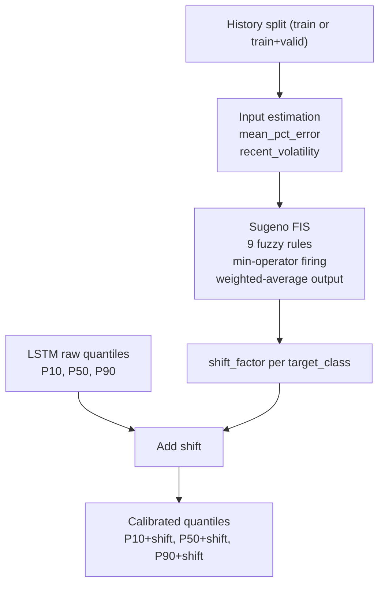
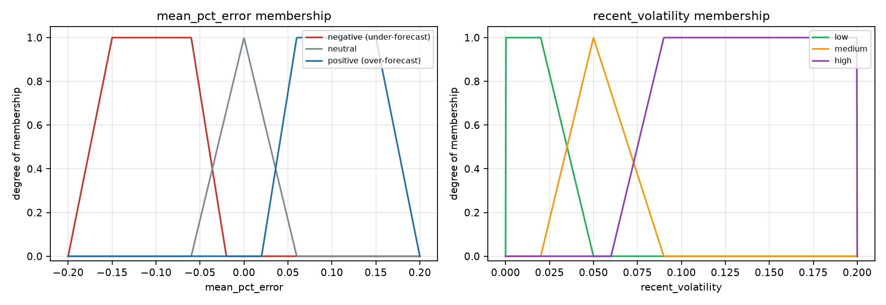
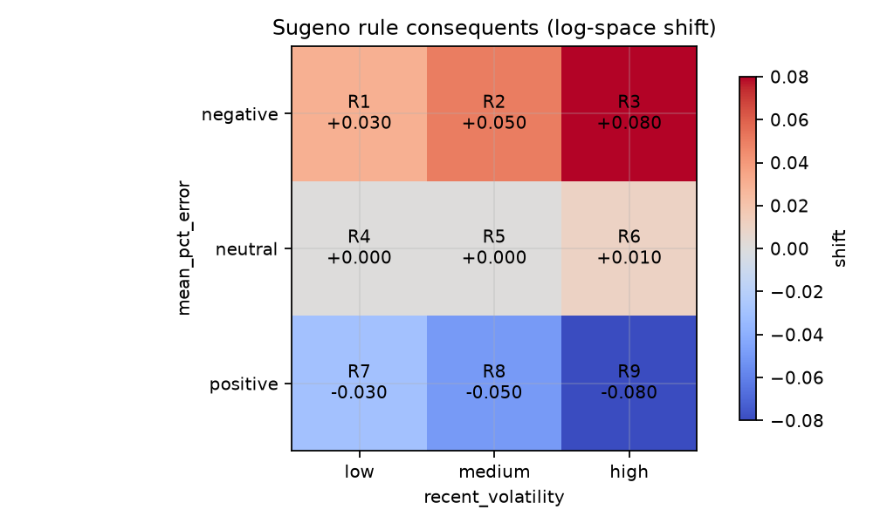
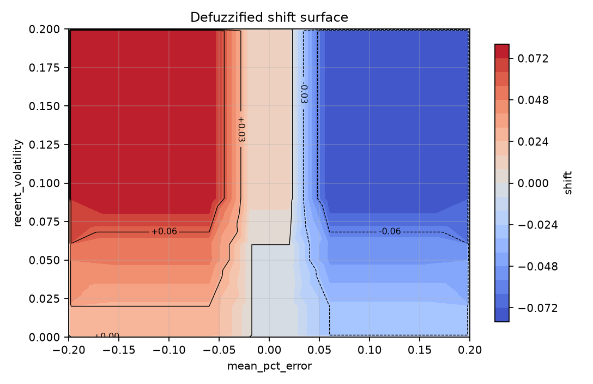

# Fuzzy Calibration for LSTM Freight Quantile Forecasts

## Introduction

Freight rates in dry bulk shipping are volatile and close to a random walk over short horizons. Point forecasts from any single model carry systematic error that changes with market conditions. A model that under-forecasts during a rising market and over-forecasts during a falling market produces biased quantiles even when its average error looks acceptable.

This work adds a fuzzy inference layer on top of an LSTM quantile forecaster. The LSTM produces P10, P50, and P90 of the future log freight level. The fuzzy layer reads two recent market signals, recent forecast bias and recent volatility, and applies a single additive correction in log space to all three quantiles. The correction is learned from history by a small set of linguistic rules, so the adjustment is interpretable and cheap to run at inference time.

The goal is a small, auditable calibration module that can be attached to the existing forecast path without retraining the LSTM.

## Related Work

### Fuzzy time series and the FILF model

Duru (2010), *A fuzzy integrated logical forecasting model for dry bulk shipping index forecasting*, applies fuzzy time series (FTS) methods to the Baltic Dry Index. The paper starts from the observation that classical FTS models lose accuracy on volatile series because the right-hand side of a fuzzy logical relationship can jump between extreme sets. It proposes two variants:

- **FILF** (Fuzzy Integrated Logical Forecasting). First-order differencing is applied before fuzzification to reduce variance and expose direction. A latest value adjustment combines the last actual value with the raw fuzzy forecast.
- **E-FILF** (Extended FILF). An error correction term is added, based on a moving average of past percentage errors, to move residuals closer to white noise.

Both variants report lower MAPE and lower error variance than classical FTS benchmarks on monthly BDI data.

### Deep quantile forecasting for the BDI

The base forecaster in this work follows the CNN-BiLSTM-AM line of models used for BDI prediction. A one-dimensional convolution extracts local patterns, a bidirectional LSTM models temporal dependencies in both directions, and an attention layer weights the relevant time steps. A quantile head produces P10, P50, and P90 directly. These models report strong fit on BDI levels, but they do not include a mechanism that corrects persistent residual bias at prediction time.

### Research gap

Fuzzy time series methods such as FILF were built for point forecasts of a single series. Deep quantile models output a distribution, and once trained they are used as-is. They have no mechanism to correct for bias that appears in one market regime and disappears in another. This work connects the two ideas. A small fuzzy layer reads two signals from the recent past, the average error and the recent volatility, and shifts the whole quantile fan up or down before it is handed to a decision maker.

### What this work does

This work implements a Sugeno-style fuzzy inference system (FIS) as a calibration stage after the LSTM. The FIS maps two inputs, mean percentage error and recent volatility, to one output, a log-space shift factor. The shift is added to P10, P50, and P90. This keeps the quantile spread unchanged and moves the fan up or down according to recent conditions. The module is designed for the inference path, so the LSTM is trained once and calibration is applied per forecast request.

## Architecture



### Base forecaster

The base model is a pooled quantile LSTM over four vessel classes (Capesize, Panamax, Supramax, Handysize). It consumes a sliding window of daily features per class and outputs three quantiles of the log return at horizon `h`. Predictions are converted to log level by adding the current `log_value`. The fuzzy layer receives this log-level frame with columns `date`, `target_class`, `h`, `p_0.1`, `p_0.5`, `p_0.9`.

### FIS inputs

Both inputs are computed per `target_class` from a history split that precedes the forecast period.

- **mean_pct_error**: average realized log return over the last `lookback` rows, divided by the mean absolute log level of those rows. Negative values indicate the market has been falling relative to recent levels, positive values indicate a rising market. This is used as a proxy for recent forecast bias.
- **recent_volatility**: standard deviation of daily changes in `log_value` over the last `lookback + 1` rows. It measures current uncertainty.



### Rule base



Red cells push the forecast up, blue cells push it down.

The sign pattern is deliberate. When recent returns are negative, the model is expected to under-forecast, so the fan is pushed up. When recent returns are positive, the model is expected to over-forecast, so the fan is pushed down. Larger volatility produces a larger correction in the same direction.

### Defuzzification

The output uses Sugeno weighted average. For firing strengths $s_i$ and consequents $c_i$:

$$
\text{shift} = \frac{\sum_i s_i\, c_i}{\sum_i s_i}
$$

If the total firing strength $\sum_i s_i$ is below $10^{-9}$, the shift is 0. This handles the case where the inputs fall outside all membership functions. The result is a single scalar per class, and the same scalar is added to P10, P50, and P90.



The surface shows what `sugeno_shift` returns for every combination of the two clamped inputs, after the nine rules are combined. The left region (negative bias) is positive, the right region (positive bias) is negative, and the middle region (neutral bias) is close to zero. Vertical bands appear where the bias membership changes set, and the surface rises in the negative-bias region as volatility increases.

## Implementation

### Files

- `src/ml/fuzzy_calibration.py`: membership functions, rule base, defuzzification, input estimation, and the public `calibrate` function.
- `src/ml/models/lstm.py`: the quantile LSTM base forecaster.
- `src/ml/inference.py`: `FreightPredictor.predict`, the live path that applies calibration.
- `src/ml/baselines.py`: evaluation harness that produces the before/after comparison.

### Calibration function

```
calibrate(pred_df, history_df, h, lookback=60) -> pl.DataFrame
```

Steps:

1. Collect the distinct `target_class` values in `pred_df`.
2. For each class, filter `history_df` to that class. If the class has no history, fall back to the pooled history.
3. Compute `mean_pct_error` and `recent_volatility` from the filtered history.
4. Evaluate the FIS to get one shift per class.
5. Build a mapping expression from class to shift.
6. Return `pred_df` with `p_0.1`, `p_0.5`, and `p_0.9` each increased by the class shift.

The function preserves the input schema and does not change the order of rows.

### Inference wiring

`FreightPredictor.predict` accepts an optional `history_df`. When it is provided, the raw quantile frame is passed to `fuzzy_calibrate` before being returned. When it is `None`, the raw quantiles are returned unchanged. This keeps calibration optional and backwards compatible.

```python
raw_pred = df.select(*exprs)
if history_df is not None:
    return fuzzy_calibrate(raw_pred, history_df, self.h)
return raw_pred
```

### Baseline comparison

`src/ml/baselines.py` trains the LSTM once and evaluates two variants:

- `lstm`: raw quantiles.
- `lstm_fuzzy`: quantiles after calibration.

Calibration uses only data known before the evaluated split. Valid forecasts are calibrated against the train split. Test forecasts are calibrated against the concatenation of train and valid. This avoids leakage from future observations.

The harness supports a filter so that only the relevant models run:

```bash
BASELINES_MODELS=lstm uv run baselines
```

The metrics are written to `src/data/baseline_metrics.csv` with pinball loss per quantile, median MAE, and directional hit rate, both pooled and per class.

### Evaluation metric: pinball loss

Each quantile is scored on its own with the pinball loss. For target $y$,
prediction $p$, and quantile level $q$:

$$
L_q(y, p) =
\begin{cases}
q\,(y - p) & y \ge p \\[4pt]
(1 - q)\,(p - y) & y < p
\end{cases}
$$

Written in one line:

$$
L_q(y, p) = \max\bigl(q\,(y - p),\; (q - 1)\,(y - p)\bigr)
$$

The loss is an asymmetric absolute error. When the actual value is above the
prediction, the error is weighted by $q$. When it is below, the error is
weighted by $1 - q$. A high quantile such as P90 is therefore punished more for
under-predicting than for over-predicting, which pushes it toward the upper
tail of the distribution.

Two properties are useful when reading the results table:

1. At $q = 0.5$ the two weights are equal and the loss becomes
   $\tfrac{1}{2}|y - p|$. The median MAE reported by the harness is exactly twice the
   `pinball_0.5` value for this reason.
2. Minimizing the expected pinball loss is equivalent to predicting the true
   $q$-th quantile. A model that outputs the real P10, P50, and P90 has the
   lowest achievable average pinball loss for those three levels.

The three losses are averaged over rows for each level, so lower is better. As
a coverage check, a well-calibrated model should satisfy
$\Pr(y < p_{0.1}) \approx 0.10$ and $\Pr(y < p_{0.9}) \approx 0.90$.

## Results and Limitations

The table below reports pooled validation results for the two variants. Lower pinball and MAE are better. Higher directional hit rate is better.

| h | lstm pinball P50 | lstm_fuzzy pinball P50 | delta | lstm dir_hit | lstm_fuzzy dir_hit |
|---|---|---|---|---|---|
| 1 | 0.007801 | 0.007806 | +0.000005 | 0.8458 | 0.8480 |
| 7 | 3.421349 | 3.422261 | +0.000912 | 0.4648 | 0.4648 |
| 30 | 3.429806 | 3.430717 | +0.000912 | 0.5110 | 0.5110 |
| 90 | 3.393264 | 3.394176 | +0.000912 | 0.5419 | 0.5419 |

The correction is small at every horizon. Directional hit rate improves slightly at h=1 and is unchanged elsewhere. The pushback on the interval losses is about 0.0009 at h=7 and above.

Two properties of the current setup explain the small effect:

1. The bias input is scaled by the mean log level, which is roughly 7 to 9. A recent log return of about 1 percent becomes a bias value near 0.001. This lands in the neutral membership region for most classes, so the firing strengths are low and the shift is near zero. Only Panamax produced a nonzero shift in the sampled runs.
2. The shift is a constant added to all three quantiles. A constant shift can correct a location bias. It cannot correct a wrong spread, a wrong shape, or a scale error in the base model. The base LSTM already has large interval losses at longer horizons, and a small location correction does not address those.

The calibration layer is therefore best described as a working, interpretable mechanism whose current input scaling limits its impact. The design is correct and the inference path is complete. Tuning the input scale and consequents is the next step before it can be expected to reduce loss.

## References

1. Duru, O. (2010). A fuzzy integrated logical forecasting model for dry bulk shipping index forecasting: An improved fuzzy time series approach. *Expert Systems with Applications*.
2. Song, Q., and Chissom, B. S. (1993). Fuzzy time series and its models. *Fuzzy Sets and Systems*.
3. Takagi, T., and Sugeno, M. (1985). Fuzzy identification of systems and its applications to modeling and control. *IEEE Transactions on Systems, Man, and Cybernetics*.
4. Koenker, R., and Bassett, G. (1978). Regression quantiles. *Econometrica*.
