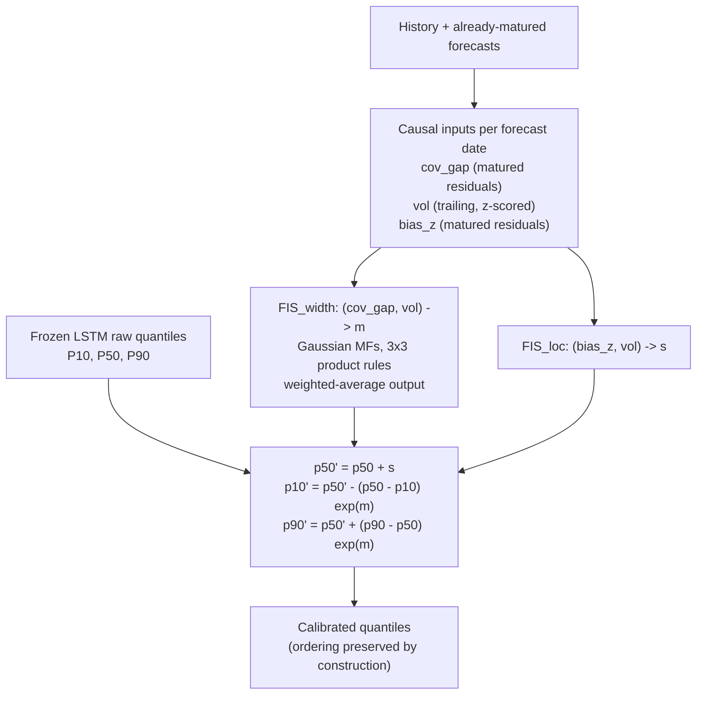

# Sugeno Fuzzy Calibration for LSTM Quantile Forecasts of Dry Bulk Vessel-Class Indices

## 1. Problem and setup

Dry bulk freight is quoted through four vessel-class indices: Capesize,
Panamax, Supramax and Handysize. These are **not** the Baltic Dry Index (BDI)
composite; the BDI is only used here as a cross-series input, and every target
below is a vessel-class index. The forecasting problem is *distributional*:
for each class and each horizon $h \in \{1, 7, 30, 90\}$ calendar days, predict
the P10, P50 and P90 of the future log index level $y_{t+h}$ given information
up to $t$.

The data pipeline builds a continuous 365-day master calendar and imputes
missing days with last-observation-carried-forward so that lags and rolling
statistics stay on a regular grid. Because weekends and holidays are then
artificial rows, the model is trained and evaluated only on real market days:
the target is shifted first, and weekend/holiday rows are dropped afterwards.
Each horizon has its own evaluation mask (the rows where $y_{t+h}$ is a real
market day), and all models are compared on the same rows within a horizon.
Models are scored on the intersection of their available rows (the LSTM needs a
warm-up window), so the deep and tree models see exactly the same test rows.
The fixed splits contain 10,053 train, 1,565 valid and 1,277 test rows; the
test split is read exactly once, at the final run, through a frozen-test guard.
Forty-four Capesize train rows with a negative index value (so an undefined
log) are dropped; see `docs/data_quality.md`.

## 2. Related work

**Point forecasting of the BDI.** Su, Park and Bae (2024) apply a
CNN-BiLSTM-AM model to the BDI. A one-dimensional convolution extracts local
patterns, a bidirectional LSTM models temporal dependence in both directions,
and an attention layer weights time steps. That model produces a *single point*
forecast. **The quantile head is this project's contribution**: the same
backbone emits P10/P50/P90 of the future log level, and the object of study is
the resulting interval fan.

**ANFIS on the BDI.** A 2025 line (doi 10.1007/s12197-025-09720-2) combines a
neural component with adaptive neuro-fuzzy inference for point forecasts of the
BDI composite. Here the targets are the four class indices and the fuzzy layer
calibrates a pre-trained *quantile* fan rather than a point.

**Fuzzy time series and E-FILF.** Duru (2010) proposes FILF and E-FILF for the
BDI: first differences expose direction, a latest-value adjustment anchors the
forecast, and E-FILF adds an error-correction term from a moving average of past
percentage errors. That idea corrects a *point* forecast with a fixed moving
average. This work connects it to a quantile fan: the correction is a learned,
readable rule gate over matured forecast residuals, and it adjusts both the
location and the width of the fan.

**Conformal calibration.** CQR (Romano et al., 2019) and ACI (Gibbs and Candès,
2021) are the strong calibration baselines. They are distribution-free but
opaque; the fuzzy layer is compared against them directly.

### Research gap

Deep quantile models are trained once and used as-is. They have no mechanism to
correct a bias that appears in one market regime and disappears in another, and
they cannot fix an interval that is systematically too wide or too narrow. This
work adds a small, interpretable calibration stage for exactly those two
failure modes while leaving the frozen base model untouched.

## 3. Method

### 3.1 Base forecaster

The base model is a pooled quantile LSTM over the four classes. It consumes a
sliding window of daily features and emits a quantile of the log return at
horizon $h$; predictions are converted to log level by adding the current
`log_value`. The head is **monotone by construction**:

$$
P50 = o_1, \qquad P10 = P50 - \mathrm{softplus}(o_2), \qquad P90 = P50 + \mathrm{softplus}(o_3),
$$

so raw quantiles can never cross. It is trained with the **exact pinball loss**
on per-class, per-horizon standardised targets. The reported model is a
five-seed ensemble; seeds differ in initialisation and batch order, and both
the per-seed and ensemble-mean predictions are saved so seed spread can be
inspected.

### 3.2 Sugeno calibration layer

**Inputs.** All inputs are recomputed per forecast date from information
available at that date. Forecast residuals are *matured*: a forecast issued at
$t$ for horizon $h$ matures at $t+h$, so the rolling window for a forecast at
$t$ may contain only forecasts issued at or before $t-h$. A test fails if any
future outcome is used.

- **cov_gap** $= P(y < P10) + P(y > P90) - 0.20$ over the last $N$ matured
  rows. Positive means the intervals are too narrow. It is only usable at
  $h = 1$ and $h = 7$; at $h \ge 30$ too few forecasts mature inside a split,
  so the width system becomes volatility-only.
- **vol**: trailing standard deviation of daily log-level changes, z-scored
  against strictly earlier rows.
- **bias_z**: rolling mean of $(y - P50)$ over the last $N$ matured rows,
  divided by the rolling standard deviation of those residuals. Positive means
  the median under-forecasts.

**Rule base and defuzzification.** Each FIS is a 3×3 Sugeno system (3 rules for
the volatility-only width system) with Gaussian membership functions with
learnable centres and widths, combined by the product t-norm. The output is the
weighted average of the consequents,

$$
\text{net} = \frac{\sum_i s_i\, c_i}{\sum_i s_i},
$$

bounded through `tanh`: $m = 0.7\tanh(\text{net})$ for the log width multiplier
and $s = 0.15\tanh(\text{net})$ for the location shift. Consequents start at
zero, so the untrained layer is exactly the identity; if the total firing
strength is below $10^{-9}$, the raw quantiles are returned. Only the FIS
parameters are trained (on valid, with the base frozen); the module is
numpy-only at inference and reads a small JSON file.

**Frozen configuration (pre-registered, one per horizon).**

| horizon | width system | location system |
|---|---|---|
| h=1 | `FIS_width(cov_gap, vol)` | `FIS_loc(bias_z, vol)` |
| h=7 | `FIS_width(cov_gap, vol)` | `FIS_loc(bias_z, vol)` |
| h=30 | `FIS_width(vol)` (vol-only) | `FIS_loc(bias_z, vol)` |
| h=90 | `FIS_width(vol)` (vol-only) | `FIS_loc(bias_z, vol)` |

This configuration was fixed before the test split was scored and is not
retuned on test. The trained membership functions and rule surfaces are dumped
to `src/data/fuzzy_params/lstm_fuzzy_h*.json` and plotted to
`docs/figures/fuzzy_v2_*.png`.

### 3.3 Baselines and evaluation

The harness (`src/ml/baselines.py`) scores, per horizon, on that horizon's
mask on a common support: `lstm`, `lstm_fuzzy`, `cqr`, `aci`, `ar1`, `xgb` and
`rw_emp` (plus `const_shift`, `lgbm`, `rw`, `lstm_fuzzy_old` in the full
tables). `ar1` is an AR(1) with drift on log returns. `rw_emp` is historical
simulation; its P50 is the current level, so its directional hit rate is N/A.
Conformal layers and the fuzzy layer are fit on valid and frozen for test, so
valid numbers for those layers are in-sample and only test is clean.

Metrics are the **pinball loss** per quantile and its mean, **central-80
coverage**, the **Winkler-80 interval score**, median MAE, crossing rate and
directional hit rate next to the always-up rate. The pinball loss is

$$
L_q(y,p) = \max\bigl(q\,(y-p),\,(q-1)\,(y-p)\bigr),
$$

an asymmetric absolute error that is minimised by the true $q$-th quantile;
at $q=0.5$ it equals $\tfrac12|y-p|$. Significance uses a Diebold-Mariano test
with a Newey-West HAC standard error at lag $h-1$ and a moving-block bootstrap
95% interval. Coverage and Winkler are reported alongside pinball because the
contribution is probabilistic.

## 4. Finding 1 — the diagnostic: an unconstrained head fails

Before the head change, an unconstrained quantile head trained under a
Huber-like loss produced badly ordered fans: **P10 > P50 in up to 66.5% of
rows at h=1 and 57.5% at h=7**, with central-80 coverage of only 18–28% at the
short horizons. The intervals were not merely biased; they were not intervals.

The monotone head with an exact pinball loss, per-class/horizon target
standardisation and width biases initialised from train empirical half-widths
fixed the ordering. Pooled central-80 coverage became:

| split | h=1 | h=7 | h=30 | h=90 |
|---|---|---|---|---|
| train | 0.776 | 0.810 | 0.825 | 0.828 |
| valid | 0.766 | 0.838 | 0.840 | 0.925 |

Train coverage is inside the pre-registered 0.70–0.90 gate at every horizon, so
no re-tuning was needed, and **quantile crossings are exactly 0 at every
horizon**. This diagnostic is the reason the rest of the work is about
calibration rather than architecture.

## 5. Finding 2 — results

### 5.1 Main table (test, common support)

Skill is pinball divided by the `rw_emp` pinball at the same horizon (lower is
better; 0.715 means 28.5% lower loss than historical simulation). Coverage and
Winkler-80 are shown because the target is a distribution, not a point.

| h | model | n | mean pinball | skill vs rw_emp | cover-80 | Winkler-80 |
|---|-------|---|--------------|-----------------|----------|------------|
| 1 | lstm | 765 | 0.00715 | 1.202 | 0.8366 | 0.1164 |
| 1 | lstm_fuzzy | 765 | 0.00779 | 1.311 | 0.7412 | 0.1274 |
| 1 | cqr | 765 | 0.00716 | 1.204 | 0.8706 | 0.1173 |
| 1 | aci | 765 | 0.00707 | 1.189 | 0.8157 | 0.1141 |
| 1 | ar1 | 765 | 0.00665 | 1.119 | 0.9242 | 0.1225 |
| 1 | **xgb** | 765 | **0.00425** | **0.715** | 0.7660 | **0.0630** |
| 1 | rw_emp | 765 | 0.00595 | 1.000 | 0.8693 | 0.0894 |
| 7 | lstm | 895 | 0.02200 | 1.049 | 0.9084 | 0.3293 |
| 7 | lstm_fuzzy | 895 | 0.02433 | 1.161 | 0.8078 | 0.3749 |
| 7 | cqr | 895 | 0.02179 | 1.039 | 0.8860 | 0.3229 |
| 7 | aci | 895 | 0.02136 | 1.019 | 0.8078 | 0.3100 |
| 7 | ar1 | 895 | 0.02211 | 1.055 | 0.9318 | 0.3570 |
| 7 | **xgb** | 895 | **0.01876** | **0.895** | 0.8313 | **0.2609** |
| 7 | rw_emp | 895 | 0.02096 | 1.000 | 0.8972 | 0.3105 |
| 30 | lstm | 505 | 0.04833 | 0.973 | 0.9386 | 0.7487 |
| 30 | lstm_fuzzy | 505 | 0.04620 | 0.931 | 0.7683 | 0.6829 |
| 30 | cqr | 505 | 0.04834 | 0.974 | 0.8990 | 0.7129 |
| 30 | **aci** | 505 | **0.04451** | **0.896** | 0.8099 | **0.6343** |
| 30 | ar1 | 505 | 0.05221 | 1.051 | 0.9386 | 0.8611 |
| 30 | xgb | 505 | 0.05712 | 1.150 | 0.5030 | 0.8906 |
| 30 | rw_emp | 505 | 0.04965 | 1.000 | 0.9307 | 0.7862 |
| 90 | lstm | 571 | 0.06914 | 0.947 | 0.9912 | 1.1143 |
| 90 | **lstm_fuzzy** | 571 | **0.05188** | **0.711** | 0.8616 | **0.7259** |
| 90 | cqr | 571 | 0.05953 | 0.816 | 0.9054 | 0.8801 |
| 90 | aci | 571 | 0.05894 | 0.808 | 0.6935 | 0.8086 |
| 90 | ar1 | 571 | 0.07464 | 1.023 | 0.9930 | 1.2730 |
| 90 | xgb | 571 | 0.12465 | 1.708 | 0.1068 | 2.2599 |
| 90 | rw_emp | 571 | 0.07298 | 1.000 | 0.9842 | 1.2361 |

The table tells a horizon-dependent story:

- **h ≤ 7:** gradient-boosted trees (`xgb`) win, with skill 0.715 and 0.895
  against historical simulation. The deep model is at parity with the conformal
  baselines and `rw_emp`, and the fuzzy layer is significantly *worse*.
- **h = 30:** ACI is best (skill 0.896); the fuzzy layer is second (0.931) and
  statistically tied with it.
- **h = 90:** the fuzzy layer is best (skill 0.711), ahead of CQR (0.816) and
  ACI (0.808), and its central-80 coverage (0.862) is far closer to nominal than
  the raw LSTM's 0.991.

### 5.2 Leakage check on the tree models

The h=1 `xgb` pinball (0.00425) is far below the deep model, so its feature set
was audited. `make_matrix` excludes every target-derived column —
`y_step_h*`, `y_mean_h*`, `target_ret_h*` — for all horizons, and also excludes
`date`, `log_value` and `target_value`; `target_class` is retained as an
intended categorical feature. The 46 features contain no residual target
column, and the top gains at h=1 are `ret_1`, `target_class`,
`cross_BC_INDEX_ret_1`, `cross_BDI_ret_1`, `ret_7`, `lag_*` and rolling
statistics — all past-only. **The h=1 result is not a leak.**

Comparing the tree model with the autocorrelation baselines on the same rows
makes the source of the short-horizon signal explicit: `xgb` reaches skill
0.715, `ar1` 1.119 and `rw_emp` 1.000 at h=1, and 0.895 / 1.055 / 1.000 at h=7.
Trees beat persistence by 29% at h=1, so the signal is not *only* return
autocorrelation, but the autocorrelation/persistence baselines are close
enough that short-horizon gains should be attributed largely to momentum in the
index levels rather than to the deep sequence model.

### 5.3 Significance (test, mean pinball)

Difference `lstm_fuzzy − competitor`; negative favours the fuzzy layer.

| h | competitor | mean diff | DM p | bootstrap 95% |
|---|---|---|---|---|
| 1 | aci | +0.00072 | <0.001 | [+0.00041, +0.00105] |
| 1 | cqr | +0.00063 | <0.001 | [+0.00035, +0.00095] |
| 1 | lstm | +0.00065 | <0.001 | [+0.00038, +0.00095] |
| 7 | aci | +0.00297 | <0.001 | [+0.00194, +0.00407] |
| 7 | cqr | +0.00254 | <0.001 | [+0.00152, +0.00367] |
| 7 | lstm | +0.00233 | <0.001 | [+0.00130, +0.00347] |
| 30 | aci | +0.00169 | 0.286 | [−0.00178, +0.00396] |
| 30 | cqr | −0.00214 | 0.183 | [−0.00561, +0.00036] |
| 30 | lstm | −0.00212 | 0.163 | [−0.00545, +0.00049] |
| 90 | aci | −0.00707 | 0.218 | [−0.01919, +0.00243] |
| 90 | cqr | −0.00765 | 0.047 | [−0.01575, −0.00055] |
| 90 | lstm | −0.01726 | <0.001 | [−0.02601, −0.00927] |

The fuzzy layer is significantly worse than every competitor at h=1 and h=7,
indistinguishable at h=30, and significantly better than the raw LSTM and CQR
at h=90 (vs ACI the interval includes zero). Because 90-day windows overlap and
the four classes are correlated, the bootstrap interval is the primary
evidence and the DM p-values are reported for completeness.

The h=90 gain is **not driven by one class**. Skill versus the class-specific
`rw_emp` at h=90 is 0.749 (Capesize), 0.734 (Panamax), 0.651 (Supramax) and
0.645 (Handysize); the fuzzy layer is the best model in all four classes. Per
class, coverage moves from 0.99 (raw LSTM) toward 0.85–0.92.

One confound must be stated. The test window is an up-trending regime: the
pooled up-rate rises from 0.48 / 0.51 / 0.50 / 0.54 on valid to
0.54 / 0.58 / 0.60 / 0.65 on test at h=1/7/30/90. Part of the h=90 location
correction may therefore be capturing a valid-to-test drift that a rolling
evaluation would expose; the width correction (the part that fixes the raw
LSTM's 0.99 coverage down to 0.86) is not a drift effect.

### 5.4 Post-hoc ablations (not used for the reported model)

These arms were run *after* the test split had been read and are shown only to
explain the short-horizon loss. They were not used to select the reported
configuration. Test pooled pinball by arm:

| h | both (reported) | widthonly | loconly | novol |
|---|---|---|---|---|
| 1 | 0.00779 | 0.00711 | 0.00755 | 0.00707 |
| 7 | 0.02433 | 0.02221 | 0.02300 | 0.02242 |
| 30 | 0.04620 | 0.04543 | 0.05131 | 0.04480 |
| 90 | 0.05188 | 0.05851 | 0.06443 | 0.05210 |

The joint width+location arm is best only at h=90. At h ≤ 30 the location shift
and the volatility input both hurt, and a simpler width-only or no-volatility
arm would have scored better. The location-only arm never wins, confirming that
the useful signal is in the interval *width*. Because the test split was
already read when these were run, this is reported as a **hypothesis for the
short-horizon loss, not a tuned result**.

## 6. Limitations

* **Fixed split, single episode.** One fixed valid and one fixed test window; a
  rolling-origin evaluation was not run, so all test numbers are a single
  out-of-sample episode.
* **Test read once.** The test split was scored once at the end through a
  frozen-test guard. No model or bound was tuned on it; the ablations in §5.4
  are explicitly post-hoc.
* **Small effective sample.** Overlapping targets (up to 90 days) and four
  correlated classes shrink the effective sample far below the row counts. The
  block bootstrap quantifies but cannot remove this.
* **Fuzzy and conformal valid numbers are in-sample.** Only the test column is a
  clean out-of-sample comparison for those layers.
* **Frozen fuzzy bounds were not tuned.** The `0.7·tanh` width and `0.15·tanh`
  location bounds were pre-registered; §5.4 suggests a width-only / no-volatility
  variant at h ≤ 30, which is left as future work.
* **h=90 may partly reflect regime drift.** The valid-to-test up-rate shift is
  documented; a rolling evaluation is needed to separate calibration skill from
  drift capture.
* **ACI under-covers at h=90** (0.694) despite a good pinball mean.
* **`lstm_fuzzy_old`** (constant location shift) changes valid pinball by under
  0.3% and cannot fix width or ordering; it is retained only as an ablation.
* **Staged, not joint, training.** The base model is frozen and only the FIS is
  trained; joint training was not run.
* **Data robustness is reported separately.** A rebuild with a 7-day congestion
  lag and the direct `macro_*_chg_90d` difference changes valid pooled pinball by
  at most +0.0004 at h=1/7 (up to ~+0.003 at h=30/90); the headline conclusions
  are unchanged. Forty-four negative-index Capesize rows are dropped.

## References

1. Duru, O. (2010). A fuzzy integrated logical forecasting model for dry bulk shipping index forecasting: An improved fuzzy time series approach. *Expert Systems with Applications*.
2. Su, M., Park, K., and Bae, S. (2024). Deep learning for the Baltic Dry Index: A CNN-BiLSTM-AM approach. *Maritime Economics and Logistics*.
3. ANFIS-based forecasting of the Baltic Dry Index (2025). *Journal of Economics and Finance*. doi:10.1007/s12197-025-09720-2
4. Romano, Y., Patterson, E., and Candès, E. J. (2019). Conformalized quantile regression. *Advances in Neural Information Processing Systems*.
5. Gibbs, I., and Candès, E. J. (2021). Adaptive conformal inference under distribution shift. *Advances in Neural Information Processing Systems*.
6. Song, Q., and Chissom, B. S. (1993). Fuzzy time series and its models. *Fuzzy Sets and Systems*.
7. Takagi, T., and Sugeno, M. (1985). Fuzzy identification of systems and its applications to modeling and control. *IEEE Transactions on Systems, Man, and Cybernetics*.
8. Koenker, R., and Bassett, G. (1978). Regression quantiles. *Econometrica*.
