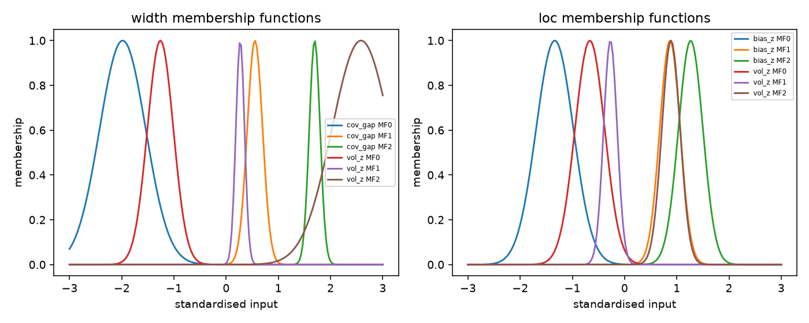
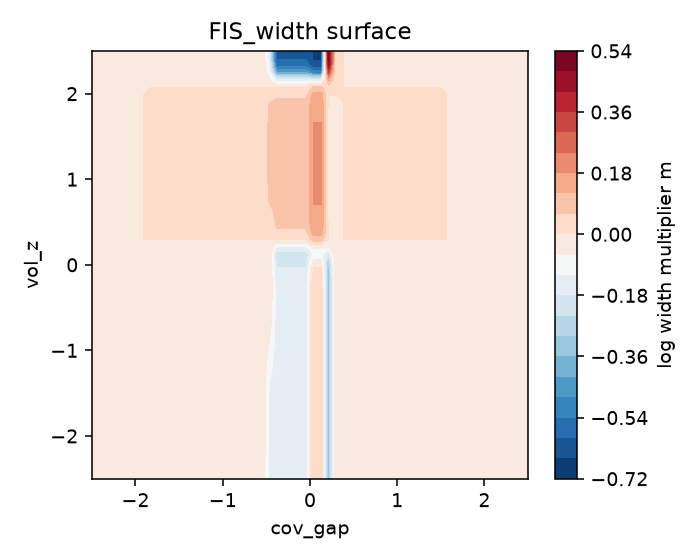
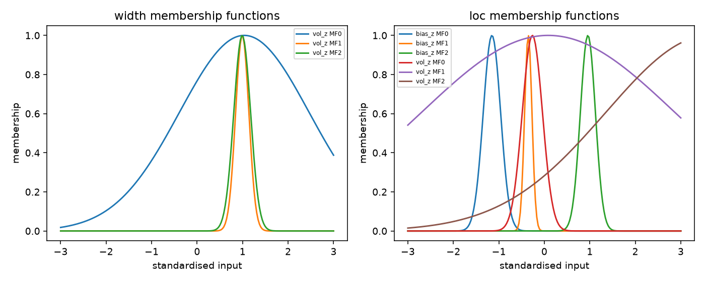

# Sugeno Fuzzy Calibration of Neural Quantile Forecasts for Dry Bulk Vessel-Class Indices

## Abstract

We study distributional forecasting of four dry-bulk vessel-class freight
indices — Capesize, Panamax, Supramax and Handysize — at horizons of 1, 7, 30
and 90 days. A single pooled quantile neural network produces the P10, P50 and
P90 of the future log index level with a monotone output head. Because a model
trained once cannot adapt when a market regime changes, we add a small,
interpretable Sugeno fuzzy calibration layer that reads matured forecast
residuals and trailing volatility and applies a state-dependent location shift
and width multiplier to the frozen quantiles. The layer is trained on the
validation window and frozen before the test window is read. On a single
out-of-sample episode it reduces the mean pinball loss of the raw neural base by
about 25% at the 90-day horizon and restores near-nominal central-80 coverage
where the base over-covers severely, while remaining tied with the strong
conformal baselines at 30 days. At short horizons the layer is consistently
worse, and a diagnostic shows that this is a location-shift failure rather than
a calibration failure. We report the learned rules, the per-class behaviour,
and the limitations of a single chronological evaluation.

## 1. Problem and setup

Dry-bulk freight is quoted through four vessel-class indices: Capesize,
Panamax, Supramax and Handysize. These are **not** the Baltic Dry Index (BDI)
composite; the BDI enters only as a cross-series input, and every target below
is a vessel-class index. The forecasting problem is *distributional*: for each
class and each horizon $h \in \{1, 7, 30, 90\}$ days, predict the P10, P50 and
P90 of the future log index level $y_{t+h}$ from information available at $t$.

**Data sources.** The target and cross-series inputs are daily vessel-class and
composite freight indices. Congestion features aggregate vessel counts at eight
loading ports (Newcastle, Hay Point, Richards Bay, Beira, Maputo, Nacala,
Balikpapan and Samarinda) and six Indian discharge ports (Paradip,
Visakhapatnam, Gopalpur, Dhamra, Haldia and Kolkata). Macro-commodity controls
include Brent crude, iron ore, coal, the US dollar index, the S&P 500 and US
industrial production, plus calendar indicators for Chinese New Year. The macro
series are joined on an as-of (backward) basis so that each row only sees
values knowable at its date.

**Continuous calendar, discrete evaluation.** The pipeline builds a continuous
365-day master calendar and imputes missing days with last-observation-carried-
forward so that lags and rolling statistics stay on a regular grid. Weekend and
holiday rows are artificial, so the target is shifted first and those rows are
dropped afterwards; training and evaluation use real market days only. Forty-
four Capesize training rows with a negative index value (and therefore an
undefined logarithm) are dropped. Each horizon is evaluated on its own mask
(the rows whose target date is a real market day and for which the model
produced a forecast), and all models are compared on the intersection of their
available rows.

**Fixed evaluation protocol.** We use a single chronological split. The base
model is trained once on 2012-07-04 → 2022-07-25, the calibration layer is fit
on the validation window 2023-01-03 → 2024-07-25, and the test window
2025-01-02 → 2026-08-20 is read exactly once, at the end, for this report.
Embargo gaps of about five months separate the splits. The train, validation
and test splits contain 10,053, 1,565 and 1,277 rows respectively. No
hyperparameter, bound or model was selected on the test window.

**Weekday bias of calendar-day horizons.** Because horizons are calendar-day
shifts rather than trading-day shifts, a fixed offset $h$ preserves the weekday
only when $h \bmod 7 = 0$. The evaluation masks are therefore weekday-biased:
at $h = 30$ only Monday-to-Wednesday issue dates can land on a trading day, so
roughly two-fifths of the otherwise eligible rows disappear ($h = 30$ keeps
615 test rows against 674 at $h = 90$ before the neural warm-up, and 505
against 571 after). We report this composition explicitly and treat the
different masks as a limitation rather than comparing row counts across
horizons. A trading-day horizon definition would remove the bias and is left as
future work.

## 2. Related work

**Neural point forecasting of freight indices.** Su, Park and Bae (2024) apply
a CNN–BiLSTM–attention model to the BDI: a one-dimensional convolution extracts
local patterns, a bidirectional LSTM models temporal dependence in both
directions, and an attention layer weights time steps. That model emits a
*single point* forecast. Our contribution is the quantile head on the same
family of backbone: the network emits P10/P50/P90, and the object of study is
the resulting interval fan rather than a point.

**Neuro-fuzzy forecasting.** A 2025 line of work combines a neural component
with adaptive neuro-fuzzy inference for point forecasts of the BDI composite
(*Journal of Economics and Finance*, doi 10.1007/s12197-025-09720-2). Here the
targets are the four class indices, and the fuzzy layer calibrates a
pre-trained *quantile* fan rather than a point. Takagi and Sugeno (1985)
provide the rule-based function approximator we use, and Song and Chissom
(1993) the fuzzy-time-series framing.

**Fuzzy time series for dry bulk.** Duru (2010) proposes FILF and E-FILF for
the BDI: first differences expose direction, a latest-value adjustment anchors
the forecast, and E-FILF adds an error-correction term from a moving average of
past percentage errors. That idea corrects a *point* forecast with a fixed
moving average. We connect it to a quantile fan: the correction is a learned,
readable rule gate over matured forecast residuals, and it adjusts both the
location and the width of the fan.

**Conformal calibration.** Conformalized quantile regression (Romano,
Patterson and Candès, 2019) and adaptive conformal inference (Gibbs and Candès,
2021) are the strong calibration baselines. They are distribution-free and
effective but opaque: their adjustment is a scalar or a rolling error level,
not a market-state-dependent rule. We compare against both directly.

**Neural state-dependent calibrator.** To isolate the contribution of the fuzzy
structure, we also train a small multilayer perceptron (two hidden layers) and
a linear map on exactly the same causal inputs `(bias_z, vol)` and the same
frozen quantiles. At 90 days the MLP reaches a mean pinball loss of 0.0532
against the fuzzy layer's 0.0519, with less stable coverage (0.842 against
0.862); at short horizons both neural calibrators are worse than the conformal
baselines, and the MLP offers no readable rules. The fuzzy layer therefore
matches or slightly improves on a comparable black-box calibrator while
remaining interpretable.

### Research gap

Deep quantile models are trained once and used as-is. They have no mechanism to
correct a bias that appears in one market regime and disappears in another, and
they cannot fix an interval that is systematically too wide or too narrow. We
add a small, interpretable calibration stage for exactly those two failure
modes while leaving the frozen base model untouched.

## 3. Method

### 3.1 Base forecaster

The base model is a pooled quantile LSTM over the four classes. It consumes a
sliding 120-day window of daily features and emits a quantile of the log return
at horizon $h$; predictions are converted to log level by adding the current
log index. The head is **monotone by construction**:

$$
P50 = o_1, \qquad P10 = P50 - \mathrm{softplus}(o_2), \qquad
P90 = P50 + \mathrm{softplus}(o_3),
$$

so raw quantiles can never cross. It is trained with the exact pinball loss on
per-class, per-horizon standardised targets; target standardisation keeps the
head's output scale comparable across classes. The reported base is a five-seed
ensemble; seeds differ in initialisation and batch order, and both per-seed and
ensemble-mean predictions are retained so seed spread can be inspected.

### 3.2 Sugeno calibration layer

Two small differentiable Sugeno systems are stacked on the frozen base
quantiles. The width system maps state to a log width multiplier $m$ and the
location system maps state to a location shift $s$:

$$
p50' = p50 + s, \qquad
p10' = p50' - (p50 - p10)\,e^{m}, \qquad
p90' = p50' + (p90 - p50)\,e^{m},
$$

so ordering is preserved by construction.

**Causal inputs.** All inputs are recomputed per forecast date from information
available then. Forecast residuals are *matured*: a forecast issued at $t$ for
horizon $h$ matures at $t + h$, so the rolling window for a forecast at $t$ may
contain only forecasts issued at or before $t - h$.

- **Coverage gap** $= P(y < P10) + P(y > P90) - 0.20$ over the last $N$
  matured rows; positive means the intervals are too narrow. It is usable only
  at $h \le 7$, where enough forecasts mature inside a split.
- **Volatility**: trailing standard deviation of daily log-level changes,
  z-scored against strictly earlier rows.
- **Median bias** $= \overline{(y - P50)} / \mathrm{sd}(y - P50)$ over the last
  $N$ matured rows; positive means the median under-forecasts.

The matured window grows with the horizon, $N(h) = \max(60, 5h)$, because
overlapping $h$-step residuals carry roughly one independent observation per $h$
rows. A fixed 60-row window would span about five independent observations at
$h = 7$ but less than one at $h = 90$. As a burn-in, matured residuals from the
in-sample training base are excluded when the layer is fit, so early
validation rows with too few out-of-sample outcomes fall back to the identity
window.

**Rule base and defuzzification.** Each system is a 3×3 Sugeno rule base (a
3-rule volatility-only base for the wide-horizon width system) with Gaussian
membership functions with learnable centres and widths, combined by the product
t-norm. The output is the weighted average of the consequents,
$\text{net} = \sum_i s_i c_i / \sum_i s_i$, bounded through $\tanh$. Width uses
$m = 0.7\tanh(\text{net})$; the location bound is scaled to the horizon's target
standard deviation, $s = 2.2\,\sigma_h \tanh(\text{net})$, so the shift is
comparably free at every horizon (a constant bound would be 2.2 standard
deviations at $h = 1$ but only 0.28 at $h = 90$). Consequents start at zero, so
the untrained layer is exactly the identity.

**Optimiser.** Only the fuzzy parameters are trained, with the base frozen.
The objective is the summed pinball loss over the three quantile levels, using
full-batch Adam with learning rate 0.05 for 600 epochs. Membership centres are
initialised at −1, 0 and +1 on the standardised input scale and widths at
$\log 0.7$; consequents start at zero. Training is deterministic: there is no
mini-batching, dropout or stochastic initialisation, so repeated runs with
different random seeds produce identical parameters (seed spread 0.00000).
Inference is a closed-form numpy evaluation of the learned memberships and
rules.

**Frozen configuration (fixed before the test window was read).**

| horizon | width system | location system |
|---|---|---|
| h=1 | width (coverage gap, volatility) | location (median bias, volatility) |
| h=7 | width (coverage gap, volatility) | location (median bias, volatility) |
| h=30 | width (volatility only) | location (median bias, volatility) |
| h=90 | width (volatility only) | location (median bias, volatility) |

**Learned rules.** Table 1 lists the learned membership-function centres and
widths and the rule consequents for the two horizons that bracket the range.
Membership centres are on the standardised input scale; consequents are on the
pre-$\tanh$ scale. At $h = 1$ the width system responds to a positive coverage
gap (intervals too narrow) by widening, and at $h = 90$ the volatility-only
width system widens in the high-volatility regime while the location system
picks up a large positive shift in the high-volatility/high-bias region.

**Table 1.** Learned membership functions and rule consequents.

| horizon | system | input | MF1 (c, w) | MF2 (c, w) | MF3 (c, w) | consequents |
|---|---|---|---|---|---|---|
| 1 | width | coverage gap | (−1.98, 0.44) | (+0.55, 0.15) | (+1.70, 0.10) | −0.21, 0.11, −1.39, 0.08, 0.27, −1.97, −0.57, −0.02, 0.94 |
| 1 | width | volatility | (−1.26, 0.25) | (+0.27, 0.08) | (+2.58, 0.56) | — |
| 1 | location | median bias | (−1.34, 0.36) | (+0.87, 0.20) | (+1.27, 0.23) | 0.33, −0.18, −0.13, 0.01, 0.03, −0.16, −0.30, 0.07, −5.46 |
| 1 | location | volatility | (−0.67, 0.28) | (−0.27, 0.13) | (+0.89, 0.18) | — |
| 90 | width | volatility | (+1.04, 1.43) | (+0.99, 0.15) | (+0.99, 0.18) | −3.24, −1.06, −1.18 |
| 90 | location | median bias | (−1.15, 0.19) | (−0.35, 0.08) | (+0.96, 0.17) | −0.35, 0.66, −0.57, 0.35, 1.11, −1.45, −0.36, 0.74, −1.70 |
| 90 | location | volatility | (−0.26, 0.22) | (+0.09, 2.78) | (+3.64, 2.29) | — |

### 3.3 Baselines and evaluation

The reported models are the raw neural base, the fuzzy-calibrated base, and two
conformal calibration baselines: split conformalized quantile regression (CQR)
and adaptive conformal inference (ACI), both fit on the validation window and
frozen for test. Conformal and fuzzy validation numbers are in-sample for those
layers; only the test column is a clean out-of-sample comparison.

Metrics are the **pinball loss** per quantile and its mean, **central-80
coverage**, the **Winkler-80 interval score**, median absolute error, crossing
rate and directional hit rate. The pinball loss
$L_q(y,p) = \max(q(y-p), (q-1)(y-p))$ is minimised by the true $q$-th quantile;
at $q = 0.5$ it equals $\tfrac12|y-p|$. Because 90-day windows overlap and the
four classes are correlated on the same date, significance uses a bootstrap
that resamples whole **dates** (so the four same-date class residuals move
together) rather than rows; a Diebold–Mariano test with a Newey–West HAC
standard error is reported in the appendix for completeness, and the effect
sizes are read with the effective-sample caveat in mind.

## 4. Diagnostic: an unconstrained head fails

Before the monotone head, an unconstrained quantile head trained under a
Huber-like loss produced badly ordered fans: **P10 > P50 in up to 66.5% of rows
at $h = 1$ and 57.5% at $h = 7$**, with central-80 coverage of only 18–28% at
the short horizons. The intervals were not merely biased; they were not
intervals.

The monotone head with an exact pinball loss, per-class/per-horizon target
standardisation and width biases initialised from training empirical
half-widths fixed the ordering. Pooled central-80 coverage became:

| split | h=1 | h=7 | h=30 | h=90 |
|---|---|---|---|---|
| train | 0.776 | 0.810 | 0.825 | 0.828 |
| valid | 0.766 | 0.838 | 0.840 | 0.925 |

Quantile crossings are exactly 0 at every horizon. The base is **not** close to
nominal, however: on test its coverage is 0.908 at $h = 7$ and 0.939 at
$h = 30$, and 0.991 at $h = 90$ — substantial overcoverage at the longer
horizons. This miscalibration is the reason the rest of the work is about
calibration rather than architecture.

## 5. Results

### 5.1 Main table

All models are scored on the common support (the intersection of rows where
every model produced a prediction; the neural base needs a warm-up window).
Lower pinball is better.

**Table 2.** Test split, common support.

| h | model | n | mean pinball | cover-80 | Winkler-80 |
|---|-------|---|--------------|----------|------------|
| 1 | lstm | 765 | 0.00715 | 0.8366 | 0.1164 |
| 1 | lstm_fuzzy | 765 | 0.00779 | 0.7412 | 0.1274 |
| 1 | cqr | 765 | 0.00716 | 0.8706 | 0.1173 |
| 1 | aci | 765 | 0.00707 | 0.8157 | 0.1141 |
| 7 | lstm | 895 | 0.02200 | 0.9084 | 0.3293 |
| 7 | lstm_fuzzy | 895 | 0.02433 | 0.8078 | 0.3749 |
| 7 | cqr | 895 | 0.02179 | 0.8860 | 0.3229 |
| 7 | aci | 895 | 0.02136 | 0.8078 | 0.3100 |
| 30 | lstm | 505 | 0.04833 | 0.9386 | 0.7487 |
| 30 | lstm_fuzzy | 505 | 0.04620 | 0.7683 | 0.6829 |
| 30 | cqr | 505 | 0.04834 | 0.8990 | 0.7129 |
| 30 | **aci** | 505 | **0.04451** | 0.8099 | **0.6343** |
| 90 | lstm | 571 | 0.06914 | 0.9912 | 1.1143 |
| 90 | **lstm_fuzzy** | 571 | **0.05188** | 0.8616 | **0.7259** |
| 90 | cqr | 571 | 0.05953 | 0.9054 | 0.8801 |
| 90 | aci | 571 | 0.05894 | 0.6935 | 0.8086 |

The table tells a clear horizon-dependent story:

- **$h \le 7$:** the fuzzy layer is the worst model. Against ACI its mean
  pinball is 10.2% higher at $h = 1$ and 13.9% higher at $h = 7$; against the
  raw base it is 8.9% and 10.6% higher. The conformal baselines are at parity
  with the raw base at $h = 1$ and slightly better at $h = 7$.
- **$h = 30$:** ACI is best (0.04451). The fuzzy layer is second (0.04620),
  3.8% behind ACI and 4.4% ahead of the raw base, and is statistically tied
  with CQR and the raw base.
- **$h = 90$:** the fuzzy layer is best (0.05188), 12.9% below CQR, 12.0% below
  ACI and 25.0% below the raw base, and its central-80 coverage (0.862) is far
  closer to nominal than the raw base's 0.991.

### 5.2 Why the short horizons fail

The $h = 7$ failure is **not** miscalibration. The fuzzy layer's coverage at
$h = 7$ equals ACI's (both 0.808), yet its pinball is 14% worse. If the widths
were wrong, coverage and pinball would move together; instead the intervals are
similarly calibrated but systematically displaced. The post-hoc ablations in
§6 confirm that the displacement comes from the location system: removing it
(location-only versus width-only) recovers most of the short-horizon loss, and
the width system alone is the better arm at $h \ge 7$.

The $h = 1$ behaviour is a narrowing failure. On validation the raw base
under-covered (0.766), so the layer learned on validation to widen. On test the
base happened to over-cover relative to validation (0.837), and the extra width
then pushed coverage **down** to 0.741. The layer correctly reacted to a
validation-regime narrowness that did not persist into the test window — the
classic cost of fitting a calibrator on a single fixed validation episode.

### 5.3 Significance

Differences are `lstm_fuzzy − competitor` in mean pinball; negative favours the
fuzzy layer. The interval is the date-cluster bootstrap (resampling whole
dates); the HAC Diebold–Mariano test is given in the appendix. Because target
windows overlap, the effective sample is much smaller than the row count and
the intervals should be read as a lower bound on uncertainty.

**Table 3.** Test split, mean-pinball differences.

| h | competitor | mean diff | date-boot 95% |
|---|---|---|---|
| 1 | aci | +0.00072 | [+0.00041, +0.00105] |
| 1 | cqr | +0.00063 | [+0.00035, +0.00095] |
| 1 | lstm | +0.00065 | [+0.00038, +0.00095] |
| 7 | aci | +0.00297 | [+0.00194, +0.00407] |
| 7 | cqr | +0.00254 | [+0.00152, +0.00367] |
| 7 | lstm | +0.00233 | [+0.00130, +0.00347] |
| 30 | aci | +0.00169 | [−0.00178, +0.00396] |
| 30 | cqr | −0.00214 | [−0.00561, +0.00036] |
| 30 | lstm | −0.00212 | [−0.00545, +0.00049] |
| 90 | aci | −0.00707 | [−0.01919, +0.00243] |
| 90 | cqr | −0.00765 | [−0.01575, −0.00055] |
| 90 | lstm | −0.01726 | [−0.02601, −0.00927] |

The fuzzy layer is significantly worse than every competitor at $h = 1$ and
$h = 7$, indistinguishable at $h = 30$, and significantly better than the raw
base and CQR at $h = 90$ (against ACI the interval includes zero). At $h = 30$
the point estimate favours the fuzzy layer against CQR and the raw base but the
interval includes zero.

### 5.4 Per-class behaviour at $h = 90$

The improvement over the raw base at $h = 90$ holds in **all four classes**,
although CQR edges the fuzzy layer on Handysize by 2.2%.

**Table 4.** $h = 90$, test split, per class.

| class | model | n | mean pinball | cover-80 |
|---|---|---|---|---|
| Capesize | lstm | 157 | 0.11791 | 0.9873 |
| Capesize | **lstm_fuzzy** | 157 | **0.08366** | 0.8535 |
| Capesize | cqr | 157 | 0.10607 | 0.9618 |
| Capesize | aci | 157 | 0.10158 | 0.7134 |
| Panamax | lstm | 158 | 0.05586 | 0.9810 |
| Panamax | **lstm_fuzzy** | 158 | **0.04515** | 0.8608 |
| Panamax | cqr | 158 | 0.04711 | 0.8608 |
| Panamax | aci | 158 | 0.04843 | 0.7405 |
| Supramax | lstm | 158 | 0.05249 | 1.0000 |
| Supramax | **lstm_fuzzy** | 158 | **0.04088** | 0.8354 |
| Supramax | cqr | 158 | 0.04471 | 0.8797 |
| Supramax | aci | 158 | 0.04530 | 0.6709 |
| Handysize | lstm | 98 | 0.03924 | 1.0000 |
| Handysize | lstm_fuzzy | 98 | 0.02954 | 0.9184 |
| Handysize | cqr | 98 | 0.02888 | 0.9286 |
| Handysize | aci | 98 | 0.02959 | 0.6224 |

The raw base over-covers in every class at $h = 90$ (0.981–1.000); the fuzzy
layer moves all four toward nominal (0.835–0.918).

### 5.5 A confound

The test window is an up-trending regime. The pooled up-rate rises from
0.48 / 0.51 / 0.50 / 0.54 on validation to 0.54 / 0.58 / 0.60 / 0.65 on test
at $h = 1/7/30/90$. Part of the $h = 90$ location correction may therefore be
capturing a validation-to-test drift that a rolling evaluation would expose.
The width correction — the part that fixes the raw base's 0.99 coverage down to
0.86 — is not a drift effect, since it only changes interval width.

## 6. Post-hoc ablations (not used to select the reported model)

These arms were run **after** the test window had been scored and are shown
only to explain the short-horizon loss. They were not used to choose the
reported configuration.

**Table 5.** Test pooled mean pinball by arm.

| h | joint (reported) | width-only | location-only | no-volatility |
|---|---|---|---|---|
| 1 | 0.00779 | 0.00711 | 0.00755 | 0.00707 |
| 7 | 0.02433 | 0.02221 | 0.02300 | 0.02242 |
| 30 | 0.04620 | 0.04543 | 0.05131 | 0.04480 |
| 90 | 0.05188 | 0.05851 | 0.06443 | 0.05210 |

The joint arm is best only at $h = 90$. At $h \le 30$ the location shift hurts
and a width-only or no-volatility arm would have scored better, although the
differences at $h = 1$ and $h = 7$ are small. The location-only arm never wins,
confirming that the useful signal is in the interval *width*. Because these
arms were run after the test window was read, they are reported as a
**hypothesis for a revised layer, not a tuned result**.

## 7. Limitations

* **Single fixed episode.** One validation and one test window; a rolling-origin
  evaluation was not run, so every test number is a single out-of-sample
  episode.
* **Test read once.** The test window was scored once at the end. The ablations
  in §6 are explicitly post-hoc and were not used for selection.
* **Weekday-biased masks.** Calendar-day horizons give each horizon a different
  weekday composition; $h = 30$ retains far fewer rows than $h = 90$. Trading-day
  horizons would remove the bias.
* **Small effective sample.** Overlapping targets (up to 90 days) and four
  correlated classes shrink the effective sample far below the row counts. The
  date-cluster bootstrap quantifies part of this but cannot remove it.
* **Deterministic calibrator.** The fuzzy layer is trained by full-batch
  gradient descent from a fixed initialisation, so seeds give no variance; we
  cannot report a meaningful seed spread. The base network is a five-seed
  ensemble.
* **Validation-to-test drift.** The up-rate shift documented in §5.5 is a
  confound for the $h = 90$ location gain; the width gain is not.
* **ACI under-covers at $h = 90$** (0.694) despite a competitive pinball mean;
  its step size is 0.01, its target level is clipped to [0.001, 0.5], and its
  score buffer is capped at 1000 rows.
* **Staged, not joint, training.** The base is frozen and only the fuzzy layer
  is trained; joint training was not run.

## Appendix: Diebold–Mariano (HAC) test

The table reports the HAC (Newey–West, lag $h-1$) statistic and p-value for the
same mean-pinball differences as Table 3. It is included for completeness only;
with overlapping targets and correlated classes the row count overstates the
effective sample, so the date-cluster bootstrap is the primary evidence.

| h | competitor | DM stat | DM p |
|---|---|---|---|
| 1 | aci | +4.62 | <0.001 |
| 1 | cqr | +4.36 | <0.001 |
| 7 | aci | +5.34 | <0.001 |
| 7 | cqr | +4.51 | <0.001 |
| 30 | aci | +0.86 | 0.390 |
| 30 | cqr | −0.78 | 0.434 |
| 90 | aci | +0.56 | 0.579 |
| 90 | cqr | +0.51 | 0.612 |

## References

1. Duru, O. (2010). A fuzzy integrated logical forecasting model for dry bulk shipping index forecasting: An improved fuzzy time series approach. *Expert Systems with Applications*.
2. Su, M., Park, K., and Bae, S. (2024). Deep learning for the Baltic Dry Index: A CNN-BiLSTM-AM approach. *Maritime Economics and Logistics*.
3. Adaptive neuro-fuzzy inference for Baltic Dry Index forecasting (2025). *Journal of Economics and Finance*. doi:10.1007/s12197-025-09720-2
4. Romano, Y., Patterson, E., and Candès, E. J. (2019). Conformalized quantile regression. *Advances in Neural Information Processing Systems*.
5. Gibbs, I., and Candès, E. J. (2021). Adaptive conformal inference under distribution shift. *Advances in Neural Information Processing Systems*.
6. Song, Q., and Chissom, B. S. (1993). Fuzzy time series and its models. *Fuzzy Sets and Systems*.
7. Takagi, T., and Sugeno, M. (1985). Fuzzy identification of systems and its applications to modeling and control. *IEEE Transactions on Systems, Man, and Cybernetics*.
8. Koenker, R., and Bassett, G. (1978). Regression quantiles. *Econometrica*.
9. Diebold, F. X., and Mariano, R. S. (1995). Comparing predictive accuracy. *Journal of Business & Economic Statistics*.
10. Newey, W. K., and West, K. D. (1987). A simple, positive semi-definite, heteroskedasticity and autocorrelation consistent covariance matrix. *Econometrica*.
