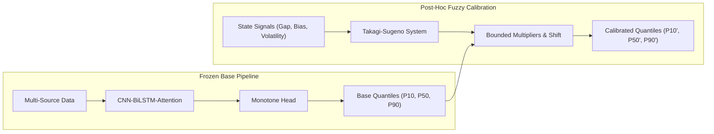

# Sugeno Fuzzy Calibration of Quantile Forecasts for Baltic Dry Index

**Authors:** Naman Hans, Srisurya Saket Karuturi, Ark Malhotra, Srilex Pooria, and Dr. Poonam Rani

## Abstract

Global shipping costs of dry goods per day are represented by the Baltic Dry Index, which is composed of subindices Capesize, Panamax, Supramax, and Handysize based on the ship's size.

This paper aims to predict those subindices, along with a fuzzy layer for allowing cheap adaptation without full-retraining on new data, on 1, 7, 30, and 90 day horizons. This method can also be applied to other highly volatile and information-dense time series datasets.

The base model used is a pooled quantile CNN-BiLSTM-attention model, trained on pinball loss; as BDI is highly volatile, the quantiles help the model express uncertainty. The quantile is outputed by a monotone head over the model. CNN picks up short local patterns, BiLSTM captures long-range dependencies in the input window, and attention weighs in this captured information and pools them in the summary vector.

After the base model is a fuzzy layer, which consists of two zero-order Takagi-Sugeno fuzzy systems: one controlling the width (interval between quantiles q10 and q90), and one the location (median forecast q50). This layer is trained on a held-out "validation data" while the base model is frozen.
# Introduction

## Baltic Dry Index

Roughly 80% volume of global merchandise trade is done by maritime transport, making shipping very important for analysing and measuring the real economy. The Baltic Dry Index (BDI) covers the dry bulk cargo (iron, coal, bauxite etc.) of this, tracking only the cost of hiring the ship, not the price of the commodity itself.

It is published daily by the Baltic Exchange in London. It is a composite of time-charter equivalent rates across vessel classes Capesize, Panamax, Supramax, and Handysize. These indices can be used to reason about the costs of various routes for any amount of supplies.

As these markets are highly volatile and subject to market risks, relying on a single model's predictions, however its accuracy, is not sufficient for justifying its use within a business or commercial system. The model must be able to express uncertainty, and its outputs must be interpretable; a chartering system might want to know the reason behind a deduction which black box neural networks cannot provide, and might need to know certain probabilities of certain outputs instead of a single value.

Furthermore, while deep sequence models are the best at accuracy, their intervals are often miscalibrated, especially once they are required to predict much farther than their training. These problems are rarely tackled in literature, which mostly seeks the purity and simplicity of only finding the best result.

## Pinball Loss

For the above problems, we use multiple unique solutions. Firstly, we utilize pinball loss to have the CNN-BiLSTM-attention model (inspired by the work of other papers) to predict quantiles instead of a single value. The accuracy of a forecast $\hat q_τ$  for the $τ$-quantile is evaluated against the pinball loss as:

$$  
L_\tau(y, \hat{q}_\tau) =  
\begin{cases}  
	\tau (y - \hat{q}_\tau), & y \ge \hat{q}_\tau \\
(1-\tau) (\hat{q}_\tau - y), & y < \hat{q}_\tau  
\end{cases}  
$$

where $y$ is the observed value.

To explain, say τ=0.9. This means that an under-forecast is penalized 9 times more heavily than an over-forecast. For τ=0.1, the opposite is the case. In this project, we use τ = 0.1, 0.5, 0.9.

## Winkler Score

Pinball loss scores one quantile, but Winkler score scores an interval between two quantiles.

An interval can be too large, so that every value falls inside it, or too narrow, so no value falls inside it. Both are penalized accordingly by the Winkler score, which is equal to the width of the interval + distance of the missing item from the interval.

So, if the observed value falls inside the interval, the score is just the width. If it falls outside, the score is the width + 2/α times the distance it missed.

$$  
W_\alpha(l, u, y) =  
\begin{cases}  
(u - l) + \dfrac{2}{\alpha}(l - y), & y < l \\
(u - l), & l \le y \le u \\
(u - l) + \dfrac{2}{\alpha}(y - u), & y > u  
\end{cases}  
$$

# Related Work

# Data
Class indices for each ship size are assembled from investing.com, along with S&P500 and the US dollar index.

## Features
The BDI is not published on weekends or holidays, and cannot be dropped without breaking lags and rolling windows for time series modelling. So, we build a continuous 365-day calendar and forward-fill (LOCF: Last Observation Carried Foward) missing feature values. The target is not forward-filled to ensure no data leakage.

We shift the target on the continuous grid so that the horizon is exactly 1, 7, 30, or 90 calendar days (t+h). Then, we only keep rows whose target date is a real market day.

## Targets

Let $I_{c,t}$ be the index level for vessel class $c \in \{\text{Capesize}, \text{Panamax}, \text{Supramax}, \text{Handysize}\}$ on date $t$; this will be our input.

Instead of having the model predict the output quantiles outright, we transform the dataset's target variable to be the future log index level:
$$
y_{c,t,h} = \log I_{c,t+h},
$$

for horizons $h \in \{1, 7, 30, 90\}$ calendar days. For each class and horizon, we predict the 10th, 50th, and 90th percentiles of $y_{c,t,h}$, denoted $\hat q_{0.1}$, $\hat q_{0.5}$, and $\hat q_{0.9}$.

Log was used as the indices are always positive, and highly skewed. It also makes percentage moves additive.

The $h$-day log return is standardised for each class and horizon, using training-period means and standard deviations only, to prevent subtle data leakage.

$$
r_{c,t,h} = y_{c,t,h} - \log I_{c,t}, \qquad
z_{c,t,h} = \frac{r_{c,t,h} - \mu_{c,h}}{\sigma_{c,h}}.
$$

The network predicts quantiles of $z_{c,t,h}$. We then undo the standardisation and $\log I_{c,t}$ back to return to log-level quantiles. This keeps the calibration layer in the same space as the final forecast.

# Architecture

*Figure 1. End-to-end architecture diagram.*

## Base Model

As was said before, the base model is a pooled quantile CNN-BiLSTM-attention network, which is given the dataset above as an input.
- 1D CNN extracts local patterns. 64 filters, kernel size 3.
- 2-layer bidirectional LSTM captures longer-range dependence. Hidden dimension 32.
- An attention layer weighs the information given by the above carefully.
- In our model, we also attach a small dense head that gives us three raw outputs for each quantile.
	- To ensure this head is monotone, unconstrained outputs $(o_1, o_2, o_3)$ are used:

$$
\hat q_{0.5} = o_1, \qquad \hat q_{0.1} = \hat q_{0.5} - \operatorname{softplus}(o_2), \qquad \hat q_{0.9} = \hat q_{0.5} + \operatorname{softplus}(o_3)
$$

This prevents quantile crossing by construction ($\hat q_{0.1} < \hat q_{0.5} < \hat q_{0.9}$). The base model is trained with multi-quantile pinball loss and frozen.

The model is pooled over the four classes (so prediction for each subindex happens simultaneously), but is trained separately for each horizon (so we have to train a new model for each value of h).

To reduce variance, we train the above model with pinball loss with 5 seeds, then average the resulting outputs.

## Fuzzy Calibration Layer

The base model gives us a forecast, but its interval may be too wide or too narrow, and its median may be biased. To adjust its output without retraining the model, we use this fuzzy calibration layer, in which we utilize two small Takagi-Sugeno systems per-horizon: one for width, and one for location.

The width controls how wide the interval should be, via a multiplier on each half-width. The location controls where the median should be, via a shift. These corrections are not fixed multipliers, but rather, computed from recent forecast performance and current market volatility. The degree to which these affect the rules is learned from a validation set; a section of the train set we cordoned for the purpose of tuning this calibration layer only.

So after the base model trains on the train set, it is frozen, and the calibration layer uses the tune set on a few recent observations to see how this old model fares with the latest data. Accordingly, we adjust.

The elements of our Takagi-Sugeno fuzzy system are:-
- Membership function: Gaussian. Smooth and differentiable, allowing the layer to train by gradient descent. Antecedants partition input into 3 memberships: Low, Medium, High.
- T-norm: normalized product. $\bar w_r(x) = w_r(x) / \sum_{r'} w_{r'}(x)$.
- Rules: A 3x3 rule base
- Defuzzification: weighted-average.

### Inputs

The fuzzy logic system takes the following as inputs:
- Trailing miss rate: over a recent window of 
- Median residual bias
- Market volatility

Each input dimension is partitioned into three Gaussian membership functions: Low, Medium, High.

$$
\mu_{j,k}(x_j) = \exp\left(-\frac{(x_j - c_{j,k})^2}{2\sigma_{j,k}^2}\right)
$$

### Zero vs First order

We have two distinct consequent formulations:
1. Sugeno 0th: each rule produces constant consequents.
2. Sugeno 1st: first order Sugeno, where each rule produces an affine function.

# Results

After scoring the

# Conclusion