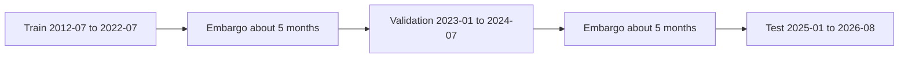
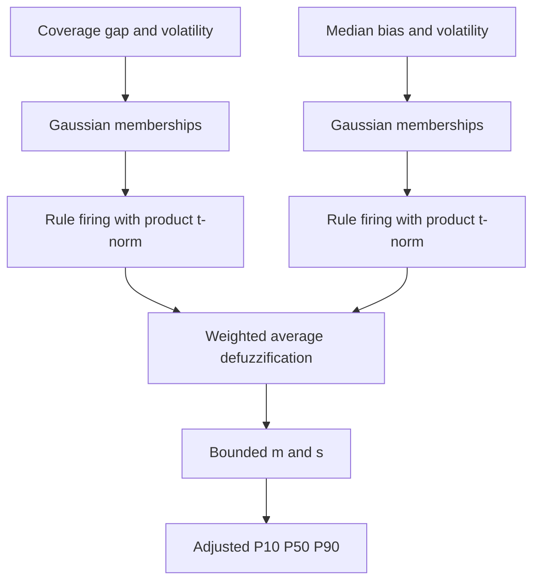

# State-Dependent Sugeno Fuzzy Calibration of Quantile Forecasts for Dry Bulk Vessel-Class Indices

**Authors:** Naman Hans, Srisurya Saket Karuturi, Ark Malhotra, Srilex Pooria, and Dr. Poonam Rani

## Abstract

Dry bulk shipping is organised around vessel classes, and Capesize, Panamax, Supramax, and Handysize indices respond differently to congestion, commodity demand, and macro-financial conditions. We study probabilistic forecasts of future log index levels for these classes at horizons of 1, 7, 30, and 90 days. The Baltic Dry Index is used only as a cross-series covariate and is never a target. The base model is a pooled quantile CNN-BiLSTM-attention network with a monotone head and a five-seed ensemble. We add a small state-dependent calibration layer made of two zero-order Takagi-Sugeno fuzzy systems, one for interval width and one for location. Both use Gaussian memberships, product t-norm, weighted-average defuzzification, and bounded outputs; their consequents start at zero, so the untrained layer is the identity. The layer is fitted on validation with the base frozen. On a single chronological test episode from 2025-01-02 to 2026-08-20, it improves mean pinball loss over the base at 30 and 90 days, from 0.04833 to 0.04645 and from 0.06914 to 0.06080, and reduces severe over-coverage. It is worse at 1 and 7 days. At 90 days it shrinks the interval to about half its original width, which is directionally right but over-corrects coverage to 0.730. The main negative result is attributional: four simple calibrators, including constant-width and linear state-dependent forms, beat the fuzzy layer at every horizon on both pinball loss and Winkler score. The learned rule base therefore does not add value beyond a bounded constant or linear correction in this episode. Its interpretability is descriptive rather than causal: at 90 days the width system is effectively a single constant-shrink rule, and at 1 day the rule signs are mixed.

## 1 Introduction

Dry bulk shipping moves iron ore, coal, grain, and other bulk cargoes. Shipowners, charterers, and analysts do not face one price; they face vessel-class indices that reflect different ship sizes and routes. Capesize vessels carry the largest cargoes and are tied to iron ore and coal flows. Panamax vessels sit in the middle. Supramax and Handysize vessels are smaller and more flexible, and they respond to regional congestion and minor bulk trade. The Baltic Dry Index is a useful aggregate signal, but it is not a substitute for class-specific targets and is used here only as a cross-series covariate.

The applied problem is not only to forecast a level, but to produce an interval that is honest about its own uncertainty. A chartering desk may need the 10th and 90th percentiles of the future log index level because the downside percentile drives risk limits and the upside percentile drives option-like decisions. Quantile forecasts are a natural language for this task. The pinball loss is the standard scoring rule for a single quantile, and the Winkler score evaluates the two endpoints jointly by rewarding narrow intervals and penalising misses. The two are not equivalent: pinball averages all quantiles, including the median, while Winkler scores the central interval and its width.

Deep sequence models can produce quantile forecasts, but their intervals are often miscalibrated. A network trained with the pinball loss may over-cover at long horizons because the training signal is dominated by large moves, or under-cover in quiet periods because it has learned an average width. The right width and location depend on the current market state. When volatility is high and recent forecasts have missed, the interval should usually be wider. When recent forecasts have been too low, the median should usually be shifted up. A fixed post-hoc multiplier cannot express this state dependence.

This paper asks whether a small, interpretable fuzzy calibration layer can correct a strong quantile base model in a state-dependent way. We use two zero-order Takagi-Sugeno systems. The first maps a matured coverage gap and volatility to a log width multiplier; the second maps a matured median bias and volatility to a location shift. The systems use Gaussian memberships, product t-norm, weighted-average defuzzification, and a small rule base. Their outputs are bounded, and their consequents start at zero, so an untrained layer leaves the base forecasts unchanged. The layer is trained only after the base model is frozen.

The protocol is conservative: one chronological split with two embargoes, a continuous 365-day calendar for features, forward-fill for missing feature values, and a training mask that drops non-market rows only after targets have been shifted. The test period is read once. We compare the fuzzy layer with the uncalibrated base and with four attribution baselines that isolate constant width, constant location, rolling-bias correction, and linear state dependence. We report pooled and per-class results, and use a date-block bootstrap that keeps all four classes together. We do not lead with row-wise p-values, because rows overlap at long horizons and the effective sample is much smaller than the row count.

The contributions are a class-level quantile protocol with a strict temporal split; a bounded Sugeno calibration layer that is the identity before training; an audit of what the layer learns through rule firing, normalized contributions, memberships, and response surfaces; and a negative attribution result showing that simple constant and linear calibrators dominate the fuzzy layer at every horizon.

## 2 Related Work

Maritime forecasting has a long history of index-level models. Work on dry bulk indices has used fuzzy time series, econometric models, and neural networks, often with the Baltic Dry Index as the target. The fuzzy time series literature initiated by Song and Chissom provides the vocabulary of fuzzy sets, membership functions, and rule-based transitions. Su, Park, and Bae study vessel-class index forecasting, which is close in spirit to our class-level target, and recent work applies adaptive neuro-fuzzy inference to the Baltic Dry Index. These works motivate our use of fuzzy systems, but they generally operate on a single aggregate series. Our target is a set of four class indices, and our fuzzy layer is a calibrator rather than a standalone forecaster.

Takagi-Sugeno systems use constant or linear consequents, which makes the output a weighted average of local models. A zero-order system is small, bounded, and easy to audit, which fits a calibration layer. The rule base can be written as a table, although overlapping Gaussian memberships mean that individual rules should not be over-interpreted; we use a 3x3 grid, with a volatility-only 3-rule variant at long horizons where the matured coverage gap is too noisy. Quantile regression was formalised by Koenker and Bassett. The pinball loss is the standard objective, and the Winkler score evaluates interval forecasts by combining width and penalties for misses. The base model is a CNN-BiLSTM-attention network: convolutional layers capture local patterns, a bidirectional LSTM captures longer-range dependence, and attention pools the history with learned weights. Post-hoc calibration is well established; our contribution is not a new calibration algorithm in general, but a specific bounded fuzzy form and an audit of what it learns. The date-block bootstrap follows the general logic of Kunsch for stationary observations.

## 3 Data, Targets, and Protocol

### 3.1 Targets and Horizons

Let \(I_{c,t}\) be the index level for vessel class \(c \in \{\text{Capesize}, \text{Panamax}, \text{Supramax}, \text{Handysize}\}\) on date \(t\). The target is the future log index level \(y_{c,t,h} = \log I_{c,t+h}\), for horizons \(h \in \{1, 7, 30, 90\}\) calendar days. For each class and horizon, we predict the 10th, 50th, and 90th percentiles of \(y_{c,t,h}\), denoted \(q_{10}\), \(q_{50}\), and \(q_{90}\). The Baltic Dry Index is used only as a cross-series covariate. It is never a target, and no result in this paper is a forecast of the Baltic Dry Index itself.

Log levels make the calibration shift additive and the width multiplier multiplicative. The base network is trained on standardised returns, but its outputs are converted back to log-level quantiles before calibration and evaluation. For each class and horizon, the \(h\)-day log return is standardised using training-period means and standard deviations. The network predicts quantiles of the standardised return, and these are transformed linearly back to log-level quantiles.

### 3.2 Data Sources

The class indices are assembled from HandyBulk and investing.com backfill. Port congestion is measured from PortWatch daily port-call data at origin and destination ports. Macro-financial series include Brent crude, iron ore, coal, the US dollar index, the S&P 500, and US industrial production. Calendar indicators capture day-of-week, month, and holiday effects. All joins are as-of joins: a feature value at time \(t\) uses only information available at or before \(t\).

Feature construction uses a continuous 365-day calendar. Missing values on weekends and holidays are forward-filled for features only. The target is shifted first, and then non-market rows are dropped. This ordering matters. If non-market rows were dropped before shifting, the target for a Friday issuance at a 1-day horizon would point to Saturday, and the training mask would be wrong. By shifting first and dropping afterwards, we retain the correct time-series logic for lags and rolling means while ensuring that training and evaluation use only real market days.

### 3.3 Chronological Split and Sample Sizes

We use a single chronological split with two embargoes. The training period runs from 2012-07-04 to 2022-07-25. The validation period runs from 2023-01-03 to 2024-07-25. The test period runs from 2025-01-02 to 2026-08-20. Each gap is approximately five months. The embargoes prevent forecasts issued near the end of one period from maturing inside the next period in a way that could leak information.

Before horizon masking, the training set contains 10,053 rows, the validation set contains 1,565 rows, and the test set contains 1,277 rows. Horizon masking removes rows whose target date is not a market day or whose outcome has not matured within the relevant period. The common-support sample sizes, which are the rows available for all models and all four classes at a given horizon, are 765 for \(h=1\), 895 for \(h=7\), 505 for \(h=30\), and 571 for \(h=90\). These are the sample sizes used in the pooled comparisons.

| Split | Start | End | Rows before horizon masking |
|---|---|---|---:|
| Training | 2012-07-04 | 2022-07-25 | 10,053 |
| Embargo 1 | 2022-07-26 | 2023-01-02 | not used for fitting |
| Validation | 2023-01-03 | 2024-07-25 | 1,565 |
| Embargo 2 | 2024-07-26 | 2025-01-01 | not used for fitting |
| Test | 2025-01-02 | 2026-08-20 | 1,277 |

### 3.4 Evaluation Quantities

For a quantile level \(q \in \{0.1, 0.5, 0.9\}\), the pinball loss is \(\rho_q(y, \hat q) = (q - \mathbf{1}\{y < \hat q\})(y - \hat q)\). The mean pinball loss averages this over the three quantiles, over classes, and over evaluation rows. The 80 percent interval is \([\hat q_{10}, \hat q_{90}]\). Empirical coverage is the fraction of rows with \(\hat q_{10} \le y \le \hat q_{90}\). The Winkler interval score at the 80 percent level is \(W = (\hat q_{90} - \hat q_{10}) + (2/0.2)(\hat q_{10} - y)\mathbf{1}\{y < \hat q_{10}\} + (2/0.2)(y - \hat q_{90})\mathbf{1}\{y > \hat q_{90}\}\). Lower values are better for pinball loss and Winkler score. Coverage is informative but not a scoring rule by itself, because an interval can achieve nominal coverage by being unnecessarily wide.

## 4 Method

### 4.1 Base Quantile Model

The base model is a pooled quantile CNN-BiLSTM-attention network. The input is a multivariate daily history for a given class, including lags of the class index, the Baltic Dry Index as a cross-series covariate, port-call congestion at origin and destination ports, the macro-financial series, and calendar indicators. Convolutional layers extract local temporal patterns. A bidirectional LSTM captures longer-range dependence in both directions within the input window. An attention layer pools the hidden states with learned weights, and a small dense head produces three raw outputs.

The quantile head is monotone by construction. Let the raw outputs be \(o_1, o_2, o_3\). We set \(\hat q_{50} = o_1\), \(\hat q_{10} = \hat q_{50} - \operatorname{softplus}(o_2)\), and \(\hat q_{90} = \hat q_{50} + \operatorname{softplus}(o_3)\). Because softplus is positive, the 10th percentile is always below the median and the 90th percentile is always above it. This removes the need for sorting or for a penalty that enforces quantile ordering. The network is pooled across the four classes, with class and horizon information supplied to the model. Pooling is important because the class-level samples are not large, and the four indices share common drivers.

The training objective is the pinball loss on per-class and per-horizon standardised returns. The network predicts quantiles of the standardised return. At prediction time, the quantiles are transformed back to log-level quantiles. The reference run uses five seeds with different initialisations and averages the resulting quantiles. The ensemble reduces variance and makes the calibration comparison less sensitive to a single training run.

### 4.2 Sugeno Calibration Layer

The calibration layer contains two zero-order Takagi-Sugeno systems for each horizon, one for width and one for location. The width system maps a coverage gap and volatility to a log width multiplier \(m\). The location system maps a median bias and volatility to a shift \(s\). Each system uses Gaussian membership functions, product t-norm, weighted-average defuzzification, and a 3x3 rule base. At horizons of 30 and 90 days, the width system uses volatility only and has 3 rules, because the matured coverage gap is too noisy at those horizons. The location system retains both inputs.

The application equations are \(\hat q_{50}' = \hat q_{50} + s\), \(\hat q_{10}' = \hat q_{50}' - (\hat q_{50} - \hat q_{10}) \exp(m)\), and \(\hat q_{90}' = \hat q_{50}' + (\hat q_{90} - \hat q_{50}) \exp(m)\). The shift moves the median and both endpoints together. The multiplier scales the lower and upper half-widths by the same factor. If \(m=0\) and \(s=0\), the adjusted quantiles equal the base quantiles. The multiplier is bounded as \(m = 0.7 \tanh(\cdot)\), so \(\exp(m)\) lies between approximately 0.50 and 2.01. The shift is bounded as \(s = 2.2 \sigma_h \tanh(\cdot)\), where \(\sigma_h\) is the pooled standard deviation of the base median error at horizon \(h\) on the calibration window. The bounds prevent a single extreme state from producing an absurd interval and make the layer stable when the input features are noisy.

### 4.3 Matured Features and Training

The calibration features use only forecasts that have matured. A forecast issued at time \(t\) for horizon \(h\) matures at \(t+h\); at issuance time \(t\), the inputs use only forecasts issued at or before \(t-h\). This prevents the layer from using an outcome that would not yet be known in deployment. We use a lookback window of \(N(h) = \max(60, 5h)\) calendar days, requiring at least five matured forecast-outcome pairs. The window is 60 days at \(h=1\) and \(h=7\), 150 days at \(h=30\), and 450 days at \(h=90\). If fewer than five matured pairs are available, the layer returns the identity correction.

The coverage gap is \(g_t = \frac{1}{N_t}\sum_{i \in \mathcal{W}_t}[\mathbf{1}\{y_i < \hat q_{10,i}\} + \mathbf{1}\{y_i > \hat q_{90,i}\}] - 0.20\), where \(\mathcal{W}_t\) is the matured window; it is positive when the interval under-covers. The median bias is \(b_t = \operatorname{mean}_{i \in \mathcal{W}_t}(y_i - \hat q_{50,i}) / \operatorname{sd}_{i \in \mathcal{W}_t}(y_i - \hat q_{50,i})\). A positive bias means the median has been too low. The volatility feature is the trailing 14-day standard deviation of daily log-level changes, z-scored against strictly earlier data, so it does not leak future volatility.

The base model is frozen; only the calibration layer is trained. The free parameters are the consequent constants and the antecedent centres and widths. The consequents start at zero and the antecedents are initialised from terciles, so the untrained layer is exactly the identity. The layer is trained on validation with pinball loss, full-batch Adam, a learning rate of 0.05, and 600 epochs. No test data are used for training, early stopping, or hyperparameter selection.

| Component | Setting |
|---|---|
| Width inputs | coverage gap and volatility; volatility only at \(h \ge 30\) |
| Location inputs | median bias and volatility |
| Membership functions | Gaussian |
| T-norm | product |
| Defuzzification | weighted average |
| Rule base | 3x3; 3 rules for the volatility-only width system |
| Width output | \(m = 0.7 \tanh(\cdot)\) |
| Location output | \(s = 2.2 \sigma_h \tanh(\cdot)\) |
| Consequent initialisation | zero, so the layer starts as the identity |
| Optimiser | full-batch Adam |
| Learning rate | 0.05 |
| Epochs | 600 |
| Base model | frozen |
| Calibration data | validation only |

The layer is the identity at initialisation, bounded, and continuous. For fixed \(s\), the adjusted interval width is strictly increasing in \(m\). The layer is trained to minimise pinball loss, not to achieve a coverage target, so it can under-cover or over-cover on test data. It has no finite-sample coverage guarantee and it does not adapt its miscoverage level with a formal update.

## 5 What the Layer Learns

### 5.1 Rule Firing and Contributions

For a zero-order Sugeno system with weighted-average defuzzification, the raw output is \(\hat y = \sum_k w_k c_k / \sum_k w_k\), where \(w_k\) is the firing strength and \(c_k\) is the consequent. The normalized contribution of rule \(k\) is \(w_k c_k / \sum_j w_j\); contributions sum to the raw output before the bounded tanh transform. A rule that almost never fires cannot be doing much work, and a rule that fires often with a counterintuitive sign is a warning that the rule base is not a clean description of state dependence.

At \(h=1\), the width system is spread across several rules. The most active rule has mean firing 0.571 and a negative consequent of \(-0.214\). It fires when the coverage gap and volatility are low, a state where the base interval tends to over-cover, so shrinking is directionally sensible. The next most active rules are low-gap/middle-volatility (firing 0.154, consequent \(+0.109\)), middle-gap/low-volatility (0.135, \(+0.082\)), and high-gap/low-volatility (0.074, \(-0.565\)). The high-gap/high-volatility rule has the expected positive consequent \(+0.940\), but exceeds firing 0.05 on only 2.6 percent of test rows. The mixed signs mean that the \(h=1\) rule base should not be read as a monotone coverage correction.

At \(h=90\), the width system is effectively a single rule. The low-volatility membership has mean firing 0.999, and the other two memberships fire on less than 1 percent of rows. Its consequent is \(-3.236\), and the bounded output is close to its lower limit. The width layer therefore acts as a near-constant shrink factor, not a state-dependent width rule. At long horizons it collapses to a constant correction, which is exactly what simple attribution baselines can express.

The \(h=90\) location system is more active across rules, but its signs are mixed. The high-bias/middle-volatility rule has firing 0.369, consequent \(+0.743\), and mean contribution \(+0.274\); the middle-bias/middle-volatility rule has firing 0.124, consequent \(+1.112\), and contribution \(+0.138\). The high-bias/low-volatility rule has firing 0.285, consequent \(-0.355\), and contribution \(-0.101\), and the high-bias/high-volatility rule has firing 0.095, consequent \(-1.700\), and contribution \(-0.161\). The average location shift is positive, but the rule table does not support a simple statement that a positive bias always shifts the median up. The rule base is a pooled fit, not a causal model.

| Horizon | System | Effective behavior | Mean width multiplier or shift |
|---:|---|---|---:|
| 1 | Width | Several rules fire; mixed signs | width multiplier 0.899 |
| 7 | Width | Several rules fire; mixed signs | width multiplier 0.958 |
| 30 | Width | Volatility-only, mostly shrink | width multiplier 0.666 |
| 90 | Width | One rule fires on essentially all rows | width multiplier 0.498 |
| 90 | Location | Several rules fire; mixed signs | mean shift \(+0.087\) |

### 5.2 Membership Curves and Response Surfaces

Figure 1 is a plot description rather than a finished figure. It should show the calibrated quantile fan for a representative class and date range. The base P10-P90 band is drawn as a shaded region, the Sugeno band is overlaid, and realised outcomes are plotted as points. The expected visual is a band that narrows modestly at short horizons and contracts sharply at 90 days, with some realised points falling outside the calibrated band at 90 days. This figure is the most direct way to show how the layer changes the output.

Figure 2 is a description of the response surfaces. The four panels are the width surface at \(h=1\), the location surface at \(h=1\), the width surface at \(h=90\), and the location surface at \(h=90\). The axes are the standardised inputs. The colour scale is the log width multiplier \(m\) or the location shift \(s\). Observed test states are overlaid as points. The linear state-dependent calibrator is overlaid as a transparent plane or as dashed contours. The expected visual is a non-monotone width surface at \(h=1\), a nearly flat width surface at \(h=90\), and a location surface whose sign changes across the input space.

Figure 3 is a description of the rule-contribution plot. For each horizon, it should show bars of mean normalized contribution by rule, separated into width and location systems. The expected visual is that a few rules dominate at \(h=1\), that the \(h=90\) width system is almost entirely one rule, and that the location system spreads contributions across several rules. This figure makes the negative attribution result visible: if most of the correction is a constant, a constant calibrator can match it.

Overlapping Gaussians mean that individual rules should not be read as isolated if-then statements. At \(h=1\), the coverage-gap memberships are centred at \(-1.98\), \(0.55\), and \(1.70\) with widths \(0.44\), \(0.15\), and \(0.10\). At \(h=90\), the width memberships are centred at \(1.04\), \(0.99\), and \(0.99\) with widths \(1.43\), \(0.15\), and \(0.18\). The first is broad and the other two are narrow and nearly identical, which explains why the system behaves like a single rule at the long horizon.

### 5.3 Comparison with the Linear Calibrator

The linear state-dependent calibrator uses the same inputs and the same tanh bounds, but its raw outputs are linear in the inputs. Its fitted width coefficient on the coverage gap is negative at \(h=1\) and \(h=7\) and positive at \(h=30\) and \(h=90\). Its fitted location coefficient on the bias is positive at \(h=1\), \(h=7\), and \(h=30\), but negative at \(h=90\). The fuzzy rule base is also not uniformly monotone. Neither model supports a clean monotone story at every horizon. The comparison is still useful because the linear calibrator is a direct ablation of the fuzzy membership and rule structure, and it performs better at every horizon. In this episode, the fuzzy layer is not an interpretable approximation to a stable linear correction; it is a more complex correction that does not pay for itself.

## 6 Baselines and Evaluation

### 6.1 Forecast Arms

We compare the following arms.

**Base.** The pooled quantile CNN-BiLSTM-attention model with the monotone head and the five-seed ensemble, without any post-hoc calibration.

**Sugeno.** The base model followed by the two zero-order Takagi-Sugeno calibration systems described in Section 4. This is the main method of the paper.

**Constant width multiplier.** A single learned \(m\) for every forecast with \(s=0\). This isolates the value of state-dependent width.

**Constant width plus constant location.** A single learned \(m\) and a single learned \(s\). This isolates the value of state dependence in both dimensions.

**Constant width plus causal rolling-bias correction.** A constant width multiplier and a location shift equal to the negative causal rolling median error, with the same bounded tanh form. This uses the bias signal but not the full rule base.

**Linear state-dependent calibrator.** The same inputs and tanh bounds, but the raw outputs are linear in the inputs. This is a direct ablation of the fuzzy membership and rule structure.

We considered a small multilayer perceptron with the same inputs and bounds, but we did not include it. With only a few hundred effective validation observations, a more flexible calibrator would be difficult to fit and would weaken the attribution argument rather than strengthen it. We report mean pinball loss, median loss, endpoint loss, and the Winkler-80 score. The median loss is the pinball loss at the 50th percentile. The endpoint loss is the average of the pinball losses at the 10th and 90th percentiles. Separating these quantities matters because a calibrator can improve the median while worsening the tails, or narrow the interval while shifting it in the wrong direction.

### 6.2 Selection and Tuning Budget

The calibration architecture, the number of membership functions, the rule-base size, the tanh bounds, the learning rate, and the epoch count were fixed before the test set was opened. The four attribution baselines are fit on validation with the same pinball objective, learning rate, and epoch budget as the Sugeno layer. Each variant is fit once per horizon; there is no variant-specific hyperparameter search and no tuning on test. The test set was read once. The attribution comparison is therefore a fair test of whether the fuzzy structure adds value beyond a bounded constant or linear correction.

### 6.3 Statistical Inference

The primary inferential tool is a date-block bootstrap. We resample consecutive blocks of dates with replacement and keep all four classes together within each block. This preserves cross-class correlation and within-block temporal dependence. We report 95 percent percentile intervals for the difference between the Sugeno layer and the base. We repeat the bootstrap with the primary block length, which is the horizon with a floor of five days, and with half that length. At \(h=90\) the common-support test period contains only about 143 distinct dates, so doubling the primary block would leave fewer than two blocks; we therefore do not report a doubled block at that horizon. We do not lead with row-wise p-values on pooled overlapping rows, because a naive test that treats each row as independent would overstate precision.

## 7 Results

### 7.1 Pooled Test Results

Table 1 reports pooled mean pinball loss, empirical coverage of the 80 percent interval, and the Winkler-80 score. The common-support sample sizes are 765, 895, 505, and 571 for horizons 1, 7, 30, and 90, respectively. All numbers are pooled across the four vessel classes.

**Table 1. Pooled test results.**

| Horizon | Model | Mean pinball | Cover-80 | Winkler-80 |
|---:|---|---:|---:|---:|
| 1 | Base | 0.00715 | 0.837 | 0.1164 |
| 1 | Sugeno | 0.00751 | 0.745 | 0.1217 |
| 7 | Base | 0.02200 | 0.908 | 0.3293 |
| 7 | Sugeno | 0.02451 | 0.820 | 0.3781 |
| 30 | Base | 0.04833 | 0.939 | 0.7487 |
| 30 | Sugeno | 0.04645 | 0.796 | 0.6828 |
| 90 | Base | 0.06914 | 0.991 | 1.1143 |
| 90 | Sugeno | 0.06080 | 0.730 | 0.8089 |

At \(h=1\), the base model is already reasonably calibrated, with coverage 0.837. The Sugeno layer narrows the interval by a mean multiplier of 0.899, pushes coverage down to 0.745, and worsens both pinball loss and Winkler score. The state features add variance without much signal at this horizon.

At \(h=7\), the base over-covers at 0.908. The Sugeno layer moves coverage to 0.820, close to nominal, but it still worsens pinball loss from 0.02200 to 0.02451 and Winkler from 0.3293 to 0.3781. This is a case where coverage alone is misleading: the interval is closer to nominal on average, but it is less efficient.

At \(h=30\), the Sugeno layer behaves as intended. Coverage moves from 0.939 to 0.796, close to the nominal 0.80, and both pinball loss and Winkler score improve, from 0.04833 to 0.04645 and from 0.7487 to 0.6828. The mean width multiplier is 0.666, so the layer makes a substantial width correction without changing the median much.

At \(h=90\), the base is severely over-covered at 0.991, and its Winkler score is 1.1143. The Sugeno layer reduces pinball loss by about 12 percent and Winkler by about 27 percent, but coverage falls to 0.730, below nominal. The mean width multiplier is 0.498, so the layer shrinks the interval to about half its original width. The correction is directionally right but too strong for the test period. The mean location shift is \(+0.087\), so the median moves up while the width shrinks; the width contraction dominates the coverage result.

### 7.2 Per-Class Results at 90 Days

Pooled results can hide class heterogeneity. Table 2 reports mean pinball loss at \(h=90\) by class.

**Table 2. Per-class mean pinball loss at \(h=90\).**

| Class | Base | Sugeno |
|---|---:|---:|
| Capesize | 0.1179 | 0.1020 |
| Panamax | 0.0559 | 0.0411 |
| Supramax | 0.0525 | 0.0449 |
| Handysize | 0.0392 | 0.0522 |

Sugeno is not the best in all classes. It improves on the base for Capesize, Panamax, and Supramax, but it is clearly worse for Handysize, from 0.0392 to 0.0522. This is a substantial failure for the pooled fuzzy calibrator.

Handysize vessels have different route structures, congestion exposure, and volatility from the larger classes. A pooled calibration layer that shares rule consequents across classes can learn a correction that works for Capesize and Panamax but is wrong for Handysize. The per-class table shows that the fuzzy layer is not a universal improvement. Any claim that the method is best across classes would be false. Class-specific calibration may be needed in future work, but the effective sample is small and class-specific layers would be prone to overfitting.

### 7.3 Attribution Results

Table 3 compares the Sugeno layer with the four simple calibrators. All four simple calibrators have lower mean pinball loss and lower Winkler score than the Sugeno layer at every horizon. The table shows the base, the Sugeno layer, the range across the four simple calibrators, and the best simple calibrator at each horizon.

**Table 3. Sugeno versus simple calibrators, pooled test.**

| Horizon | Base pinball | Sugeno pinball | Simple range pinball | Best simple pinball | Best simple | Sugeno Winkler | Best simple Winkler |
|---:|---:|---:|---:|---|---:|---:|
| 1 | 0.00715 | 0.00751 | 0.00707 to 0.00711 | 0.00707 | Constant width plus location | 0.1217 | 0.1145 |
| 7 | 0.02200 | 0.02451 | 0.02152 to 0.02173 | 0.02152 | Constant width | 0.3781 | 0.3151 |
| 30 | 0.04833 | 0.04645 | 0.04464 to 0.04576 | 0.04464 | Linear state dependent | 0.6828 | 0.6538 |
| 90 | 0.06914 | 0.06080 | 0.05207 to 0.05872 | 0.05207 | Constant width plus location | 0.8089 | 0.7313 |

A constant width multiplier captures most of the benefit at 1, 7, and 30 days: it is already close to the best simple calibrator and is clearly better than Sugeno. At 90 days, width alone is not enough, because constant-width pinball loss is 0.05810. Adding a constant location shift helps substantially there, reducing pinball loss to 0.05207 and Winkler from 0.78323 to 0.73128; at the other horizons the location term is close to neutral. The linear state-dependent calibrator beats Sugeno at every horizon and is the strongest attribution arm at 30 days, with pinball loss 0.04464 and Winkler 0.65381. State dependence is therefore useful at 30 days, but the fuzzy rule structure is not needed to capture it.

The rolling-bias arm improves on constant width at 30 days, but at 90 days it is slightly worse than constant width and clearly worse than a constant location shift. This is consistent with a regime-shift explanation: a rolling median lags a persistent change in the up-rate, whereas a constant shift learned on validation happens to move in the right direction. Neither is a reliable long-horizon bias correction, but the comparison shows that the fuzzy location component is not uniquely valuable.

The date-block bootstrap reinforces the ranking. The Sugeno-minus-base interval is \([+0.00010, +0.00070]\) at \(h=1\), \([+0.00064, +0.00478]\) at \(h=7\), \([-0.00624, +0.00234]\) at \(h=30\), and \([-0.01014, -0.00632]\) at \(h=90\). The layer is significantly worse than the base at 1 and 7 days, inconclusively different at 30 days, and significantly better at 90 days. The block-length sensitivity does not change this reading. These intervals compare Sugeno with the base only; they do not test the attribution ranking, which rests on a consistent point-estimate pattern rather than a formal bootstrap.

## 8 Discussion

The results are mixed, and that is the main message. The Sugeno layer does what it was designed to do at 30 days: it moves coverage from 0.939 to 0.796, close to nominal, and improves both pinball loss and Winkler score. At 90 days it improves on the base, with a large reduction in Winkler score, but over-corrects coverage to 0.730. At 1 and 7 days it is worse than the base. The layer is therefore not a universal upgrade. It helps when the base is severely miscalibrated and the state features carry signal, and hurts when the base is already close to calibrated and the state features add noise.

The attribution comparison is the most informative negative result. Every simple calibrator in Table 3 beats the fuzzy layer at every horizon on both pinball loss and Winkler score. At 1 day, constant width plus location is best. At 7 days, constant width alone is best. At 30 days, the linear state-dependent calibrator is best, which shows that state dependence has value but does not require fuzzy memberships or a rule base. At 90 days, constant width plus a constant location shift is best, which shows that the long-horizon gain comes mostly from correcting location, not from a state-dependent width rule. The fuzzy layer is a more complex version of the same idea, and in this episode the complexity does not pay for itself.

The per-class results are a warning against pooling without checking. Sugeno improves on the base for three classes at 90 days but is far worse for Handysize. A pooled layer can learn a correction dominated by the larger classes and more volatile regimes; Handysize has different route and congestion exposure, and the pooled rule base does not capture it. Pooling is not wrong, but it is a modelling choice with a cost, and that cost is visible in the per-class table.

The learned rules are only partly interpretable, and the audit makes that precise. At \(h=90\), the width system is effectively one rule that shrinks the interval by about half, so it is not state-dependent at the long horizon. At \(h=1\), several width rules fire, but their signs are mixed, so the rule base does not implement a monotone coverage correction. The location system at \(h=90\) has a positive average shift, but the high-bias rules do not all have positive consequents. We do not claim that the rules recover a stable economic mechanism; we claim only that they describe which states the layer responds to, and that response is not uniformly monotone.

We do not recommend width-only calibration as a default. Width-only rules can shrink an over-wide interval, but cannot correct a persistent location bias. At 1, 7, and 30 days, constant width is already close to the best simple arm, so the width component captures most of the gain. At 90 days, width alone leaves pinball loss at 0.05810, while adding a constant location shift lowers it to 0.05207. A location correction should be included; a width-only layer is not a safe default.

## 9 Limitations

The first limitation is the single episode. One chronological split and one test period mean that the results are conditional on one market regime. The validation-to-test up-rate shift is a confound for the long-horizon location correction: a shift learned in a period with a lower up-rate may be too low for a period with a higher up-rate. This is a plausible explanation for some of the \(h=90\) error, so those location results should not be generalised without a regime-shift analysis.

The second limitation is the small effective sample. At \(h=90\), targets overlap heavily and the four classes are correlated, so the row count overstates the independent information. The common-support sample is 571, but the effective number of independent observations is much smaller. The date-block bootstrap respects this dependence but cannot create information that is not there; intervals will be wide and close rankings may be unstable. The calendar-day horizon also interacts with the weekday-biased mask: a 30-day horizon can land on a weekend or holiday, and the mask retains under half of the eligible rows at \(h=30\). This can induce weekday bias. A trading-day horizon would avoid it but change the economic interpretation.

The third limitation is staged training. The base is frozen when the calibration layer is trained. Joint training might produce a better base and calibrator, but it would blur attribution: it would be harder to say whether an improvement comes from the base or the calibrator. The staged design is cleaner for this paper, but not the best possible predictive system. The calibrator also needs matured labels, so at \(h=90\) it cannot use the most recent 90 days of outcomes. A method that calibrates without waiting for maturity, for example with a proxy or model-based correction, would be more responsive; we do not have one here.

The fourth limitation is the scope of the interpretability audit. We report one calibration fit, impose no sign or monotonicity constraints, and do not estimate consequent stability across seeds or rolling validation windows. The audit shows that the learned signs are mixed, but not whether a sign-constrained fit would perform better or worse. We test only four simple calibrators; we do not test a small MLP, a gradient-boosted calibrator, or a class-specific calibrator. The linear arm shows that the fuzzy rule structure is not necessary for the state dependence at 30 days, but does not rule out a more flexible non-fuzzy calibrator doing better.

## 10 Conclusion

We studied state-dependent Sugeno fuzzy calibration of quantile forecasts for four dry bulk vessel-class indices. The base model is a pooled quantile CNN-BiLSTM-attention network with a monotone head and a five-seed ensemble. The calibration layer is a pair of small zero-order Takagi-Sugeno systems that map matured coverage and bias signals, together with volatility, to a bounded width multiplier and location shift. It is the identity before training, bounded and continuous, and trained on validation with the base frozen.

The empirical results are mixed, and the negative attribution result is the main finding. The fuzzy layer improves on the base at 30 and 90 days and reduces severe over-coverage there, but it is worse at 1 and 7 days. More importantly, four simple calibrators beat the fuzzy layer at every horizon on both pinball loss and Winkler score. At 30 days a linear state-dependent calibrator is best, and at 90 days constant width plus a constant location shift is best. The fuzzy rule structure therefore does not add value beyond a bounded constant or linear correction in this episode. The pooled layer is not best for every class: Handysize at 90 days is a clear failure. The rule audit shows that the long-horizon width system is effectively a single constant-shrink rule, while short-horizon width rules have mixed signs and long-horizon location rules are not uniformly monotone.

The broader lesson is that calibration is not a single problem: width, location, horizon, class, and regime all interact. A small fuzzy layer can express some of that interaction, but it is not a universal improvement. The next step is a new episode with a pre-registered protocol, class-aware or hierarchical calibration, a sign-constrained and seed-stable rule audit, and a formal comparison against the simple attribution calibrators. In this episode, bounded width and location corrections do the work, and the fuzzy rule base does not.

## Appendix A. Rule Tables with Firing Strengths

The tables report test-set mean normalized firing, the fraction of rows with firing above 0.05, and the mean normalized contribution, which sums to the raw output before the bounded tanh transform. The rule indices follow the row-major order of the 3x3 grid.

**Table A1. \(h=1\) width system.**

| Rule | Coverage gap MF | Volatility MF | Consequent | Mean firing | Firing above 0.05 | Mean contribution |
|---:|---:|---:|---:|---:|---:|---:|
| 0 | low | low | -0.214 | 0.571 | 0.595 | -0.122 |
| 1 | low | middle | 0.109 | 0.154 | 0.193 | 0.017 |
| 2 | low | high | -1.386 | 0.026 | 0.103 | -0.036 |
| 3 | middle | low | 0.082 | 0.135 | 0.162 | 0.011 |
| 4 | middle | middle | 0.265 | 0.027 | 0.044 | 0.007 |
| 5 | middle | high | -1.967 | 0.008 | 0.041 | -0.016 |
| 6 | high | low | -0.565 | 0.074 | 0.082 | -0.042 |
| 7 | high | middle | -0.021 | 0.001 | 0.009 | 0.000 |
| 8 | high | high | 0.940 | 0.003 | 0.026 | 0.003 |

**Table A2. \(h=1\) location system.**

| Rule | Bias MF | Volatility MF | Consequent | Mean firing | Firing above 0.05 | Mean contribution |
|---:|---:|---:|---:|---:|---:|---:|
| 0 | low | low | 0.330 | 0.213 | 0.646 | 0.070 |
| 1 | low | middle | -0.181 | 0.414 | 0.637 | -0.075 |
| 2 | low | high | -0.128 | 0.025 | 0.035 | -0.003 |
| 3 | middle | low | 0.005 | 0.097 | 0.336 | 0.000 |
| 4 | middle | middle | 0.029 | 0.190 | 0.332 | 0.006 |
| 5 | middle | high | -0.156 | 0.026 | 0.031 | -0.004 |
| 6 | high | low | -0.296 | 0.008 | 0.056 | -0.002 |
| 7 | high | middle | 0.072 | 0.021 | 0.093 | 0.002 |
| 8 | high | high | -5.455 | 0.001 | 0.001 | -0.003 |

**Table A3. \(h=90\) width system.**

| Rule | Volatility MF | Consequent | Mean firing | Firing above 0.05 | Mean contribution |
|---:|---:|---:|---:|---:|---:|
| 0 | low | -3.236 | 0.999 | 1.000 | -3.232 |
| 1 | middle | -1.063 | 0.000 | 0.002 | 0.000 |
| 2 | high | -1.178 | 0.001 | 0.005 | -0.001 |

**Table A4. \(h=90\) location system.**

| Rule | Bias MF | Volatility MF | Consequent | Mean firing | Firing above 0.05 | Mean contribution |
|---:|---:|---:|---:|---:|---:|---:|
| 0 | low | low | -0.348 | 0.000 | 0.000 | 0.000 |
| 1 | low | middle | 0.663 | 0.000 | 0.000 | 0.000 |
| 2 | low | high | -0.570 | 0.000 | 0.000 | 0.000 |
| 3 | middle | low | 0.353 | 0.094 | 0.371 | 0.033 |
| 4 | middle | middle | 1.112 | 0.124 | 0.415 | 0.138 |
| 5 | middle | high | -1.446 | 0.032 | 0.289 | -0.047 |
| 6 | high | low | -0.355 | 0.285 | 0.898 | -0.101 |
| 7 | high | middle | 0.743 | 0.369 | 1.000 | 0.274 |
| 8 | high | high | -1.700 | 0.095 | 0.748 | -0.161 |
