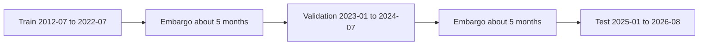
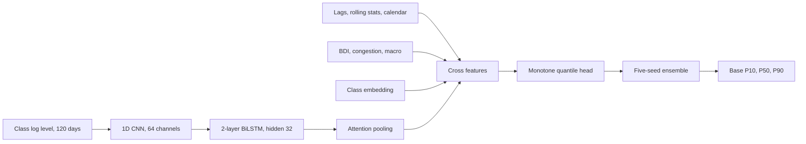
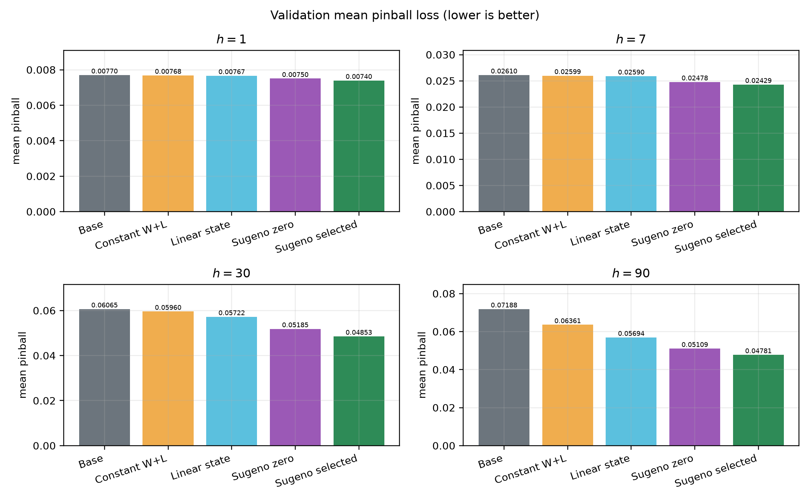
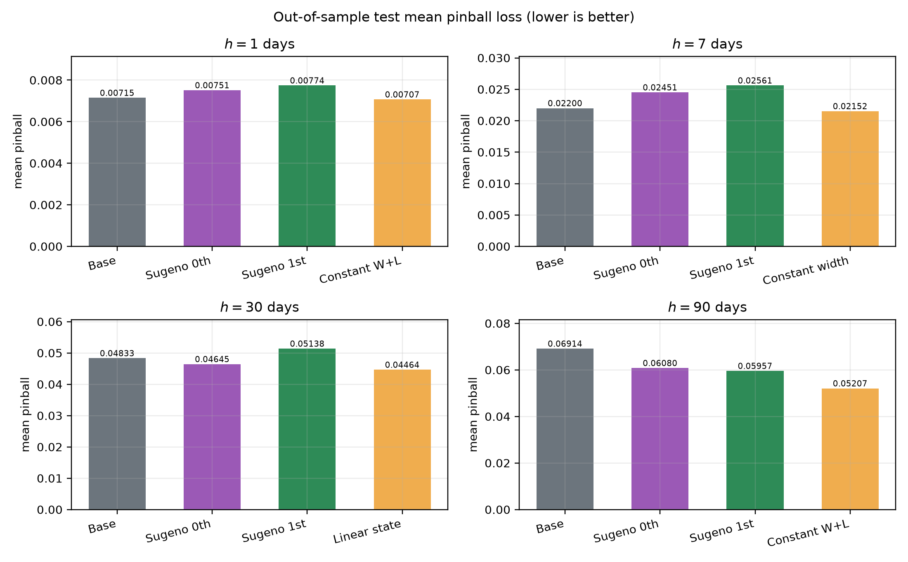
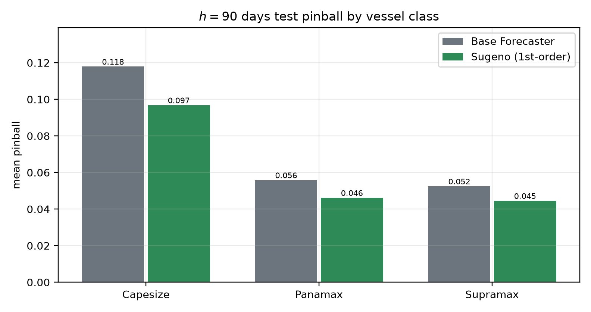

# Sugeno Fuzzy Calibration of Quantile Forecasts for Baltic Dry Index Vessel Classes

**Authors:** Naman Hans, Srisurya Saket Karuturi, Ark Malhotra, Srilex Pooria, and Dr. Poonam Rani

## Abstract

The Baltic Dry Index describes the cost of moving dry bulk cargo by sea. It is not one series but a family of vessel-class indices: Capesize, Panamax, Supramax, and Handysize. We forecast the future log level of those four class indices at 1, 7, 30, and 90 days. We also produce an 80 percent interval around each forecast, because a chartering decision needs a range, not only a point. The Baltic Dry Index itself is used only as a cross-series input and is never a target.

The base forecaster is a pooled quantile CNN-BiLSTM-attention model trained with pinball loss. The convolutional layer picks up short local patterns in the class history, the bidirectional LSTM captures longer-range dependence, and attention pools the history into a summary vector. A monotone head turns that summary into P10, P50, and P90. A five-seed ensemble averages the quantiles.

After the base model is frozen, we add two small Takagi-Sugeno fuzzy systems. One controls interval width. The other controls location, meaning the median forecast. They use Gaussian memberships, product t-norm, weighted-average defuzzification, and bounded outputs. Their consequents start at zero, so the untrained layer leaves the base forecast unchanged. We test zero-order and first-order consequents, symmetric and separate lower/upper width multipliers, and pooled and class-aware variants. The validation-selected layer uses first-order consequents with separate width multipliers.

The result is mixed. On validation, the selected layer beats the base at every horizon and gives the lowest pooled pinball loss, 0.03201 against 0.04158. On the one-shot test, it is worse than the base at 1, 7, and 30 days and better only at 90 days. At 90 days it lowers pinball from 0.06914 to 0.05957 and moves coverage from 0.991 to 0.793. Four simple calibrators still beat it at every test horizon. The fuzzy layer is useful as a compact, auditable correction, but the experiment does not show that fuzzy structure is necessary.

## 1. What Are We Predicting?

Roughly 80 percent of global merchandise trade by volume moves by sea. Dry bulk is the part that carries iron ore, coal, grain, bauxite, and similar cargoes. The Baltic Dry Index tracks the cost of hiring a ship for those cargoes, not the price of the cargo itself. It is published daily by the Baltic Exchange in London and is built from time-charter equivalent rates across four vessel classes.

The classes are not interchangeable. Capesize vessels carry the largest cargoes and are tied to iron ore and coal flows. Panamax sits in the middle. Supramax and Handysize are smaller and more flexible, and they respond more to regional congestion and minor bulk trade. A single aggregate index hides this variation, so we model each class separately while letting the four classes share one network.

The applied problem is not only to forecast a level. A chartering desk may need the 10th and 90th percentiles of the future log index level because the downside percentile drives risk limits and the upside percentile drives option-like decisions. A point forecast cannot express that risk. A quantile forecast can.

Deep sequence models can produce quantiles, but their intervals are often miscalibrated. A network trained with pinball loss may over-cover at long horizons because the training signal is dominated by large moves, or under-cover in quiet periods because it has learned an average width. The right width and location depend on the current market state. When volatility is high and recent forecasts have missed, the interval should usually be wider. When recent forecasts have been too low, the median should usually move up. A fixed post-hoc multiplier cannot express that state dependence.

This paper asks a narrow question: can a small, interpretable fuzzy layer correct a strong quantile base model in a state-dependent way? We do not propose a new base forecaster. We add two small Takagi-Sugeno systems on top of a frozen network, fit them on validation only, and compare them with simpler calibrators. The comparison is the point.

## 2. Where This Fits Prior Work

Maritime forecasting has a long history of index-level models. Work on dry bulk indices has used fuzzy time series, econometric models, and neural networks, often with the Baltic Dry Index as the target. The fuzzy time series literature initiated by Song and Chissom gives us the vocabulary of fuzzy sets, membership functions, and rule-based transitions. Su, Park, and Bae study vessel-class index forecasting, which is close in spirit to our class-level target, and recent work applies adaptive neuro-fuzzy inference to the Baltic Dry Index. These works motivate fuzzy systems, but they generally operate on a single aggregate series. Our target is four class indices, and our fuzzy layer is a calibrator rather than a standalone forecaster.

Takagi-Sugeno systems use constant or linear consequents, so the output is a weighted average of local models. A zero-order system is small, bounded, and easy to audit, which fits a calibration layer. The rule base can be written as a table, although overlapping Gaussian memberships mean that individual rules should not be over-interpreted. Quantile regression was formalised by Koenker and Bassett. The pinball loss is the standard objective, and the Winkler score evaluates interval forecasts by combining width and penalties for misses. The base model is a CNN-BiLSTM-attention network: convolutional layers capture local patterns, a bidirectional LSTM captures longer-range dependence, and attention pools the history with learned weights. Post-hoc calibration is well established. Our contribution is a specific bounded fuzzy form and an audit of what it learns, not a claim that fuzzy rules are always the best calibrator.

## 3. Data, Step by Step

The paper follows the same order as the notebook that produced it: load the indices, build features, shift targets, split time, fit the base model, fit the calibrator, and score. The order matters because the target shift and the market-day mask have to happen in the right sequence.

### 3.1 Load the indices

The class indices are assembled from investing.com and HandyBulk backfill. Port congestion comes from PortWatch daily port calls at selected origin and destination ports. Macro and commodity series cover Brent crude, Australian coal, iron ore, USD/INR, US industrial production, the S&P 500, and the US dollar index. The Baltic Dry Index enters as a cross-series input only.

Table 1 lists the exact feature columns. The current class's own `log_value` is the only sequence input. Every other column is a cross-sectional feature attached at the forecast date. This is a deliberate simplification: the sequence model learns the shape of the class's own history, while the head sees the wider market state once per forecast.

**Table 1. Feature columns used by the base model.**

| Group | Exact columns |
|---|---|
| Class history | `log_value`, `lag_1`, `lag_2`, `lag_3`, `lag_5`, `lag_10`, `lag_21`, `lag_63`; `rolling_mean_30`, `rolling_std_30`, `rolling_zscore_30`, `rolling_mean_90`, `rolling_std_90`, `rolling_zscore_90`; `ret_1`, `ret_7`, `ret_30` |
| Calendar | `dayofweek`, `month`, `weekofyear`, `indian_fiscal_quarter`, `is_monsoon`, `is_cyclone_season`, `is_cny_window` |
| Port congestion | `congestion_origin_calls`, `congestion_dest_calls`, `congestion_origin_exports_log1p`, `congestion_dest_imports_log1p` |
| Macro | `macro_brent_level`, `macro_brent_chg_90d`, `macro_coal_au_level`, `macro_coal_au_chg_90d`, `macro_iron_ore_level`, `macro_iron_ore_chg_90d`, `macro_usd_inr_level`, `macro_usd_inr_chg_90d`, `macro_us_indpro_level`, `macro_us_indpro_chg_90d`, `MACRO_SP500`, `MACRO_DXY` |
| Cross-series | `cross_BDI_log_level`, `cross_BDI_ret_1`, and the one-day returns of the other three class indices |

The congestion block aggregates port calls over eight origin ports (Newcastle, Hay Point, Richards Bay, Beira, Maputo, Nacala, Balikpapan, and Samarinda) and six destination ports (Paradip, Visakhapatnam, Gopalpur, Dhamra, Haldia, and Kolkata). The macro levels and their 90-day changes are joined as of the forecast date, so a row never sees a value published after its own date.

### 3.2 Build features on a continuous calendar

The class indices are not published on weekends or holidays. Dropping those days would break lags and rolling windows, so we build a continuous 365-day calendar and forward-fill missing feature values. The target is not forward-filled. It is shifted on the continuous grid and then masked to real market days.

This order is important. We shift on the continuous grid so the horizon is exactly 1, 7, 30, or 90 calendar days, then keep only rows whose target date is a real market day. A weekend or holiday is never treated as a one-day move, and the horizon is never silently shortened by dropping rows first.

### 3.3 Shift targets

Let $I_{c,t}$ be the index level for vessel class $c \in \{\text{Capesize}, \text{Panamax}, \text{Supramax}, \text{Handysize}\}$ on date $t$. The target is the future log index level:

$$
y_{c,t,h} = \log I_{c,t+h},
$$

for horizons $h \in \{1, 7, 30, 90\}$ calendar days. For each class and horizon we predict the 10th, 50th, and 90th percentiles of $y_{c,t,h}$, written as $\hat q_{0.1}$, $\hat q_{0.5}$, and $\hat q_{0.9}$.

Logs are used because the indices are positive and highly skewed. A log transform makes percentage moves additive and turns a width multiplier into a natural object. For each class and horizon, the $h$-day log return is standardised using training-period means and standard deviations:

$$
r_{c,t,h} = y_{c,t,h} - \log I_{c,t}, \qquad
z_{c,t,h} = \frac{r_{c,t,h} - \mu_{c,h}}{\sigma_{c,h}}.
$$

The network predicts quantiles of $z_{c,t,h}$. We then undo the standardisation and add $\log I_{c,t}$ back to return to log-level quantiles. This keeps the calibration layer in the same space as the final forecast.

### 3.4 Split time, not rows

We use one chronological split with two embargo gaps. The gaps are larger than the longest lag plus the longest horizon, so a forecast issued near the end of one period cannot mature inside the next period. The test period is read once.

*Figure 1. Chronological split. The two embargoes separate fitting, selection, and the one-shot test read.*

Table 2 gives the dates and row counts before horizon masking. The common-support sample sizes, which are the rows available for all models and all four classes at a given horizon, are 765 for 1 day, 895 for 7 days, 505 for 30 days, and 571 for 90 days. The 30-day count is lower than the 90-day count because a fixed calendar-day offset keeps a different weekday mix at each horizon.

**Table 2. Chronological split and sample sizes.**

| Split | Start | End | Rows before horizon masking |
|---|---|---|---:|
| Training | 2012-07-04 | 2022-07-25 | 10,053 |
| Embargo 1 | 2022-07-26 | 2023-01-02 | not used for fitting |
| Validation | 2023-01-03 | 2024-07-25 | 1,565 |
| Embargo 2 | 2024-07-26 | 2025-01-01 | not used for fitting |
| Test | 2025-01-02 | 2026-08-20 | 1,277 |

## 4. Base Quantile Model

The base model is a pooled quantile CNN-BiLSTM-attention network. It is pooled over the four classes but trained separately for each horizon. Pooling matters because class-level samples are small, especially for Handysize, and the four indices share common drivers. Training one model per horizon keeps the output scale and the meaning of the quantiles stable.

*Figure 2. Base architecture. Only the class's own log level enters the sequence branch; the remaining features enter once at the head.*

The quantile head is monotone by construction. Let the raw outputs be $o_1, o_2, o_3$. We set:

$$
\hat q_{0.5} = o_1, \qquad
\hat q_{0.1} = \hat q_{0.5} - \operatorname{softplus}(o_2), \qquad
\hat q_{0.9} = \hat q_{0.5} + \operatorname{softplus}(o_3).
$$

Because softplus is positive, the 10th percentile is always below the median and the 90th percentile is always above it. No sorting step is needed. The head biases are initialised to the training-set empirical half-widths for the horizon, so the untrained head starts with sensible widths instead of collapsing to a point.

The sequence branch receives a 120-day window of the class's own `log_value`. The CNN uses 64 channels, kernel size 3, ReLU, and dropout 0.2. The BiLSTM has two layers with hidden size 32 and LayerNorm. Attention uses an additive score and a softmax over time. The pooled context is concatenated with a two-dimensional class embedding and the cross features, then passed to a small dense head.

Training uses pinball loss on per-class and per-horizon standardised returns. We train for at most 100 epochs with batch size 64, gradient clipping at 1.0, and early stopping on the last 15 percent of training dates. The learning rate is 0.001 for 1 and 7 days and 0.0001 for 30 and 90 days. The frozen reference run uses five seeds and averages the resulting quantiles. The current default is one seed for speed.

## 5. Fuzzy Calibration Layer

### 5.1 What the layer corrects

- The frozen base outputs P10, P50, P90 per class and horizon, but its intervals are miscalibrated: over-covered at long horizons, and the median is sometimes persistently biased in one direction.
- The layer corrects two quantities per forecast:
  - **Width**: how wide the interval should be, via a multiplier on each half-width.
  - **Location**: where the median should sit, via a shift.
- The correction is state-dependent: it is computed from recent forecast performance and current market volatility, not from a fixed multiplier.
- The base network stays frozen. Only the layer is fit. Reason: base and layer remain separately attributable, and calibration never risks the base model.

### 5.2 State signals

The layer reads three signals at each issuance date $t$. All three are computable at time $t$ without knowing the future.

- **Coverage gap** $g_t$: over the last $N_t$ matured forecast-outcome pairs, the fraction of outcomes outside $[\hat q_{0.1}, \hat q_{0.9}]$, minus 0.20. Positive means under-coverage. Reason: a direct measure of whether the base interval is currently the right width.

$$
g_t = \frac{1}{N_t}\sum_{i \in \mathcal{W}_t}
\left[\mathbf{1}\{y_i < \hat q_{0.1,i}\} + \mathbf{1}\{y_i > \hat q_{0.9,i}\}\right] - 0.20
$$

- **Median bias** $b_t$: mean of $(y_i - \hat q_{0.5,i})$ over the same window, divided by its standard deviation. Positive means the median has been too low. Reason: scale-free, so it is comparable across classes and horizons.

$$
b_t = \frac{\operatorname{mean}_{i \in \mathcal{W}_t}(y_i - \hat q_{0.5,i})}
{\operatorname{sd}_{i \in \mathcal{W}_t}(y_i - \hat q_{0.5,i})}
$$

- **Volatility**: standard deviation of trailing 14-day daily log-level changes, z-scored against strictly-past data. Reason: interval width should track the current market state.
- **Maturity rule**: a forecast issued at $t$ for horizon $h$ matures at $t+h$. At time $t$, the layer uses only forecasts issued on or before $t - h$. Reason: in deployment, later outcomes are not yet known; using them would leak.
- **Window**: $N(h) = \max(60, 5h)$ calendar days, at least 5 matured pairs, otherwise the layer outputs the identity. Reason: long horizons produce matured pairs less frequently and need a longer window; 5 pairs is the minimum for a stable fraction or z-score.

### 5.3 System design

The system is a Takagi-Sugeno (T-S) fuzzy system mapping the signal vector $x$ to the correction.

- Mechanics, in order of computation:
  - Gaussian antecedents per input: $\mu_{j,k}(x_j) = \exp\left(-(x_j - c_{j,k})^2 / (2\sigma_{j,k}^2)\right)$. Reason: smooth and differentiable, so the layer trains by gradient descent; centres and widths are directly readable.
  - Product t-norm: rule firing $w_r = \prod_j \mu_{j,k_j}(x_j)$, normalized to $\bar w_r$. Reason: overlapping memberships interpolate smoothly instead of switching rules on and off.
  - Consequents: constant for 0th order, $f_r = c_r$; linear for 1st order, $f_r = c_r + \sum_j a_{rj} x_j$. The 0th order is readable, one constant per rule; the 1st order can tilt with the inputs.
  - Weighted-average defuzzification: $\hat y = \sum_r \bar w_r f_r$. Reason: output is a smooth function of the inputs, and a bounded output layer can be applied on top.
- Rule base: 3x3 for two-input systems, 3 rules for volatility-only width. Reason: small enough to audit rule by rule, large enough to respond locally.
- Why a fuzzy system and not a plain linear model: the design goal is a bounded, auditable, state-dependent correction, and a rule table gives a local description with bounded outputs. Whether this beats a simpler linear correction is an empirical question; the answer is in Section 7.2.
- Inputs per horizon:
  - Width, 1-day and 7-day: coverage gap + volatility.
  - Width, 30-day and 90-day: volatility only. Reason: at long horizons few pairs have matured, so the coverage gap is too noisy to drive the rules.
  - Location, all horizons: median bias + volatility.

### 5.4 Applying the correction

The 7 Sugeno arms differ only in consequent order and width structure. The selected variant uses 1st-order consequents and separate lower and upper multipliers; it outputs a shift $s$ and multipliers $m_{\text{lo}}, m_{\text{hi}}$:

$$
\hat q'_{0.5} = \hat q_{0.5} + s,
$$

$$
\hat q'_{0.1} = \hat q'_{0.5} - (\hat q_{0.5} - \hat q_{0.1})\, e^{m_{\text{lo}}},
\qquad
\hat q'_{0.9} = \hat q'_{0.5} + (\hat q_{0.9} - \hat q_{0.5})\, e^{m_{\text{hi}}}.
$$

- Separate lower and upper multipliers. Reason: the interval can become asymmetric around the shifted median.
- Exponential multiplier. Reason: $e^m > 0$ always, so $\hat q'_{0.1} < \hat q'_{0.5} < \hat q'_{0.9}$ is preserved for any output; no sorting step is needed.
- The shift moves all three quantiles as a block, so widths are not distorted by the location correction.
- Bounds, applied via tanh:
  - $m = 0.7\tanh(\cdot)$, so $e^m \in [0.50, 2.01]$: the half-width can shrink by at most half or expand by at most 2x.
  - $s = 2.2\sigma_h \tanh(\cdot)$, where $\sigma_h$ is the pooled standard deviation of base median error at horizon $h$ on the calibration window: the shift is at most about 2 standard deviations of the base error.
  - Reason: one extreme state should not produce an absurd interval.
- Identity property: if all consequents are zero then $m_{\text{lo}} = m_{\text{hi}} = s = 0$, and the corrected quantiles equal the base quantiles.

### 5.5 Training the layer

- Free parameters: consequent constants, one slope per input per rule (1st-order only), antecedent centres, antecedent widths.
- Initialisation: consequents at 0, antecedents on an evenly spaced grid. The untrained layer is exactly the identity. Reason: zero is a valid fallback, so the layer can only deviate from the base if the fit justifies it.
- Fit on validation only, pinball loss, full-batch Adam, learning rate 0.05, 600 epochs. Reason: the test split is read once, at the end, so no test data may touch training, early stopping, or model selection.
- Ten arms share the same frozen base predictions, the same fit split, the same objective, learning rate, epoch budget, and seed. Reason: differences between arms then come only from the arm design.
  - Base arm: no calibration. Reference for every comparison.
  - Two ordinary calibrators: constant width + location shift, and linear state dependence. Reason: isolate what a state-dependent correction can achieve without fuzzy machinery.
  - Seven Sugeno variants: 0th-order consequents, 1st-order consequents, split width, shrunk class offsets, weight decay with early stopping, the full combination, and 1st-order + split width. Each isolates one design choice.
- Selection rule: lowest mean pooled validation pinball, tie-break on mean Winkler. Only the winner is scored on test, once. Reason: a single test read keeps the test estimate honest.

## 6. Evaluation

- **Pinball loss**, the standard quantile score, averaged over $q \in \{0.1, 0.5, 0.9\}$, the four classes, and the evaluation rows:

$$
\rho_q(y, \hat q) =
\begin{cases}
q(y - \hat q), & y \ge \hat q, \\
(1-q)(\hat q - y), & y < \hat q.
\end{cases}
$$

  At $q = 0.9$ an under-forecast is penalised nine times more than an over-forecast; at $q = 0.1$ the reverse. Lower is better.
- **Coverage**: fraction of rows with $\hat q_{0.1} \le y \le \hat q_{0.9}$, nominal 0.80. Diagnostic only. Reason: an interval can hit nominal coverage by being unnecessarily wide, so coverage is not a scoring rule.
- **Winkler score**: interval width plus penalties for misses at both ends; evaluates the two endpoints jointly. Lower is better.

$$
W = (\hat q_{0.9} - \hat q_{0.1})
+ \frac{2}{0.2}(\hat q_{0.1} - y)\mathbf{1}\{y < \hat q_{0.1}\}
+ \frac{2}{0.2}(y - \hat q_{0.9})\mathbf{1}\{y > \hat q_{0.9}\}.
$$

- **Uncertainty**: date-block bootstrap. Resample consecutive blocks of dates with all four classes kept together inside each block; block length equals the horizon with a floor of five days; report 95 percent percentile intervals for the layer-minus-base difference. Reason: rows overlap at long horizons and classes are correlated, so row-level p-values would overstate the effective sample.

## 7. Results

### 7.1 Validation

The selected arm is 1st-order consequents with split width.

- Best at every horizon. Mean pooled pinball 0.03201, against 0.04158 for the base and 0.03693 for the linear state-dependent calibrator.
- Reductions against the base: 4.0, 6.9, 20.0, and 33.5 percent at 1, 7, 30, and 90 days.
- Coverage 0.755, 0.792, 0.805, 0.861: closer to nominal than the base at every horizon.

*Figure 3. Pooled validation mean pinball by horizon. Lower is better. The selected arm is best at every horizon.*

**Table 3. Pooled validation mean pinball.**

| Horizon | Base | Constant W+L | Linear state | Sugeno 0th | Sugeno selected |
|---:|---:|---:|---:|---:|---:|
| 1 | 0.00770 | 0.00768 | 0.00767 | 0.00750 | 0.00740 |
| 7 | 0.02610 | 0.02599 | 0.02590 | 0.02478 | 0.02429 |
| 30 | 0.06065 | 0.05960 | 0.05722 | 0.05185 | 0.04853 |
| 90 | 0.07188 | 0.06361 | 0.05694 | 0.05109 | 0.04781 |

- Ablations, mean pooled pinball:
  - 0th-order to 1st-order: 0.03381 to 0.03230. The largest single improvement.
  - Split width alone: 0.03371. Combined with 1st-order: 0.03201.
  - Shrunk class offsets: barely change the fit, because the L2 penalty pulls them close to zero.
  - Weight decay with early stopping: the worst Sugeno arm at 0.03608; the full combination inherits it at 0.03569. The chronological holdout has few matured long-horizon outcomes and stops the fit too early. A negative result in this sample, not evidence that regularisation is generally harmful.
- The 90-day win is not one class's win: the selected arm is best in Capesize, Panamax, and Handysize, and in Supramax it is 0.03447 against 0.03430 for the 0th-order arm.

### 7.2 Test

One-shot read on the frozen test split. The base and simple-calibrator rows come from the frozen reference run, which used the same base predictions and the same protocol.

*Figure 4. Pooled test mean pinball. Lower is better.*

**Table 4. Pooled test mean pinball.**

| Horizon | Base | Sugeno selected | Constant width | Constant W+L | Rolling bias | Linear state |
|---:|---:|---:|---:|---:|---:|---:|
| 1 | 0.00715 | 0.00774 | 0.00712 | 0.00707 | 0.00710 | 0.00709 |
| 7 | 0.02200 | 0.02561 | 0.02152 | 0.02154 | 0.02155 | 0.02173 |
| 30 | 0.04833 | 0.05138 | 0.04573 | 0.04576 | 0.04547 | 0.04464 |
| 90 | 0.06914 | 0.05957 | 0.05810 | 0.05207 | 0.05872 | 0.05302 |

- 1 day: coverage moves from 0.837 to 0.749, pinball and Winkler both worsen. The base is already close to nominal, so the state features mainly add variance.
- 7 days: coverage moves from 0.908 to 0.793, but pinball rises from 0.02200 to 0.02561 and Winkler from 0.3293 to 0.4018.
- 30 days: over-correction. Coverage falls from 0.939 to 0.709, pinball is 6.3 percent worse than the base, and Winkler is 2.7 percent better only because the interval is narrower.
- 90 days: the only win. The base is severely over-covered at 0.991 with Winkler 1.1143. The layer cuts pinball from 0.06914 to 0.05957 (13.8 percent), cuts Winkler from 1.1143 to 0.8001 (28.2 percent), moves coverage to 0.793, and shrinks mean width from 1.1102 to 0.5776. The only horizon where it improves all three quantities.
- **Attribution result**: all four frozen simple calibrators beat the selected fuzzy layer at every test horizon. Constant W+L wins at 1 and 90 days, constant width at 7 days, linear state at 30 days with 0.04464.
- The validation and test rankings disagree. A validation win did not predict a test win.

*Figure 5. Pooled test coverage of the 80 percent interval. The base over-covers, most severely at 90 days.*

### 7.3 Per class at 90 days

**Table 5. Test results at 90 days by class.**

| Class | Base pinball | Selected pinball | Selected cover-80 | Selected Winkler |
|---|---:|---:|---:|---:|
| Capesize | 0.1179 | 0.0968 | 0.796 | 1.2334 |
| Panamax | 0.0559 | 0.0462 | 0.797 | 0.6601 |
| Supramax | 0.0525 | 0.0445 | 0.785 | 0.6062 |
| Handysize | 0.0392 | 0.0457 | 0.796 | 0.6444 |

- The layer improves on Capesize, Panamax, and Supramax, and worsens on Handysize, 0.0392 to 0.0457.
- Coverage for all four classes lands between 0.785 and 0.797, whereas the 0th-order fit drove Handysize coverage to 0.531. Split width therefore fixes the worst coverage failure without making the Handysize point score competitive.
- Handysize has a different route structure, congestion exposure, and volatility, so a pooled layer learns a correction that helps Capesize and Panamax and is wrong for Handysize. Shrunk per-class offsets did not fix this on validation, so it is not a simple class-level offset. Class-specific rule bases would fit on too few samples.

*Figure 6. Test mean pinball at 90 days by class. The selected arm improves three classes and worsens Handysize.*

### 7.4 Interpretability audit

Audited on the 0th-order reference fit, because one constant per rule can be read as a table. Firing properties apply to both fits; the 1st-order fit adds a slope per input per rule and cannot be summarised as constants.

*Figure 7. 0th-order reference membership functions at 1 and 90 days. At 90 days the width system has one broad low-volatility membership, so it behaves like a single rule.*

- 1 day, width: several rules fire with mixed signs. The most active rule has mean firing 0.571 and consequent -0.214, so it shrinks the interval when the coverage gap and volatility are low, the state where the base tends to over-cover. The high-gap, high-volatility rule has the expected positive consequent of +0.940 but exceeds firing 0.05 on only 2.6 percent of test rows. Not a monotone coverage correction.
- 90 days, width: effectively one rule. The low-volatility membership has mean firing 0.999, the other two fire on less than 1 percent of rows, and the consequent is -3.236, a mean multiplier of 0.498. The width layer acts as a near-constant shrink factor, not a state-dependent rule.
- 90 days, location: positive average shift of +0.087, several rules fire, but the high-bias rules do not all have positive consequents.

**Table 6. Audit summary for the 0th-order reference fit.**

| Horizon | System | Effective behaviour | Mean multiplier or shift |
|---:|---|---|---:|
| 1 | Width | Several rules fire; mixed signs | 0.899 |
| 7 | Width | Several rules fire; mixed signs | 0.958 |
| 30 | Width | Volatility-only, mostly shrink | 0.666 |
| 90 | Width | One rule fires on essentially all rows | 0.498 |
| 90 | Location | Several rules fire; mixed signs | +0.087 |

- The rule table describes which states the layer responds to. It does not recover a stable economic mechanism, and the response is not uniformly monotone.

## 8. Discussion

- The results are mixed, and that is the main message.
- The fuzzy arm wins the validation ablation at every horizon, then improves on the base only at 90 days on test. On validation it beats the base by 4.0 to 33.5 percent; on test it is 8.3 percent worse at 1 day, 16.4 percent worse at 7 days, 6.3 percent worse at 30 days, and 13.8 percent better at 90 days. The gaps between arms are small relative to selection noise and regime shift.
- The attribution result is the most informative negative result: every simple calibrator beats the selected fuzzy layer at every test horizon, on pinball and on Winkler.
  - Linear state wins at 30 days: state dependence has value, but does not require fuzzy memberships or a rule base.
  - Constant W+L wins at 90 days: the long-horizon gain comes mostly from correcting location, not from a state-dependent width rule.
- The disagreement between splits is itself a finding. The base over-covers at most horizons in both periods, but much more severely on test at 90 days, so a rule fitted on a short validation window does not transfer uniformly.
- Do not recommend width-only calibration as a default: at 90 days, width alone leaves test pinball at 0.05810, while adding location lowers it to 0.05207.

## 9. Limitations

- **Single episode.** One chronological split and one test period, so the results are conditional on one market regime. The validation-to-test up-rate shift confounds the long-horizon location correction, and the split disagreement is consistent with it.
- **Selection noise.** Ten arms scored on one validation window, winner chosen on a point estimate with no correction for selection. The top five arms differ by only 0.03201 to 0.03381, so the identity of the winner is not stable. A nested or rolling-origin protocol would be needed to quantify selection bias.
- **Small effective sample.** At 90 days targets overlap heavily and the four classes are correlated, so the common-support sample of 571 overstates the independent information. The date-block bootstrap respects the dependence but cannot create information. The calendar-day horizon interacts with the weekday-biased mask: a 30-day target can land on a weekend or holiday, and the mask keeps under half of the eligible rows at 30 days. A trading-day horizon would avoid this but change the economic interpretation.
- **Data caveat.** The PortWatch publication lag is undocumented, so same-day congestion features may be optimistic.
- **Staged training and maturity.** Freezing the base preserves attribution, but joint training might improve prediction. The calibrator needs matured labels, so at 90 days it cannot use the most recent 90 days of outcomes. A method that calibrates without waiting for maturity would be more responsive.
- **Audit scope.** One fit per arm, no sign or monotonicity constraints, no consequent stability across seeds or windows, four simple calibrators only. A more flexible non-fuzzy calibrator is not ruled out.

## 10. Conclusion

- State-dependent Sugeno calibration of quantile forecasts for four dry bulk vessel-class indices: a pair of small T-S systems on a frozen CNN-BiLSTM-attention base, mapping matured coverage and bias signals plus volatility to a bounded width multiplier and location shift.
- Identity before training, bounded and continuous, fitted on validation only.
- Validation: the selected arm beats the base by 4.0 to 33.5 percent at every horizon, and beats the constant and linear calibrators at every horizon.
- Test: the selected arm improves only at 90 days, and four simple calibrators beat it at every horizon.
- The fuzzy layer is a compact, auditable correction. The experiment does not show that fuzzy structure is necessary.
- Next step: a multi-episode, pre-registered protocol with nested selection, class-aware calibration, and a sign-constrained rule audit.
