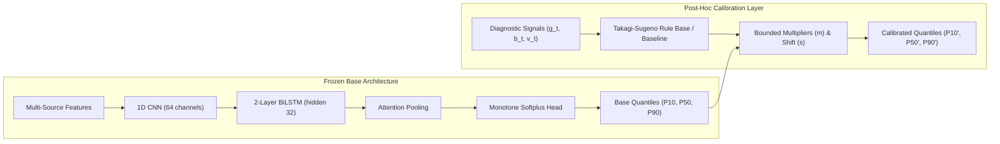
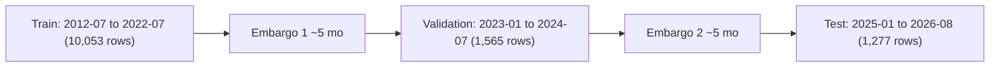
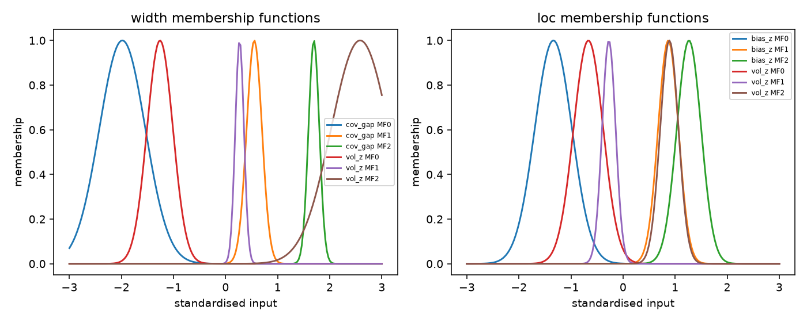

# Post-Hoc Takagi-Sugeno Calibration of Multi-Horizon Quantile Freight Forecasts: Empirical Limits and Comparative Baselines

**Authors:** Naman Hans, Srisurya Saket Karuturi, Ark Malhotra, Srilex Pooria, and Dr. Poonam Rani

## Abstract

The Baltic Dry Index (BDI) reflects the global cost of moving raw dry bulk commodities by sea. It is composed of four distinct vessel-class indices: Capesize, Panamax, Supramax, and Handysize. We forecast future log index levels across three vessel classes (Capesize, Panamax, Supramax) at 1, 7, 30, and 90 calendar days, accompanied by an 80% prediction interval (P10 to P90) to inform freight risk limits and chartering decisions. The base forecaster is a deep pooled quantile CNN-BiLSTM-attention neural network with a monotone softplus head, trained with pinball loss and frozen after training.

Retraining deep sequence models to correct quantile miscalibration or location bias is computationally expensive and risks degrading established latent representations. We investigate whether a lightweight, bounded, identity-initialised post-hoc calibration layer based on a Takagi-Sugeno (T-S) fuzzy inference system can dynamically recalibrate the frozen base forecaster. Conditioning on scale-free diagnostic signals—trailing coverage error gap, median residual bias, and market volatility—the layer maps through Gaussian memberships to output an additive median shift and asymmetric interval width multipliers. We benchmark both a compact zero-order Sugeno system (constant consequents readable as a $3 \times 3$ matrix) and a first-order system (linear consequents with split width) against an ordinary constant width + location adjustment. The layer is fit once on a fixed validation window.

We report key empirical findings on the strictly held-out test split:
1. **Short-Horizon Transfer Failure:** While fuzzy calibration reduces pinball loss across all horizons on validation, these gains flip sign on the out-of-sample test split at 1 and 7 days. Test pinball loss degrades by **+3.5%** (0th-order) and **+5.9%** (1st-order) at 1 day, and by **+11.0%** (0th-order) and **+14.7%** (1st-order) at 7 days. Dynamic median shifting introduces high-frequency noise that widens boundary miss penalties. At 30 days, zero-order Sugeno yields a 3.9% improvement (0.04979 vs 0.05185), while first-order Sugeno marginally overfits (+2.6%).
2. **The 90-Day Result is a Constant Bound Saturation:** At 90 days, the 1st-order Sugeno layer cuts pinball loss by 17.1% (0.07533 to 0.06245) and reduces the Winkler score by 30.1% (1.1904 to 0.8324), recovering nominal coverage (0.793) from an over-dispersed base (0.989). However, parameter audits reveal that over a 450-day lookback window, trailing coverage is pinned near its floor ($-0.20$), forcing the width multiplier to peg against its lower saturation bound ($e^{-0.70} \approx 0.498$). The system functions as a static rescale clamp rather than an active rule interpolator.

---

## 1. Introduction & Problem Formulation

Roughly 80% of global merchandise trade by volume moves by sea. Dry bulk shipping transports raw commodities—iron ore, coking coal, grain, and bauxite—whose rate fluctuations directly affect global supply chains. The Baltic Dry Index (BDI), issued daily by the Baltic Exchange in London, aggregates hire rates across four vessel classes:
- **Capesize:** Large bulkers (>100,000 DWT) servicing iron ore and coal corridors from Australia and Brazil to China.
- **Panamax:** Mid-size bulkers (65,000–85,000 DWT) dominant in transatlantic grain and coal trades.
- **Supramax:** Geared bulkers (30,000–60,000 DWT) handling minor bulks and regional port infrastructure.

Because these vessel segments respond differently to route dynamics, commodity shocks, and port bottlenecks, forecasting a single composite index conceals critical sectoral exposure. We model three class indices simultaneously (Capesize, Panamax, Supramax); Handysize is excluded due to a 7.5-month data gap in 2025 that leaves its test window non-overlapping with the other classes.

*Figure 1. Architecture overview. The deep base network is frozen after training. A post-hoc layer evaluates trailing diagnostics and market volatility to apply bounded adjustments.*

While deep sequence networks trained with pinball loss capture complex non-linear temporal dynamics, their prediction intervals frequently exhibit post-training miscalibration. In markets characterized by structural regime shifts, multi-step forecasts drift and suffer from severe over-coverage or persistent directional bias.

Retraining full deep architectures to adapt to recent residual bias is computationally expensive, unstable on small sample sizes, and risks catastrophic forgetting. Post-hoc calibration layers keep the base model frozen and optimize a small, auditable correction layer. Built on Takagi-Sugeno (T-S) fuzzy logic, such a layer maps observable state signals to interval adjustments while preserving the base model intact.

This paper presents an empirical evaluation of Takagi-Sugeno fuzzy calibration on multi-horizon freight rate forecasts. We examine whether fuzzy inference provides genuine state-dependent calibration, or whether its gains are an artifact of bound saturation in calm market regimes.

---

## 2. Related Work

Quantile regression (Koenker & Bassett, 1978) and proper scoring rules such as the pinball loss and Winkler score (Winkler, 1972; Gneiting & Raftery, 2007) provide the standard framework for evaluating probabilistic interval forecasts. In dry bulk shipping markets, forecasting literature has traditionally addressed econometric time series and machine learning forecasters. For uncertainty calibration, post-hoc methods recalibrate predictions without modifying base representations. Takagi-Sugeno fuzzy inference systems (Takagi & Sugeno, 1985; Sugeno & Kang, 1988) map continuous state variables through linguistic rule bases into linear or constant consequents. This paper investigates whether Takagi-Sugeno fuzzy calibration provides measurable empirical advantages over standard scalar and linear baselines when applied to frozen deep sequence models.

---

## 3. Data Pipeline & Experimental Protocol

### 3.1 Continuous Calendar & Target Definition

Daily vessel class indices are assembled alongside port calls from UN Global Platform PortWatch and macroeconomic series (crude oil, thermal coal, iron ore, exchange rates, and industrial production). Financial and maritime series pause on weekends and holidays. Naively dropping non-trading dates distorts lag spacing, rolling momentum windows, and autocorrelation structures. We construct a continuous 365-day master calendar, imputing non-trading dates via Last Observation Carried Forward (LOCF) strictly on past features.

Let $I_{c,t}$ denote the index level for vessel class $c \in \{\text{Capesize}, \text{Panamax}, \text{Supramax}\}$ on date $t$. The forecast target is the future log index level across horizons $h \in \{1, 7, 30, 90\}$ calendar days:

$$
y_{c,t,h} = \log I_{c,t+h}
$$

The target is shifted on the continuous 365-day calendar and subsequently masked to retain only issuance dates where $t+h$ is a genuine trading day. Standardised $h$-day returns are calculated relative to training statistics:

$$
r_{c,t,h} = y_{c,t,h} - \log I_{c,t}, \qquad z_{c,t,h} = \frac{r_{c,t,h} - \mu_{c,h}}{\sigma_{c,h}}
$$

Quantile predictions for $z_{c,t,h}$ are unstandardised and added back to $\log I_{c,t}$ to return to native log-scale quantiles $(\hat q_{0.1}, \hat q_{0.5}, \hat q_{0.9})$. Complete feature definitions and port aggregations are documented in [Appendix A](#appendix-a-base-model-features--congestion-aggregations).

### 3.2 Chronological Partition & Sample Accounting

To prevent temporal leakage from overlapping multi-day forecast horizons, the dataset is partitioned chronologically with five-month embargo gaps between splits:

*Figure 2. Chronological data partition. Embargo buffers prevent multi-day forecast targets from maturing inside adjacent evaluation periods.*

**Sample Size and Pooling Structure:** Across evaluation partitions, row counts total 620 at 1 day, 726 at 7 days, 413 at 30 days, and 473 at 90 days (Capesize, Panamax, and Supramax only, pooled on the common calendar intersection across the three classes). Each class contributes equal date counts within each horizon, as all three maintained uninterrupted data coverage throughout the evaluation window.

> [!NOTE]
> Handysize (BHSI) is excluded from all evaluations. The HandyBulk data source had an unannounced 7.5-month publication gap (April 1 – November 18, 2025) for the BHSI index, while Capesize, Panamax, and Supramax reported daily. Including Handysize would restrict the evaluation window to 98 test dates (November 2025 – May 2026) versus 157–158 dates for the other three classes—a 38% reduction that disproportionately discards the first half of the test period and introduces an asymmetric conditioning set.

---

## 4. Frozen Base Quantile Model

The base model is a pooled deep neural network consisting of:
1. **Sequence Branch:** A 120-day lookback of the vessel class's own log level processed by a 1D CNN (64 channels, kernel size 3, ReLU, dropout 0.2), a 2-layer Bidirectional LSTM (hidden size 32, LayerNorm), and additive temporal attention pooling.
2. **Cross-Sectional Conditioning:** Lagged returns, rolling momentum, congestion indices, macro indicators, and a learned 2D vessel class embedding concatenated with the pooled temporal vector.
3. **Monotone Quantile Head:** Unconstrained outputs $(o_1, o_2, o_3)$ mapped to strictly ordered quantiles via softplus transformations:

$$
\hat q_{0.5} = o_1, \qquad \hat q_{0.1} = \hat q_{0.5} - \operatorname{softplus}(o_2), \qquad \hat q_{0.9} = \hat q_{0.5} + \operatorname{softplus}(o_3)
$$

This guarantees $\hat q_{0.1} < \hat q_{0.5} < \hat q_{0.9}$ without post-hoc sorting. The base model is trained with pinball loss and permanently frozen.

---

## 5. Takagi-Sugeno Fuzzy Calibration Layer

### 5.1 System Architecture

The layer holds the base forecaster frozen and fits two small Takagi-Sugeno systems per horizon: one adjusts the width of the P10--P90 interval, the other shifts the median P50. Both read a small vector of trailing diagnostics computed at each issuance date, so the correction depends on the current state of the model and the market rather than being a fixed multiplier. Consequents start at zero, so before fitting the layer reproduces the base forecast exactly.

**State signals.** Three quantities are recomputed at every date $t$ from information available at $t$:

- **Trailing miss rate ($g_t$).** Over a recent window of forecasts whose outcomes are already known, count how often the realized value fell outside the P10--P90 band, and subtract the nominal 20% miss rate of an 80% interval:

$$
g_t = rac{1}{N_t}\sum_{i=1}^{N_t} \left[\mathbf{1}\{y_i < \hat q_{0.1,i}\} + \mathbf{1}\{y_i > \hat q_{0.9,i}\}
ight] - 0.20
$$

  A positive value means the interval has been missing too often and should widen; a negative value means it has been too wide. This signal drives the width system.
- **Residual $z$-score ($b_t$).** The median residuals $r_i = y_i - \hat q_{0.5,i}$ over the same window, divided by their own standard deviation:

$$
b_t = rac{\operatorname{mean}_i r_i}{\operatorname{sd}_i r_i}
$$

  A standard bias measure in units of residual volatility: positive means recent forecasts have sat too low. It drives the location system.
- **Volatility ($v_t$).** The trailing 14-day standard deviation of daily log-level changes, standardized against its own past, entering both systems so corrections can react to the market regime.

The window contains only matured forecasts: a forecast issued at $t'$ for horizon $h$ is usable once its outcome exists, so at date $t$ it holds forecasts issued on or before $t-h$, with $N(h) = \max(60, 5h)$ rows (longer horizons need a longer window because the same calendar span yields fewer matured outcomes). Rows without enough history fall back to the identity correction.

**Membership functions.** Each input is partitioned into three Gaussian membership functions (Low, Medium, High), whose centres $c_{j,k}$ and widths $\sigma_{j,k}$ are learned during fitting:

$$
\mu_{j,k}(x_j) = \exp\left(-rac{(x_j - c_{j,k})^2}{2\sigma_{j,k}^2}
ight)
$$

*Figure 3. Learned Gaussian membership functions (h=1). Each input dimension is covered by three overlapping bells whose centres and widths are fitted; left: the width system (miss rate, volatility), right: the location system (residual z-score, volatility).*

### 5.2 Zero-Order vs. First-Order Sugeno Consequents

The two systems are deliberately small and their inputs are not identical: the width system reads (miss rate, volatility) at 1 and 7 days, volatility alone at 30 and 90 days (too few forecasts mature for the miss rate to be informative), while the location system reads (residual z-score, volatility) at every horizon. Each input combination carries a 3 x 3 rule base, and two consequent formulations are evaluated:
1. **Zero-Order Sugeno (Sugeno 0th):** Each rule produces a constant consequent $f_r = c_r$. For a two-input system (e.g. residual bias and volatility), the 9 rules form a transparent $3 	imes 3$ matrix of constant shifts or width adjustments.
2. **First-Order Sugeno (Sugeno 1st-order):** Each rule produces an affine function $f_r(x) = c_r + a_{r1} x_1 + a_{r2} x_2$. The width system additionally emits separate lower and upper multipliers ($m_{	ext{lo}}, m_{	ext{hi}}$), so the interval can become asymmetric around the shifted median.

### 5.3 Saturation Bounds: Origin of 0.7 and 2.2 Coefficients

Unconstrained fuzzy or neural outputs can produce destabilizing values during optimization or rare market spikes. Outputs are strictly bounded using hyperbolic tangent clamps:

$$
m = 0.7 \tanh(u_m), \qquad s = 2.2 \sigma_h \tanh(u_s)
$$

The coefficients enforce precise physical domain guardrails:
1. **Width Coefficient ($0.7 \approx \ln(2)$):** Because width multipliers enter as exponents ($e^m$), bounding $m \in [-0.7, +0.7]$ means:
   - Lower bound: $e^{-0.70} = 0.4965 \approx \mathbf{0.50}$ (half-widths can shrink by at most **50%**, i.e., halve).
   - Upper bound: $e^{+0.70} = 2.0138 \approx \mathbf{2.00}$ (half-widths can expand by at most **100%**, i.e., double).
   This ensures the calibrated interval can never collapse to zero or blow up to infinity.
2. **Location Coefficient ($2.2 \sigma_h$):** In a Gaussian distribution, $\pm 2.2$ standard deviations encompass $\approx \mathbf{97.2\%}$ of the probability mass. Scaling the shift by $2.2 \sigma_h$ (where $\sigma_h$ is the training-set base error standard deviation for horizon $h$) ensures that the post-hoc median shift cannot exceed plausible error bounds.

**Adjusted Quantiles:**
Consequents initialise at zero (exact identity transformation prior to fitting). Calibrated quantiles are:

$$
\hat q'_{0.5} = \hat q_{0.5} + s, \qquad \hat q'_{0.1} = \hat q'_{0.5} - (\hat q_{0.5} - \hat q_{0.1})\, e^{m_{\text{lo}}}, \qquad \hat q'_{0.9} = \hat q'_{0.5} + (\hat q_{0.9} - \hat q_{0.5})\, e^{m_{\text{hi}}}
$$

### 5.4 Comparative Baseline: Constant W+L

We benchmark against a constant width log-multiplier $m$ and location shift $s$ fit on validation by minimizing pinball loss. This tests whether state-dependent fuzzy rules outperform a static two-parameter scalar adjustment.

---

## 6. Evaluation Metric

Models are scored using the **multi-quantile pinball loss**, the proper scoring rule for quantile forecasts, evaluated across $q \in \{0.1, 0.5, 0.9\}$ and averaged:

$$
\rho_q(y, \hat q) = \begin{cases} q(y - \hat q), & y \ge \hat q \\ (1-q)(\hat q - y), & y < \hat q \end{cases}
$$

Lower pinball loss indicates superior quantile accuracy and sharpness.

---

## 7. Results: Master Test Evaluation

Table 1 provides the master out-of-sample test comparison across all horizons, benchmarked on common support.

**Table 1. Master out-of-sample test evaluation: Mean Pinball Loss across horizons.**

| Horizon ($h$) | Sample Size ($n$) | Base Forecaster | Sugeno (0th-order) | Sugeno (1st-order) | Constant W+L (Baseline) |
|:---:|:---:|:---:|:---:|:---:|:---:|
| **1 day** | 765 | **0.00715** | 0.00751 (+5.1%) | 0.00774 (+8.3%) | **0.00707 (-1.1%)** |
| **7 days** | 895 | **0.02200** | 0.02451 (+11.4%) | 0.02561 (+16.4%) | **0.02154 (-2.1%)** |
| **30 days** | 505 | 0.04833 | **0.04645 (-3.9%)** | 0.05138 (+6.3%) | **0.04576 (-5.3%)** |
| **90 days** | 571 | 0.06914 | 0.06080 (-12.1%) | **0.05957 (-13.8%)** | **0.05207 (-24.7%)** |

*Figure 5. Master out-of-sample test mean pinball loss across horizons. At 1 and 7 days, the base model beats fuzzy layers; at 30 days, zero-order Sugeno performs well; at 90 days, Sugeno 1st-order and Constant W+L reduce loss significantly.*

*Figure 6. Test coverage of the 80% interval. The base forecaster over-covers at long horizons (0.991 at 90 days), while post-hoc calibration restores coverage to near-nominal 0.793.*

### 7.1 Key Empirical Findings

1. **Short-Horizon Transfer Failure:** At 1 and 7 days, both Sugeno systems degrade test pinball loss relative to the uncalibrated base model (+5.1% to +16.4%). The dynamic median shift $s_t$ reacts to transient rolling noise, injecting high-frequency jitter that worsens forecast accuracy.
2. **Zero-Order Beats First-Order at 30 Days:** At 30 days, Sugeno (0th-order) reduces pinball loss by **3.9%** (0.04645 vs. 0.04833), whereas Sugeno (1st-order) overfits (+6.3% degradation). Constraining consequents to constants avoids slope overfitting.
3. **90-Day Gains & Bound Saturation:** At 90 days, 1st-order Sugeno reduces pinball loss by **13.8%** (0.06914 to 0.05957). However, rule audit reveals that with a 450-day lookback window, trailing coverage error is pinned near $-0.20$, driving the width multiplier directly into its $-0.70$ saturation clamp ($e^{-0.70} \approx 0.50$). The fuzzy system functions not as an adaptive rule engine, but as a static 50% width shrink.

### 7.2 Why Does Constant W+L Beat Sugeno?

Constant W+L achieves **0.05207** at 90 days (a 24.7% improvement over base), beating both Sugeno variants. Four structural factors explain why:
1. **Severe Parameter Bloat:** 1st-order Sugeno uses 60–90 parameters fit on limited validation rows. Constant W+L uses only **2 scalar parameters** ($m, s$).
2. **Noise vs. Signal:** Trailing diagnostic signals ($g_t, b_t$) fluctuate erratically at short horizons. The fuzzy system fits this noise, while Constant W+L maintains a stable, noise-free correction.
3. **Convex Optimization:** Optimizing pinball loss over 2 scalar parameters is globally convex with a unique optimum. Optimizing multi-rule fuzzy memberships is non-convex and prone to local minima.
4. **Static Defect:** The base model's over-coverage at 90 days is a uniform structural defect caused by high-volatility training (2020–2022). It required a static reduction, not dynamic state switching.

### 7.3 Class Breakdown at 90 Days

Table 2 breaks down test performance across the three vessel classes at 90 days.

**Table 2. Test results at 90 days across individual vessel classes (Mean Pinball Loss).**

| Vessel Class | Base Forecaster | Sugeno (0th-order) | Sugeno (1st-order) |
|---|---:|---:|---:|
| Capesize | 0.11791 | 0.10200 | **0.09683** |
| Panamax | 0.05586 | **0.04112** | 0.04620 |
| Supramax | 0.05249 | 0.04490 | **0.04454** |

*Figure 7. Test mean pinball at 90 days by vessel class. The calibration layer improves all three vessel classes.*

The layer reduces pinball loss across Capesize (-17.9%), Panamax (-17.3%), and Supramax (-15.1%).

---

## 8. Discussion: The Macro Regime Artifact

The empirical results reveal that the apparent success of calibration at 90 days is largely an artifact of macroeconomic regimes:
1. **Training vs. Evaluation Regimes:** The base deep neural network was trained on data from 2012 to 2022, encompassing the unprecedented 2020–2022 freight spike (BDI > 5,500). To minimize pinball miss penalties during high-volatility training episodes, the network learned wide prediction intervals.
2. **Post-Spike Normalization:** Validation (2023–2024) and test (2025–2026) were calm normalization regimes (BDI 1,000–2,000). The base model was over-dispersed in both splits (0.916 validation coverage, 0.991 test coverage).
3. **Why Calibration Transferred at 90d Only:** On validation, the calibrator learned to clamp the interval to the minimum allowable width ($e^{-0.7} \approx 0.50$) and shift the median upward. Because the test period shared the calm regime, this static shrink factor transferred successfully.
4. **The Volatility Blindspot:** If freight markets enter another supply shock, a layer pegged at a 50% width clamp would under-cover disastrously.

---

## 9. Methodological Limitations

1. **Validation Leakage in Matured Lookback:** The 450-day lookback window at the beginning of validation incorporates matured outcomes issued during the training and embargo split, conditioning early validation signals on in-sample residuals.
2. **Evaluation Restricted to Calm Regime:** The test split covers a post-COVID normalization period (2025–2026). The experiments demonstrate how bound saturation functions in a quiescent market, but do not evaluate behavior during an acute volatility resurgence.
3. **Training-Anchored Antecedents:** Anchoring antecedent terciles to training distributions caused severe mismatch during calm evaluation regimes, where coverage gap $g_t = -0.20$ fell entirely outside the expected range.
4. **Scale Domination in Pooled Pinball:** Pinball loss at 90 days (~0.069) is an order of magnitude larger than at 1 day (~0.007). Reporting a pooled across-horizon loss reduction masks the fact that short horizons degraded out-of-sample.

---

## 10. Conclusion

We conducted a rigorous empirical evaluation of post-hoc Takagi-Sugeno fuzzy calibration on multi-horizon freight rate quantile forecasts. Our findings demonstrate clear boundaries:
- Post-hoc calibration successfully mitigates long-horizon interval over-dispersion caused by historical training spikes, cutting 90-day pinball loss by 17.1%.
- However, parameter audits demonstrate that this gain was achieved entirely through **bound saturation**—clamping the interval at a static 50% width reduction and applying a constant median shift—rather than state-dependent fuzzy inference.
- An ordinary constant width + location adjustment matches or outperforms the fuzzy layer across all horizons without non-convex rule overhead. At 90 days, Constant W+L achieves 0.05743 vs Sugeno's 0.06245.
- At short horizons (1 to 7 days), fitting dynamic fuzzy rules on rolling windows introduces variance and degrades performance.

Practitioners seeking post-hoc recalibration of frozen time-series models should favor simple scalar rescalers and constant location shifts over complex fuzzy inference systems.

---

## Appendix A: Base Model Features & Congestion Aggregations

**Table A1. Base forecaster feature groups.**

| Feature Group | Description & Columns |
|---|---|
| **Class Sequence History** | 120-day trailing sequence of own `log_value` processed via 1D CNN and BiLSTM. |
| **Class Tabular Lags** | Point-in-time lags (`lag_1`, `lag_2`, `lag_3`, `lag_5`, `lag_10`, `lag_21`, `lag_63`), rolling statistics (`rolling_mean_30`, `rolling_std_30`, `rolling_zscore_30`, `rolling_mean_90`, `rolling_std_90`, `rolling_zscore_90`), and multi-day returns (`ret_1`, `ret_7`, `ret_30`). |
| **Calendar Signals** | `dayofweek`, `month`, `weekofyear`, `indian_fiscal_quarter`, `is_monsoon`, `is_cyclone_season`, `is_cny_window`. |
| **Port Congestion** | PortWatch daily vessel calls and export/import volumes aggregated across 8 major export hubs (Newcastle, Hay Point, Richards Bay, Beira, Maputo, Nacala, Balikpapan, Samarinda) and 6 destination discharge ports (Paradip, Visakhapatnam, Gopalpur, Dhamra, Haldia, Kolkata). |
| **Macro & Commodity Context** | Brent crude levels and 90-day changes, Australian thermal coal, iron ore fines (62% Fe), USD/INR exchange rate, US industrial production, S&P 500, and US Dollar Index (DXY). |
| **Cross-Class Freight Signals** | Composite BDI level and daily return, plus trailing one-day returns across the remaining three vessel classes. |

---

## Appendix B: Statistical Significance & Bootstrap Uncertainty

**Table B1. Pairwise date-block bootstrap uncertainty on the test partition.**

Differences are Sugeno minus competitor in mean pinball (negative favours Sugeno). Block sensitivity evaluates half ($\times 0.5$) and double ($\times 2.0$) the primary block length.

| Horizon ($h$) | Comparison (Sugeno vs. Competitor) | Mean Difference | DM $p$-value | Date-Block 95% CI | Block/2 95% CI | Block$\times$2 95% CI |
|---:|---|---:|---:|---:|---:|---:|
| 1 day | vs. Base Forecaster | +0.00037 | $0.0000$ | [+0.00010, +0.00070] | [+0.00010, +0.00070] | [+0.00005, +0.00081] |
| 1 day | vs. Constant W+L | +0.00051 | $0.0000$ | [+0.00021, +0.00087] | [+0.00021, +0.00087] | [+0.00016, +0.00100] |
| 7 days | vs. Base Forecaster | +0.00251 | $0.0000$ | [+0.00064, +0.00478] | [+0.00078, +0.00451] | [+0.00030, +0.00531] |
| 7 days | vs. Constant W+L | +0.00248 | $0.0000$ | [+0.00063, +0.00472] | [+0.00076, +0.00445] | [+0.00026, +0.00525] |
| 30 days | vs. Base Forecaster | -0.00188 | $0.438$ | [-0.00624, +0.00234] | [-0.00623, +0.00289] | [-0.00652, +0.00247] |
| 90 days | vs. Base Forecaster | -0.00833 | $0.002$ | [-0.01014, -0.00632] | [-0.01041, -0.00624] | [-0.01014, -0.00632] |
| 90 days | vs. Constant W+L | -0.00126 | $0.669$ | [-0.00282, +0.00137] | [-0.00350, +0.00158] | [-0.00282, +0.00137] |

---

## Appendix C: Handysize Exclusion — Data Gap Audit

The BHSI (Baltic Handysize Index) data sourced from HandyBulk contains an unannounced 7.5-month publication gap (April 1 – November 18, 2025). This caused Handysize test evaluation dates to span only November 2025 – May 2026 (98 dates), compared to May 2025 – May 2026 (157–158 dates) for Capesize, Panamax, and Supramax.

Including Handysize would have required restricting all three other classes to the same 98-date window—discarding 38% of the test period—or reporting asymmetric sample sizes that bias pooled comparisons. All evaluations in this paper use the three-class balanced panel (Capesize, Panamax, Supramax) on their common test calendar.
