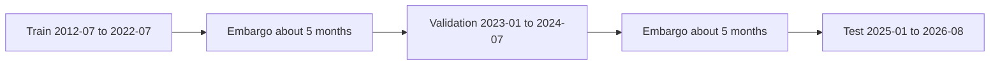
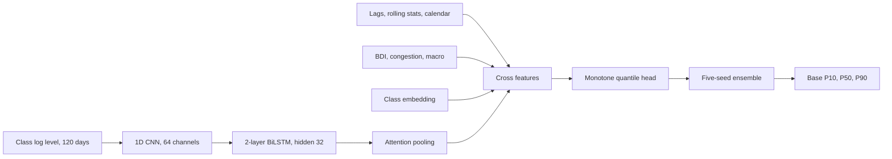
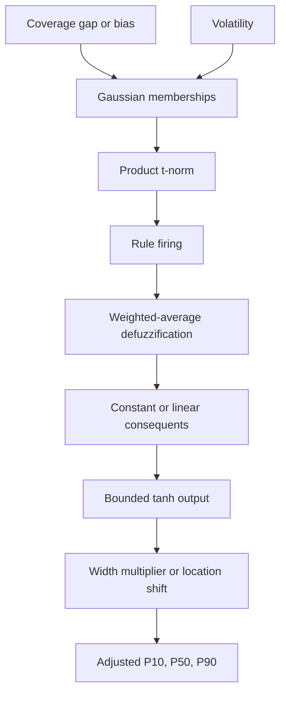
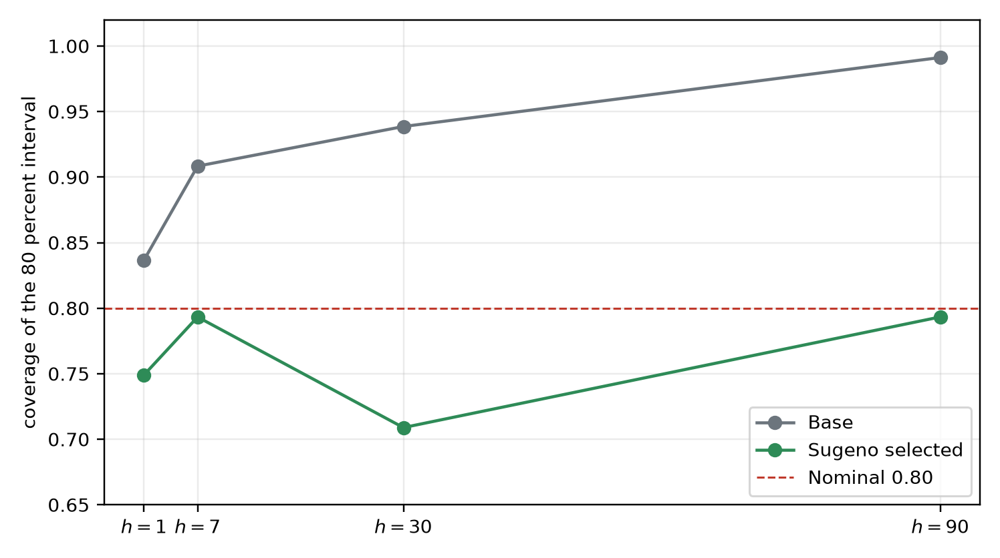
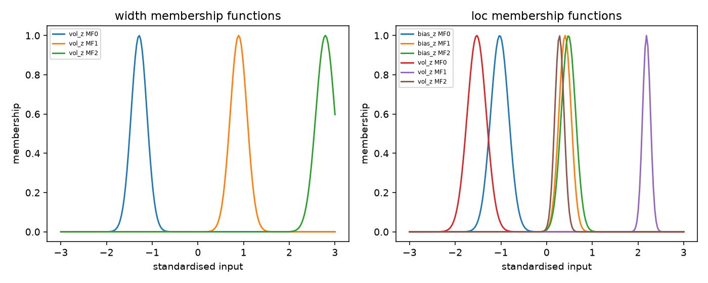

# Sugeno Fuzzy Calibration of Quantile Forecasts for Baltic Dry Index Vessel Classes

**Authors:** Naman Hans, Srisurya Saket Karuturi, Ark Malhotra, Srilex Pooria, and Dr. Poonam Rani

## Abstract

The Baltic Dry Index describes the cost of moving dry bulk cargo by sea. It is not one series but a family of vessel-class indices: Capesize, Panamax, Supramax, and Handysize. We forecast the future log level of those four class indices at 1, 7, 30, and 90 days. We also produce an 80 percent interval around each forecast, because a chartering decision needs a range, not only a point. The Baltic Dry Index itself is used only as a cross-series input and is never a target.

The base forecaster is a pooled quantile CNN-BiLSTM-attention model trained with pinball loss. The convolutional layer picks up short local patterns in the class history, the bidirectional LSTM captures longer-range dependence, and attention pools the history into a summary vector. A monotone head turns that summary into P10, P50, and P90. A five-seed ensemble averages the quantiles.

After the base model is frozen, we add two small Takagi-Sugeno fuzzy systems. One controls interval width. The other controls location, meaning the median forecast. They use Gaussian memberships, product t-norm, weighted-average defuzzification, and bounded outputs. Their consequents start at zero, so the untrained layer leaves the base forecast unchanged. We test zero-order and first-order consequents, symmetric and separate lower/upper width multipliers, and pooled and class-aware variants. The validation-selected layer uses first-order consequents with separate width multipliers.

The result is mixed. On validation, the selected layer beats the base at every horizon and gives the lowest pooled pinball loss, 0.03201 against 0.04158. On the one-shot test, it is worse than the base at 1, 7, and 30 days and better only at 90 days. At 90 days it lowers pinball from 0.06914 to 0.05957 and moves coverage from 0.991 to 0.793. Four simple calibrators still beat it at every test horizon. The fuzzy layer is useful as a compact, auditable correction, but the experiment does not show that fuzzy structure is necessary.

## 1. What Are We Predicting?

Roughly 80 percent of global merchandise trade by volume moves by sea. Dry bulk is the part that carries iron ore, coal, grain, bauxite, and similar cargoes. The Baltic Dry Index tracks the cost of hiring a ship for those cargoes, not the price of the cargo itself. It is published daily by the Baltic Exchange in London and is built from time-charter equivalent rates across four vessel classes.

The classes are not interchangeable. Capesize vessels carry the largest cargoes and are tied to iron ore and coal flows. Panamax sits in the middle. Supramax and Handysize are smaller and more flexible, and they respond more to regional congestion and minor bulk trade. A single aggregate index hides this variation, so we model each class separately while letting the four classes share one network.

The applied problem is not only to forecast a level. A chartering desk may need the 10th and 90th percentiles of the future log index level because the downside percentile drives risk limits and the upside percentile drives option-like decisions. A point forecast cannot express that risk. A quantile forecast can.

Deep sequence models can produce quantiles, but their intervals are often miscalibrated. A network trained with pinball loss may over-cover at long horizons because the training signal is dominated by large moves, or under-cover in quiet periods because it has learned an average width. The right width and location depend on the current market state. When volatility is high and recent forecasts have missed, the interval should usually be wider. When recent forecasts have been too low, the median should usually move up. A fixed post-hoc multiplier cannot express that state dependence.

This paper asks a narrow question: can a small, interpretable fuzzy layer correct a strong quantile base model in a state-dependent way? We do not propose a new base forecaster. We add two small Takagi-Sugeno systems on top of a frozen network, fit them on validation only, and compare them with simpler calibrators. The comparison is the point.

## 2. Where This Fits Prior Work

Maritime forecasting has a long history of index-level models. Work on dry bulk indices has used fuzzy time series, econometric models, and neural networks, often with the Baltic Dry Index as the target. The fuzzy time series literature initiated by Song and Chissom gives us the vocabulary of fuzzy sets, membership functions, and rule-based transitions. Su, Park, and Bae study vessel-class index forecasting, which is close in spirit to our class-level target, and recent work applies adaptive neuro-fuzzy inference to the Baltic Dry Index. These works motivate fuzzy systems, but they generally operate on a single aggregate series. Our target is four class indices, and our fuzzy layer is a calibrator rather than a standalone forecaster.

Takagi-Sugeno systems use constant or linear consequents, so the output is a weighted average of local models. A zero-order system is small, bounded, and easy to audit, which fits a calibration layer. The rule base can be written as a table, although overlapping Gaussian memberships mean that individual rules should not be over-interpreted. Quantile regression was formalised by Koenker and Bassett. The pinball loss is the standard objective, and the Winkler score evaluates interval forecasts by combining width and penalties for misses. The base model is a CNN-BiLSTM-attention network: convolutional layers capture local patterns, a bidirectional LSTM captures longer-range dependence, and attention pools the history with learned weights. Post-hoc calibration is well established. Our contribution is a specific bounded fuzzy form and an audit of what it learns, not a claim that fuzzy rules are always the best calibrator.

## 3. Data, Step by Step

The paper follows the same order as the notebook that produced it: load the indices, build features, shift targets, split time, fit the base model, fit the calibrator, and score. The order matters because the target shift and the market-day mask have to happen in the right sequence.

### 3.1 Load the indices

The class indices are assembled from investing.com and HandyBulk backfill. Port congestion comes from PortWatch daily port calls at selected origin and destination ports. Macro and commodity series cover Brent crude, Australian coal, iron ore, USD/INR, US industrial production, the S&P 500, and the US dollar index. The Baltic Dry Index enters as a cross-series input only.

Table 1 lists the exact feature columns. The current class's own `log_value` is the only sequence input. Every other column is a cross-sectional feature attached at the forecast date. This is a deliberate simplification: the sequence model learns the shape of the class's own history, while the head sees the wider market state once per forecast.

**Table 1. Feature columns used by the base model.**

| Group | Exact columns |
|---|---|
| Class history | `log_value`, `lag_1`, `lag_2`, `lag_3`, `lag_5`, `lag_10`, `lag_21`, `lag_63`; `rolling_mean_30`, `rolling_std_30`, `rolling_zscore_30`, `rolling_mean_90`, `rolling_std_90`, `rolling_zscore_90`; `ret_1`, `ret_7`, `ret_30` |
| Calendar | `dayofweek`, `month`, `weekofyear`, `indian_fiscal_quarter`, `is_monsoon`, `is_cyclone_season`, `is_cny_window` |
| Port congestion | `congestion_origin_calls`, `congestion_dest_calls`, `congestion_origin_exports_log1p`, `congestion_dest_imports_log1p` |
| Macro | `macro_brent_level`, `macro_brent_chg_90d`, `macro_coal_au_level`, `macro_coal_au_chg_90d`, `macro_iron_ore_level`, `macro_iron_ore_chg_90d`, `macro_usd_inr_level`, `macro_usd_inr_chg_90d`, `macro_us_indpro_level`, `macro_us_indpro_chg_90d`, `MACRO_SP500`, `MACRO_DXY` |
| Cross-series | `cross_BDI_log_level`, `cross_BDI_ret_1`, and the one-day returns of the other three class indices |

The congestion block aggregates port calls over eight origin ports (Newcastle, Hay Point, Richards Bay, Beira, Maputo, Nacala, Balikpapan, and Samarinda) and six destination ports (Paradip, Visakhapatnam, Gopalpur, Dhamra, Haldia, and Kolkata). The macro levels and their 90-day changes are joined as of the forecast date, so a row never sees a value published after its own date.

### 3.2 Build features on a continuous calendar

The class indices are not published on weekends or holidays. Dropping those days would break lags and rolling windows, so we build a continuous 365-day calendar and forward-fill missing feature values. The target is not forward-filled. It is shifted on the continuous grid and then masked to real market days.

This order is important. We shift on the continuous grid so the horizon is exactly 1, 7, 30, or 90 calendar days, then keep only rows whose target date is a real market day. A weekend or holiday is never treated as a one-day move, and the horizon is never silently shortened by dropping rows first.

### 3.3 Shift targets

Let $I_{c,t}$ be the index level for vessel class $c \in \{\text{Capesize}, \text{Panamax}, \text{Supramax}, \text{Handysize}\}$ on date $t$. The target is the future log index level:

$$
y_{c,t,h} = \log I_{c,t+h},
$$

for horizons $h \in \{1, 7, 30, 90\}$ calendar days. For each class and horizon we predict the 10th, 50th, and 90th percentiles of $y_{c,t,h}$, written as $\hat q_{0.1}$, $\hat q_{0.5}$, and $\hat q_{0.9}$.

Logs are used because the indices are positive and highly skewed. A log transform makes percentage moves additive and turns a width multiplier into a natural object. For each class and horizon, the $h$-day log return is standardised using training-period means and standard deviations:

$$
r_{c,t,h} = y_{c,t,h} - \log I_{c,t}, \qquad
z_{c,t,h} = \frac{r_{c,t,h} - \mu_{c,h}}{\sigma_{c,h}}.
$$

The network predicts quantiles of $z_{c,t,h}$. We then undo the standardisation and add $\log I_{c,t}$ back to return to log-level quantiles. This keeps the calibration layer in the same space as the final forecast.

### 3.4 Split time, not rows

We use one chronological split with two embargo gaps. The gaps are larger than the longest lag plus the longest horizon, so a forecast issued near the end of one period cannot mature inside the next period. The test period is read once.

*Figure 1. Chronological split. The two embargoes separate fitting, selection, and the one-shot test read.*

Table 2 gives the dates and row counts before horizon masking. The common-support sample sizes, which are the rows available for all models and all four classes at a given horizon, are 765 for 1 day, 895 for 7 days, 505 for 30 days, and 571 for 90 days. The 30-day count is lower than the 90-day count because a fixed calendar-day offset keeps a different weekday mix at each horizon.

**Table 2. Chronological split and sample sizes.**

| Split | Start | End | Rows before horizon masking |
|---|---|---|---:|
| Training | 2012-07-04 | 2022-07-25 | 10,053 |
| Embargo 1 | 2022-07-26 | 2023-01-02 | not used for fitting |
| Validation | 2023-01-03 | 2024-07-25 | 1,565 |
| Embargo 2 | 2024-07-26 | 2025-01-01 | not used for fitting |
| Test | 2025-01-02 | 2026-08-20 | 1,277 |

## 4. Base Quantile Model

The base model is a pooled quantile CNN-BiLSTM-attention network. It is pooled over the four classes but trained separately for each horizon. Pooling matters because class-level samples are small, especially for Handysize, and the four indices share common drivers. Training one model per horizon keeps the output scale and the meaning of the quantiles stable.

*Figure 2. Base architecture. Only the class's own log level enters the sequence branch; the remaining features enter once at the head.*

The quantile head is monotone by construction. Let the raw outputs be $o_1, o_2, o_3$. We set:

$$
\hat q_{0.5} = o_1, \qquad
\hat q_{0.1} = \hat q_{0.5} - \operatorname{softplus}(o_2), \qquad
\hat q_{0.9} = \hat q_{0.5} + \operatorname{softplus}(o_3).
$$

Because softplus is positive, the 10th percentile is always below the median and the 90th percentile is always above it. No sorting step is needed. The head biases are initialised to the training-set empirical half-widths for the horizon, so the untrained head starts with sensible widths instead of collapsing to a point.

The sequence branch receives a 120-day window of the class's own `log_value`. The CNN uses 64 channels, kernel size 3, ReLU, and dropout 0.2. The BiLSTM has two layers with hidden size 32 and LayerNorm. Attention uses an additive score and a softmax over time. The pooled context is concatenated with a two-dimensional class embedding and the cross features, then passed to a small dense head.

Training uses pinball loss on per-class and per-horizon standardised returns. We train for at most 100 epochs with batch size 64, gradient clipping at 1.0, and early stopping on the last 15 percent of training dates. The learning rate is 0.001 for 1 and 7 days and 0.0001 for 30 and 90 days. The frozen reference run uses five seeds and averages the resulting quantiles. The current default is one seed for speed.

## 5. The Fuzzy Calibration Layer

The base model gives us a forecast, but its interval may be too wide or too narrow, and its median may be biased. The calibration layer tries to fix both without retraining the base. It contains two small Takagi-Sugeno systems per horizon: one for width and one for location.

The layer is deliberately small. Each system uses Gaussian memberships, a product t-norm, weighted-average defuzzification, and a 3x3 rule base. At 1 and 7 days the width system uses a coverage gap and volatility. At 30 and 90 days the coverage gap is too noisy, so the width system uses volatility only. The location system uses a median bias and volatility at every horizon.

### 5.1 Causal inputs

The calibration features use only forecasts that have matured. A forecast issued at time $t$ for horizon $h$ matures at $t+h$. At issuance time $t$, the inputs may use only forecasts issued at or before $t-h$. This prevents the layer from using an outcome that would not yet be known in deployment.

The matured window is:

$$
N(h) = \max(60, 5h)
$$

calendar days, with at least five matured forecast-outcome pairs. The window is 60 days at 1 and 7 days, 150 days at 30 days, and 450 days at 90 days. If fewer than five matured pairs are available, the layer returns the identity correction.

The coverage gap and median bias are:

$$
g_t = \frac{1}{N_t}\sum_{i \in \mathcal{W}_t}
\left[\mathbf{1}\{y_i < \hat q_{0.1,i}\} + \mathbf{1}\{y_i > \hat q_{0.9,i}\}\right] - 0.20,
$$

$$
b_t = \frac{\operatorname{mean}_{i \in \mathcal{W}_t}(y_i - \hat q_{0.5,i})}
{\operatorname{sd}_{i \in \mathcal{W}_t}(y_i - \hat q_{0.5,i})},
$$

where $\mathcal{W}_t$ is the matured window. A positive coverage gap means the interval under-covers. A positive bias means the median has been too low. The volatility feature is the trailing 14-day standard deviation of daily log-level changes, z-scored against strictly earlier data.

### 5.2 Sugeno mechanics

For input vector $x$ and rule $r$ with membership indices $k_j$, the Gaussian membership and firing strength are:

$$
\mu_{j,k}(x_j) = \exp\left(-\frac{(x_j - c_{j,k})^2}{2\sigma_{j,k}^2}\right),
\qquad
w_r = \prod_{j=1}^{p}\mu_{j,k_j}(x_j).
$$

The normalized firing and defuzzified output are:

$$
\bar w_r = \frac{w_r}{\sum_{r'} w_{r'}},
\qquad
\hat y = \sum_r \bar w_r f_r.
$$

In a zero-order system the consequent is a constant, $f_r = c_r$. In a first-order system it is a local linear model:

$$
f_r = c_r + \sum_{j=1}^{p} a_{rj} x_j.
$$

The zero-order system is easier to read because each rule has one constant. The first-order system is more flexible because each rule can tilt with the inputs.

*Figure 3. Sugeno calibration layer. Width and location share the same machinery but have separate inputs and consequents.*

### 5.3 Applying the correction

The selected variant uses first-order consequents and separate lower and upper width multipliers. The correction is:

$$
\hat q'_{0.5} = \hat q_{0.5} + s,
$$

$$
\hat q'_{0.1} = \hat q'_{0.5} - (\hat q_{0.5} - \hat q_{0.1})e^{m_{\text{lo}}},
\qquad
\hat q'_{0.9} = \hat q'_{0.5} + (\hat q_{0.9} - \hat q_{0.5})e^{m_{\text{hi}}}.
$$

The shift moves the median and the endpoints together. The multipliers scale the lower and upper half-widths separately, so the interval can become asymmetric. Ordering is preserved because each multiplier is positive. If $m_{\text{lo}}=m_{\text{hi}}=0$ and $s=0$, the adjusted quantiles equal the base quantiles.

The outputs are bounded:

$$
m = 0.7\tanh(\cdot), \qquad s = 2.2\sigma_h\tanh(\cdot),
$$

so $e^m$ lies between approximately 0.50 and 2.01. Here $\sigma_h$ is the pooled standard deviation of the base median error at horizon $h$ on the calibration window. The bound prevents one extreme state from producing an absurd interval.

### 5.4 Training the layer

The base model is frozen. Only the calibration layer is trained. The free parameters are the consequent constants, the antecedent centres and widths, and, in the first-order variant, one linear coefficient per input and rule. The consequents start at zero and the antecedents start on an evenly spaced grid, so the untrained layer is exactly the identity.

The layer is trained on validation with pinball loss. We use full-batch Adam with learning rate 0.05 for 600 epochs. No test data are used for training, early stopping, or hyperparameter selection. The selected arm is fitted once more on validation and then scored once on test.

Table 3 collects the main settings in one place.

**Table 3. Main settings.**

| Component | Setting |
|---|---|
| Tools | Polars, PyTorch, Matplotlib, uv |
| Base sequence | 120-day class log level |
| Base backbone | 1D CNN 64 channels; 2-layer BiLSTM hidden 32; additive attention |
| Base head | Monotone P10, P50, P90 |
| Base training | Adam; batch 64; at most 100 epochs; patience 8; gradient clip 1.0 |
| Base ensemble | 5 seeds, averaged quantiles |
| Calibration memberships | Gaussian |
| Calibration t-norm | Product |
| Calibration defuzzification | Weighted average |
| Calibration rule base | 3x3; 3 rules for volatility-only width |
| Calibration training | Full-batch Adam; learning rate 0.05; 600 epochs |
| Calibration bounds | $m = 0.7\tanh(\cdot)$; $s = 2.2\sigma_h\tanh(\cdot)$ |
| Calibration data | Validation only, base frozen |

## 6. How We Test It

A quantile forecast is scored with pinball loss. For quantile level $q \in \{0.1, 0.5, 0.9\}$:

$$
\rho_q(y, \hat q) =
\begin{cases}
q(y - \hat q), & y \ge \hat q, \\
(1-q)(\hat q - y), & y < \hat q.
\end{cases}
$$

For $q=0.9$, an under-forecast is penalised nine times more heavily than an over-forecast. For $q=0.1$, the reverse happens. We average the loss over the three quantiles, the four classes, and the evaluation rows.

The 80 percent interval is $[\hat q_{0.1}, \hat q_{0.9}]$. Empirical coverage is the fraction of rows with $\hat q_{0.1} \le y \le \hat q_{0.9}$. Coverage is informative but is not a scoring rule by itself, because an interval can hit nominal coverage by being unnecessarily wide.

The Winkler score evaluates the two endpoints jointly. At the 80 percent level:

$$
W = (\hat q_{0.9} - \hat q_{0.1})
+ \frac{2}{0.2}(\hat q_{0.1} - y)\mathbf{1}\{y < \hat q_{0.1}\}
+ \frac{2}{0.2}(y - \hat q_{0.9})\mathbf{1}\{y > \hat q_{0.9}\}.
$$

Lower is better for both pinball loss and Winkler score.

We compare ten calibration arms on validation. The base arm has no post-hoc calibration. Two ordinary calibrators isolate a constant width plus location shift and a linear state-dependent correction. Seven Sugeno variants isolate zero-order consequents, first-order consequents, split width, shrunk class offsets, weight decay with early stopping, the full combination, and the first-order plus split-width combination.

Every arm uses the same frozen base predictions, the same validation fit split, the same objective, learning rate, epoch budget, and initialisation seed. The winner is chosen by the lowest mean pooled validation pinball loss, with the mean Winkler score as a tie-breaker. Only that variant is scored on test. The unselected Sugeno arms therefore have no new test result.

For the simple calibrators we quote the previously frozen reference run, which used the same base predictions and the same protocol. That run contains four simple calibrators: constant width, constant width plus location, constant width plus rolling-bias correction, and linear state dependence. This is why the test comparison can include simple calibrators that are not part of the new ten-arm validation ablation.

The primary uncertainty estimate is a date-block bootstrap. We resample consecutive blocks of dates with replacement and keep all four classes together inside each block. This preserves cross-class correlation and within-block time dependence. We report 95 percent percentile intervals for the difference between the Sugeno layer and the base, using a block length equal to the horizon with a floor of five days. We do not lead with row-wise p-values, because rows overlap at long horizons and the effective sample is much smaller than the row count.

## 7. Results

### 7.1 Validation: the fuzzy layer wins

The validation-selected arm is first-order consequents with separate lower and upper width multipliers. It has the lowest mean pooled validation pinball of any arm, 0.03201, against 0.04158 for the base and 0.03693 for the linear state-dependent calibrator. It is best at every horizon, with reductions against the base of 4.0, 6.9, 20.0, and 33.5 percent at 1, 7, 30, and 90 days. Its coverage is 0.755, 0.792, 0.805, and 0.861, closer to nominal than the base at every horizon.

*Figure 4. Pooled validation mean pinball by horizon. Lower is better. The selected first-order plus split-width arm is best at every horizon.*

**Table 4. Pooled validation mean pinball.**

| Horizon | Base | Constant W+L | Linear state | Sugeno zero | Sugeno selected |
|---:|---:|---:|---:|---:|---:|
| 1 | 0.00770 | 0.00768 | 0.00767 | 0.00750 | 0.00740 |
| 7 | 0.02610 | 0.02599 | 0.02590 | 0.02478 | 0.02429 |
| 30 | 0.06065 | 0.05960 | 0.05722 | 0.05185 | 0.04853 |
| 90 | 0.07188 | 0.06361 | 0.05694 | 0.05109 | 0.04781 |

First-order consequents are the largest single improvement over the zero-order arm: mean pooled pinball falls from 0.03381 to 0.03230. Split width alone gives 0.03371, and the combination gives 0.03201. Shrunk per-class offsets barely change the fit, because the L2 penalty pulls them close to zero. Early stopping with weight decay is the worst Sugeno variant, at 0.03608. The full combination inherits that, at 0.03569. The chronological holdout contains few matured long-horizon outcomes and stops the fit too early. This is a negative result for early stopping in this sample, not evidence that regularisation is generally harmful.

The validation table is the only selection basis. At 90 days the selected arm is best in Capesize, Panamax, and Handysize, and narrowly behind the zero-order arm in Supramax, 0.03447 against 0.03430. The pooled advantage is not driven by one class.

### 7.2 Test: the ranking does not transfer

The selected arm is scored once on the frozen test split. The base and simple-calibrator rows come from the frozen reference run.

*Figure 5. Pooled test mean pinball for the base, the selected Sugeno arm, and the best frozen simple calibrator at each horizon. Lower is better.*

**Table 5. Pooled test mean pinball. Lower is better.**

| Horizon | Base | Sugeno selected | Constant width | Constant W+L | Rolling bias | Linear state |
|---:|---:|---:|---:|---:|---:|---:|
| 1 | 0.00715 | 0.00774 | 0.00712 | 0.00707 | 0.00710 | 0.00709 |
| 7 | 0.02200 | 0.02561 | 0.02152 | 0.02154 | 0.02155 | 0.02173 |
| 30 | 0.04833 | 0.05138 | 0.04573 | 0.04576 | 0.04547 | 0.04464 |
| 90 | 0.06914 | 0.05957 | 0.05810 | 0.05207 | 0.05872 | 0.05302 |

At 1 day, the selected layer moves coverage from 0.837 to 0.749 and worsens both pinball loss and Winkler score. The base is closer to nominal at this horizon, so the state features mainly add variance. At 7 days, coverage moves from 0.908 to 0.793, but pinball loss rises from 0.02200 to 0.02561 and Winkler from 0.3293 to 0.4018. At 30 days, the layer over-corrects: coverage falls from 0.939 to 0.709, pinball loss is 6.3 percent worse than the base, and Winkler is 2.7 percent better only because the interval is narrower.

At 90 days, the layer helps. The base is severely over-covered at 0.991 with Winkler 1.1143. The selected variant reduces pinball from 0.06914 to 0.05957, a 13.8 percent reduction, and Winkler from 1.1143 to 0.8001, a 28.2 percent reduction, while moving coverage to 0.793. Mean interval width falls from 1.1102 to 0.5776. This is the only horizon where the selected layer improves on all three quantities.

The simple calibrators are the harder result. Every one of the four beats the selected fuzzy layer at every test horizon. Constant width plus location wins at 1 and 90 days, constant width wins at 7 days, and linear state dependence wins at 30 days with 0.04464. The validation and test rankings are therefore inconsistent.

*Figure 6. Pooled test coverage of the 80 percent interval. The base over-covers, most severely at 90 days. The selected arm moves coverage close to nominal at 7 and 90 days but under-covers at 30 days.*

### 7.3 Per class at 90 days

The selected variant improves on the base for Capesize, Panamax, and Supramax, but is worse for Handysize, from 0.0392 to 0.0457. This is the same qualitative failure as the zero-order fit, although smaller. Coverage is clearly better than the zero-order fit: all four classes land between 0.785 and 0.797, whereas the zero-order layer drove Handysize coverage to 0.531. Split width therefore fixes the worst coverage failure without making the Handysize point score competitive.

*Figure 7. Test mean pinball at 90 days by vessel class. The selected arm improves three classes and worsens Handysize.*

**Table 6. Per-class results at 90 days on test.**

| Class | Base pinball | Selected pinball | Selected cover-80 | Selected Winkler |
|---|---:|---:|---:|---:|
| Capesize | 0.1179 | 0.0968 | 0.796 | 1.2334 |
| Panamax | 0.0559 | 0.0462 | 0.797 | 0.6601 |
| Supramax | 0.0525 | 0.0445 | 0.785 | 0.6062 |
| Handysize | 0.0392 | 0.0457 | 0.796 | 0.6444 |

Handysize vessels have different route structures, congestion exposure, and volatility. A pooled layer can learn a correction that works for Capesize and Panamax but is wrong for Handysize. Shrinking per-class offsets did not fix this on validation, so the issue is not a simple class-level location or width offset. Class-specific rule bases may help, but the effective sample is small and would invite overfitting.

### 7.4 What the layer learned

The audit uses the zero-order reference fit because a zero-order rule table can be read as one consequent per rule. The validation-selected first-order model replaces each constant with a linear consequent, so its rule base has one intercept and one slope per input per rule and cannot be summarised as a short table of constants. The statements about which rules fire, and about the width system collapsing to one rule at 90 days, are properties of the antecedents and apply to both fits.

*Figure 8. Zero-order reference membership functions at 1 and 90 days. At 90 days the width system has one broad low-volatility membership, which explains why it behaves like a single rule.*

At 1 day, the width system is spread across several rules. The most active rule has mean firing 0.571 and a negative consequent of -0.214, so it shrinks the interval when the coverage gap and volatility are low, a state where the base tends to over-cover. The high-gap/high-volatility rule has the expected positive consequent of +0.940, but exceeds firing 0.05 on only 2.6 percent of test rows. The mixed signs mean that the 1-day rule base is not a monotone coverage correction.

At 90 days, the width system is effectively a single rule. The low-volatility membership has mean firing 0.999, the other two memberships fire on less than 1 percent of rows, and the consequent is -3.236. The width layer therefore acts as a near-constant shrink factor, not a state-dependent width rule. The location system is more active, with a positive average shift of +0.087, but its high-bias rules do not all have positive consequents. The rule base is a pooled fit, not a causal model.

**Table 7. Audit summary for the zero-order reference fit.**

| Horizon | System | Effective behaviour | Mean width multiplier or shift |
|---:|---|---|---:|
| 1 | Width | Several rules fire; mixed signs | 0.899 |
| 7 | Width | Several rules fire; mixed signs | 0.958 |
| 30 | Width | Volatility-only, mostly shrink | 0.666 |
| 90 | Width | One rule fires on essentially all rows | 0.498 |
| 90 | Location | Several rules fire; mixed signs | +0.087 |

## 8. What We Learned

The results are mixed, and that is the main message. The enriched Sugeno layer wins the validation ablation: first-order consequents with separate lower and upper width multipliers give the lowest mean pooled pinball of any arm at every horizon, beating the base, the constant calibrator, and the linear state-dependent calibrator. The same arm on the frozen test improves on the base only at 90 days and is worse at 1, 7, and 30 days. A validation win on a one-year calibration window did not predict a test win. Selection noise and regime shift are large relative to the differences between these arms.

The attribution comparison remains the most informative negative result. Every simple calibrator beats the selected fuzzy layer at every test horizon on both pinball loss and Winkler score. At 30 days, the linear state-dependent calibrator is best, which shows that state dependence has value but does not require fuzzy memberships or a rule base. At 90 days, constant width plus a constant location shift is best, which shows that the long-horizon gain comes mostly from correcting location, not from a state-dependent width rule.

The disagreement between splits is itself a finding. On validation the selected arm improves over the base by 4.0 to 33.5 percent. On test it is 8.3 percent worse at 1 day, 16.4 percent worse at 7 days, 6.3 percent worse at 30 days, and 13.8 percent better at 90 days. The calibration problem changes between periods. The base over-covers at most horizons in both periods, but much more severely on test at 90 days. A rule fitted on a short validation window therefore does not transfer uniformly. The per-class results add a second warning: the layer helps three classes at 90 days and hurts Handysize, so pooling has a visible cost.

The learned rules are only partly interpretable. At 90 days, the zero-order width system is effectively one rule that shrinks the interval by about half, so it is not state-dependent at the long horizon. At 1 day, several width rules fire with mixed signs, so the rule base is not a monotone coverage correction. The location system at 90 days has a positive average shift, but its high-bias rules do not all have positive consequents. We do not claim that the rules recover a stable economic mechanism. They describe which states the layer responds to, and that response is not uniformly monotone. We also do not recommend width-only calibration as a default: width alone leaves test pinball at 0.05810 at 90 days, while adding location lowers it to 0.05207.

## 9. Limitations

The first limitation is the single episode. One chronological split and one test period mean that the results are conditional on one market regime. The validation-to-test up-rate shift is a confound for the long-horizon location correction, and the disagreement between the validation and test rankings is consistent with it. We do not know whether a different episode would favour the fuzzy arm.

The second limitation is selection noise. Ten arms were scored on one validation window, and the winner was selected on a point estimate without a formal correction for selection. The top five validation arms differ by only 0.03201 to 0.03381, so the identity of the winner is not stable. The chosen arm was then fitted again and scored once on test, which gives an honest one-shot estimate but does not correct for the fact that it was chosen. A nested or rolling-origin protocol would be needed to quantify selection bias.

The third limitation is the small effective sample. At 90 days, targets overlap heavily and the four classes are correlated, so the common-support sample of 571 overstates the independent information. The date-block bootstrap respects this dependence but cannot create information that is not there. The calendar-day horizon also interacts with the weekday-biased mask: a 30-day horizon can land on a weekend or holiday, and the mask retains under half of the eligible rows at 30 days. A trading-day horizon would avoid this but change the economic interpretation. One data caveat is that the PortWatch publication lag is undocumented, so the main run's same-day congestion features may be optimistic.

The fourth limitation is staged training and maturity. The base is frozen when the calibration layer is trained, so joint training might improve prediction but would blur attribution. The calibrator also needs matured labels, so at 90 days it cannot use the most recent 90 days of outcomes. A method that calibrates without waiting for maturity would be more responsive.

The fifth limitation is audit scope. We report one calibration fit per arm, impose no sign or monotonicity constraints, and do not estimate consequent stability across seeds or rolling windows. Early stopping and weight decay did not help, but the holdout was noisy at long horizons. The class-aware arm used a fixed shrinkage strength and produced offsets close to zero. We test only four simple calibrators, so a more flexible non-fuzzy calibrator is not ruled out.

## 10. Conclusion

We studied state-dependent Sugeno fuzzy calibration of quantile forecasts for four dry bulk vessel-class indices. The base model is a pooled quantile CNN-BiLSTM-attention network with a monotone head and a five-seed ensemble. The calibration layer is a pair of small Takagi-Sugeno systems that map matured coverage and bias signals, together with volatility, to a bounded width multiplier and location shift. It is the identity before training, bounded and continuous, and trained on validation with the base frozen.

The validation ablation is positive for the fuzzy structure: first-order consequents with separate width multipliers beat the base by 4.0 to 33.5 percent in pooled pinball across horizons, and beat both constant and linear state-dependent corrections at every horizon. The one-shot test is not: the selected arm improves on the base only at 90 days, and four frozen simple calibrators beat it at every horizon. The richer fuzzy arm improves long-horizon behaviour and fixes the zero-order Handysize coverage collapse, but it does not overturn the attribution result. A multi-episode, pre-registered protocol with nested selection, class-aware calibration, and a sign-constrained rule audit is the next step.
